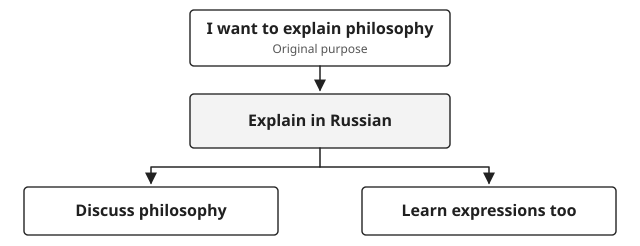
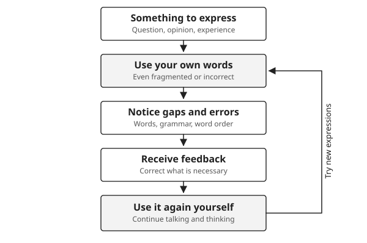
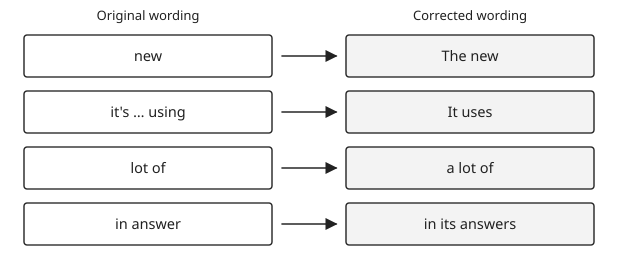
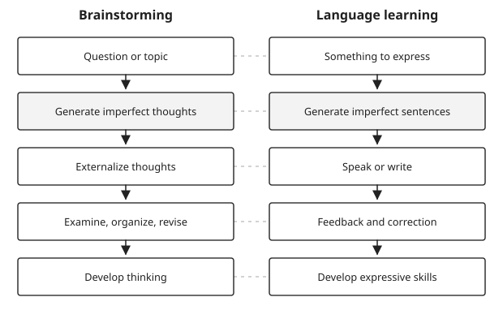
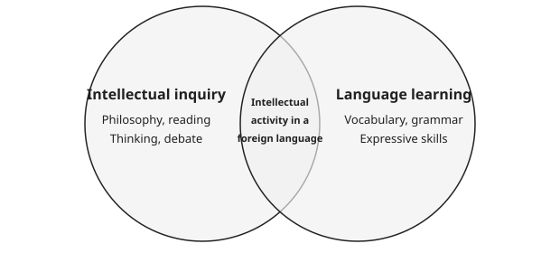
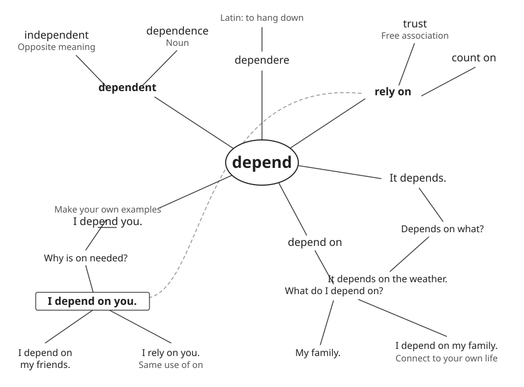

# Brainstorm-based Language Learning

Use the language first, even if you make mistakes.

When we want to communicate in a foreign language, we sometimes hesitate because we do not know the grammar, cannot recall a word, or fear making mistakes. But we need not wait until we can speak correctly before speaking.

Start with the words you know and express yourself, even imperfectly. Have another person or AI correct your expression, then use it again yourself. By repeating this process, you can learn a language through actually using it.

I want to consider this method as **“Brainstorm-based language learning,”** an application of the philosophy of brainstorming to learning.

## 1. Talking about philosophy turned into Russian practice

I was explaining philosophy to my mother. Because she found it difficult to understand my explanation in Japanese, I began mixing in Russian and eventually switched to a conversation mainly in Russian.

At first, I spoke in fragments. I arranged the words I knew, asked my mother about unfamiliar expressions, and sometimes used Japanese. When she corrected an expression, I used it to explain my point again, then continued to the next topic.

After about three hours of such conversation, I felt that my ability to express myself in Russian had improved considerably. I had not set out to study Russian. I had something I wanted to communicate about philosophy, and I was using the language to do so.

*Figure 01. Having something to communicate can trigger learning, even when language study is not the sole purpose.*

## 2. Generate, correct, and use again

The core of this method is not being given the correct answer at the outset, but expressing yourself first. Trying to construct a sentence yourself reveals exactly what you do not know and where you made mistakes.

*Figure 02. Do not stop after receiving feedback; use the corrected expression yourself.*

If you do not know a necessary word, ask at that moment. You may mix in your native language. Feedback is material for continuing the conversation, not for stopping it completely.

## 3. A practical example with AI

Suppose you want to say in English, “The new ChatGPT is nice. It uses a lot of visualisations in its answers.” First, create your own sentences with the English words you know.

**My original English**

new chatgpt sol 6.2 is nice  
it's in answer using lot of visualisation

**Correction preserving the original wording**

**The** new ChatGPT Sol 6.2 is nice.  
It **uses a** lot of **visualisations in its answers**.

*Figure 03. Correct the article, verb form, word order, and so on. Here, visualisation also needs the plural form.*

Asking AI to compose fluent, advanced English from scratch might produce a polished text. But that is different from the learning goal here. Preserving the original vocabulary and expressions allows you to compare the two versions and see precisely where you went wrong and how to correct it.

**The goal is not to obtain correct English, but to become able to generate correct English yourself.** Of course, if the original expression fails to convey the intended meaning, learn the necessary alternative wording.

## 4. Common ground with brainstorming

Classical brainstorming includes the principle of deferred judgment. During idea generation, one temporarily refrains from judging correctness or feasibility too strictly and generates freely. Examination and evaluation come afterward.

This principle can be applied to language learning. Rather than stopping speech because the grammar might be wrong, express yourself first and correct it afterward.

*Figure 04. Neither makes correctness or completeness a prerequisite for generation.*

This does not mean affirming every mistake unconditionally or disregarding accuracy. It means not preventing generation merely because it might be wrong.

Classical brainstorming is primarily a method of idea generation and does not refer to this language learning method itself. Nevertheless, this practice can be called Brainstorm-based language learning as an application of its underlying philosophy.

## 5. Connections to language acquisition research

This practice shares elements with several ideas discussed in second-language acquisition research.

| Theory or concept | Connection to this method |
| --- | --- |
| Output hypothesis | Speaking or writing reveals gaps in knowledge and lets you test your own expressions. |
| Noticing hypothesis | Attend to differences between your expression and the feedback received. |
| Interaction hypothesis | Clarify meaning and adjust expressions during conversation. |
| Corrective feedback | Recognize errors and reconsider expressions through corrections. |
| Proceduralization | Through practice, turn explicit language knowledge into usable skills. |

These are theoretical similarities, not direct proof of the effectiveness of the method as a whole. The improvement I felt after three hours might reflect activation of existing Russian knowledge as well as acquisition of new knowledge. It is important to check whether expressions can still be used on subsequent days and to practise repeatedly.

## 6. Combine intellectual inquiry and language learning

Think about philosophy, write a diary, discuss a book, debate with someone, or brainstorm. Try doing activities you already do in the language you want to learn.

*Figure 05. Language is both an object of study and a tool for thinking and intellectual inquiry.*

Intellectual activity itself provides practice opportunities even without setting aside time solely for language learning. This does not eliminate the need for systematic study of pronunciation, grammar, and vocabulary. Combine these approaches as needed.

## 7. Connect language knowledge through association

Instead of memorizing words and expressions in isolation, start with one word and freely write down associated words, etymologies, derivatives, synonyms, antonyms, related concepts, and example sentences. On paper or a canvas, connect related items with lines.

For example, start from the English word depend, associate it with dependent, independent, and rely on, and create your own sentences.

- I depend you. (My own incorrect example)
  - Why is this expression wrong?
  - I depend on you. (Corrected example)
    - I depend on my friends.
    - It depends on the weather.
  - What other expressions use on in the same way?
    - I rely on you.

When an example is wrong, do not stop at writing the correct sentence. Write down why it was wrong, the relevant wording or grammar, and other examples using the same pattern. Let questions arising from mistakes lead to further learning.

*Figure 06. Place a word at the center and connect associations, etymologies, related words, examples, and reasons for errors with lines. You can write questions in Japanese and, as you become comfortable, pose questions and develop associations in English.*

Let associations and questions guide learning freely from words to examples, examples to grammar, and grammar to other expressions.

## 8. Using your native language

You may use your native language, such as Japanese, while learning. If questions or thoughts cannot yet be expressed in the target language alone, mixing in your native language lets you continue learning without interrupting thought or association.

As learning progresses, however, it is desirable to gradually reduce dependence on the native language. Instead of associating an English word only with its Japanese meaning, associate it with other English words. Explain words in English, write questions in English, and think about them in English.

The eventual aim is to associate, think, and develop a brainstorm in the target language itself, without going through your native language. But avoiding your native language need not become an absolute rule. Use it freely when necessary.

## 9. How to begin

1. Choose something you genuinely want to think about or communicate.
2. Express it in the foreign language you know. Mix in your native language where necessary.
3. Ask another person or AI to correct it while preserving the original wording as much as possible.
4. Say or write the corrected expression yourself.
5. Continue the conversation or thinking. Try using the same expression again another day.

When using AI, you could give the following instructions:

> I will express what I want to communicate in the foreign language I know. Even when I make mistakes, preserve my original vocabulary, wording, and nuance as much as possible, correcting only the necessary grammar, word order, and usage.
>
> If a correction cannot preserve my meaning, explain why and tell me the necessary expression. Do not replace my wording with more advanced expressions without reason.
>
> Briefly explain corrections when needed. Try not to interrupt the flow of conversation or thought.
>
> My goal is not to have correct sentences made for me, but to become able to create correct sentences myself.

## 10. Learning as Brainstorm practice

This idea is not confined to language learning. Form hypotheses despite incomplete knowledge. Write thoughts despite imperfect logic. Externalize unfinished material and use the result to examine, correct, and develop it further.

Learning is not only practising after acquiring complete knowledge. It also means beginning practice in an imperfect state and acquiring knowledge and skills through that practice.

> **Improve thinking, knowledge, and skills by generating even imperfect material, without making correctness or completeness a prerequisite, and then examining, correcting, and developing it.**

Do not wait until you are correct to practise.  
Become more accurate through practice.

---

Terminology: “Brainstorm-based language learning” and “Brainstorm practice” are used here not as established academic terms, but as concepts for extending the principles of brainstorming to learning and intellectual activity.
