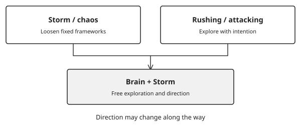
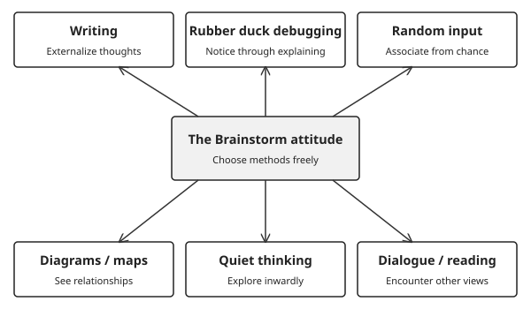
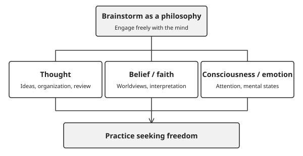
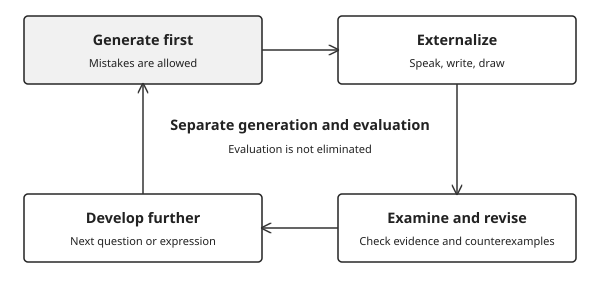
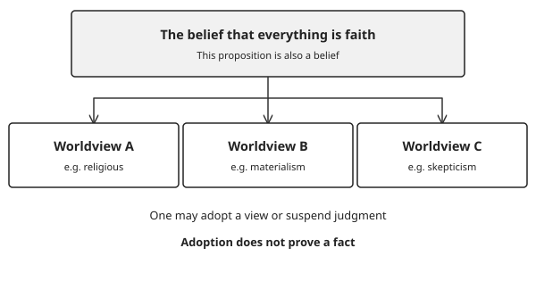
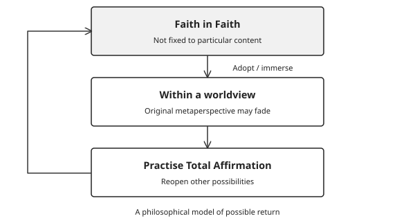
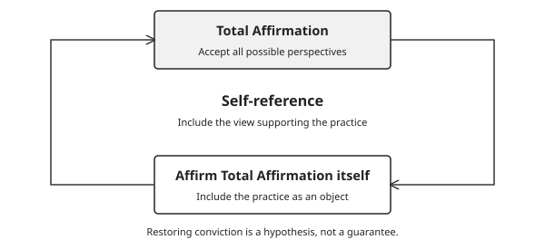
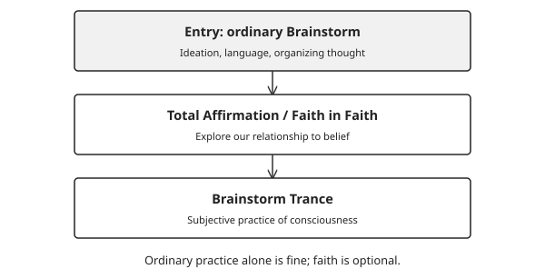
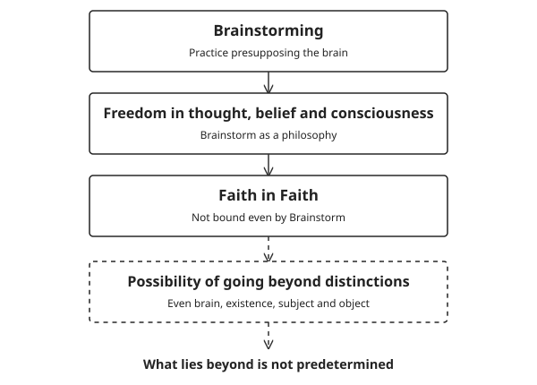
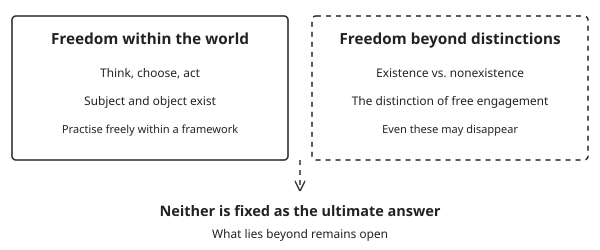

# A Philosophy Called Brainstorm

**An attempt to go beyond a single method of thinking and to engage freely with thought, belief, and consciousness.**

Brainstorming is generally known as a technique in which a group meets to generate ideas. I want to understand the word more broadly. Not as following a particular procedure, but as the attitude of freely choosing and using ways of thinking itself — and further, as extending that freedom to belief, emotion, and states of consciousness. This is what I call “Brainstorm.”

The article has four parts. Part 1 starts from the common understanding of the word brainstorming and presents Brainstorm as a philosophy about methods. Part 2 applies it to belief as Faith in Faith and Total Affirmation and examines the structure they share. Part 3 situates Brainstorm in relation to chaos magic and Brainstorm Trance Esotericism. Part 4 considers the possibility of going beyond the framework of Brainstorm itself.

“Brainstorm” as described here does not seek to revise the definition of an existing term. It is a personal philosophy developed from ordinary brainstorming as its starting point.

## 1. What Brainstorm is

### 1.1 The word brainstorming

#### Two meanings of Storm

Storm can mean a tempest as a noun, and to rush or attack as a verb. Alex Osborn, who devised brainstorming, explained the word in the latter sense: using the brain to storm, or attack, a creative problem [1]. I add the sense of a tempest to this and combine the two as metaphors for Brainstorm.

Like a storm, thought can move freely as established sequences and frameworks loosen. At the same time, one can have an intention to explore something and direct thought toward it.

*Figure 1. Free exploration and direction. The sense of attack follows Osborn’s explanation; overlaying the sense of a tempest is my own interpretation.*

A clear conclusion or goal is not necessary at the outset. Exploration in the hope that something interesting might emerge is enough. The goal can also change along the way.

### 1.2 Not a method, but a philosophy about methods

Ordinary brainstorming emphasizes generating many ideas while withholding criticism. In my conception of Brainstorm, however, following a particular procedure is not an end in itself.

Consider rubber duck debugging: putting your thoughts into words as if explaining them to someone makes ambiguities and contradictions apparent. Random input uses an unrelated word or object as a trigger for association. Webbing is a kind of diagram that spreads related ideas outward from a central theme like a web. Even simply writing one’s thoughts out as a clean draft of ordinary prose can be a practice, since ideas become organized and new insights arise in the course of writing.

These are not classical brainstorming itself, but they are methods one can freely choose within the philosophy of Brainstorm. And they are only a few examples. Writing on paper, thinking silently, having conversations, and reading can all be practices.

*Figure 2. Each technique can be selected within the philosophy of Brainstorm. Those shown are only examples.*

Brainstorm does not mean using many methods at once. What matters is not the number of methods but freedom from attachment to them. Which method is suitable depends on the purpose and circumstances.

The distinction between simply thinking and practising Brainstorm is not determined solely by the outward appearance of the activity. It lies in the attitude one takes toward one’s own way of thinking.

The idea of freely choosing methods need not be limited to thinking techniques. Beliefs, emotions, attention, and states of consciousness also fall within its scope.

*Figure 3. From an idea-generation technique to a philosophy concerning the workings of the mind as a whole.*

> Brainstorm is a philosophy and practice that aims to engage freely with thought, belief, emotion, states of consciousness, and other aspects of the mind without being rigidly bound to them.

By freedom here I do not mean complete voluntary control over every mental state. Rather, the aim is to be able to choose, as appropriate, whether to seek control or to let go.

### 1.3 Generating imperfect material

The classical brainstorming principle of deferred judgment can also be applied to Brainstorm in its broader sense.

Excessive concern with correctness from the outset may prevent us from writing anything. Instead, we can first externalize thoughts even if they are wrong, then examine them and make the necessary corrections.

*Figure 4. Use what has been generated as material for the next step in thinking.*

In foreign-language learning, for example, arrange the words you know into an utterance, receive corrections, and try saying it again. In philosophy, write an imperfect hypothesis and develop it by investigating contradictions and counterexamples.

This does not mean treating mistakes as truths. It means **not making correctness a prerequisite for generation**. When accuracy is needed, actively verify it.

Example: [Brainstorm-based language learning](../brainstorm-language-learning/guide.md).

## 2. From methods to belief

### 2.1 Faith in Faith

The idea of freely choosing thinking methods can be extended to beliefs and worldviews.

What I call “Faith in Faith” is the belief that “everything is faith.” This proposition itself is no exception. Rather than treating it as an absolute truth, we regard it as one belief.

*Figure 5. The idea of being able to adopt different perspectives without treating any particular worldview as the only one.*

This does not mean believing in nothing. It resembles an empty vessel in that it does not prescribe particular beliefs in advance. It nevertheless has the formal content that “everything is faith.”

“Faith” here is my own broad term encompassing not only religious faith but also assumptions and perspectives through which we understand the world. It does not mean that scientific evidence and unsupported assertions are equally reliable.

Faith in Faith is a meta-belief that takes not only individual beliefs as its object but also itself as a belief (this structure is discussed in 2.3). Faith in Faith itself is therefore not made absolute. Adopting it, not adopting it, and returning to it are all possibilities.

**The flexibility of Faith in Faith lies not only in being able to choose beliefs freely, but also in not needing to be bound by Faith in Faith itself.**

#### The self-containedness of Faith in Faith

Faith in Faith is also a self-contained belief. Because the belief that everything is faith includes itself as a belief, it does not need to posit a further absolute premise outside faith in order to locate itself. In that sense, Faith in Faith is complete within itself. Nor does it need to posit ever-higher beliefs in order to regard itself as a belief.

This self-containedness does not mean that the truth of the belief is proved by self-reference, nor that it is a closed system excluding other beliefs. Precisely because it too is relativized as one belief, one can move from it to other beliefs.

### 2.2 A precursor to faith and Total Affirmation

Faith in Faith is better understood as a “precursor” from which one can move into various beliefs, rather than as a necessary premise common to all belief systems.

When we wholeheartedly adopt a worldview, the previous metaperspective might disappear from our awareness. Requiring us to retain that perspective at all times would impose a fixed condition on freedom itself.

I therefore position Total Affirmation as a way to return to Faith in Faith.

*Figure 6. A reversible model of entering a particular perspective and opening up the possibility of other perspectives again.*

Total Affirmation is the practice of accepting the possibility of all perspectives and including the very attitude of acceptance among the things affirmed. I consider it possible that even if conviction in the philosophy is lost, remembering only the form of the method and practising it again might restore that conviction.

*Figure 7. Total Affirmation includes itself among its objects. This provides the conceptual basis for a return to Faith in Faith.*

Total Affirmation does not require continually adopting all beliefs at once. Precisely because various beliefs can be affirmed, it becomes possible to select a particular belief or to relinquish it.

Total Affirmation opens up the possibility of various beliefs, among which one can choose. Faith in Faith itself, which makes this choice possible, is also among the objects of choice. It contains the possibility of relinquishing itself.

This is openness as a structural property; it does not guarantee that those who believe in it will actually remain flexible at all times.

However, whether this self-referential structure actually strengthens conviction, or whether one can return from any belief, remains untested. The question of how to create an occasion for returning also remains. Total Affirmation is distinct from simultaneously accepting contradictory propositions as facts or condoning harmful conduct.

### 2.3 Self-inclusion as a shared structure

Brainstorm, Faith in Faith, and Total Affirmation share a structure: none of them places itself outside the domain to which it applies. I first look at each individually and then summarize what they have in common.

#### Brainstorming about Brainstorm

**Brainstorm about Brainstorm, too. Not being bound even by the definition of Brainstorm is part of the philosophy of Brainstorm.**

If the objects of Brainstorm are not limited, Brainstorm itself is included among them. This is self-reference through self-inclusion. If we call brainstorming about Brainstorm “the Brainstorm of Brainstorm,” it is a meta-practice that takes the method of thinking itself as an object of thought.

By becoming one object of thought among others, Brainstorm itself is relativized. The philosophy of Brainstorm can be reconsidered, changed, and even relinquished.

#### The self-reference of Faith in Faith

The word “everything” in the proposition “everything is faith” includes that proposition itself. Thus the understanding that everything is faith is itself a belief. Faith in Faith is not merely a position from which other beliefs are observed externally; it is a self-referential belief that includes itself within the same domain.

This self-reference does not negate the proposition that everything is faith. Rather, it applies the same perspective to the proposition itself. There is consequently no need to exempt oneself and occupy an absolute position outside faith. It is a meta-belief about faith, and at the same time that meta-position itself is relativized.

#### The self-reference of Total Affirmation

Total Affirmation is itself an object of affirmation. Through self-inclusion, Total Affirmation, which stood on the side of affirming, is also placed on the side of the affirmed. Here there is self-objectification and, through it, self-relativization. In taking the practice of affirming itself as an object of affirmation, Total Affirmation is also a meta-practice.

Likewise, self and other, the affirming and the affirmed, Total Affirmation and non-Total Affirmation (the negation of Total Affirmation, or an attitude that does not adopt it) all stand on the same level as objects of affirmation. Total Affirmation does not treat itself as special. This does not mean that the distinction between subject and object necessarily disappears; it means relativizing the privilege attached to that distinction.

#### The shared structure

**Self-inclusion → self-objectification → self-relativization**

| Concept | Self-inclusion / self-reference | Self-relativization |
| --- | --- | --- |
| Brainstorm of Brainstorm | Takes Brainstorm itself as an object of Brainstorm | Brainstorm becomes an object of thought on a par with other philosophies and methods |
| Faith in Faith | Includes Faith in Faith itself as one belief | Faith in Faith stands on a par with other beliefs |
| Total Affirmation | Takes Total Affirmation itself as an object of affirmation | Total Affirmation and non-Total Affirmation are equally objects of affirmation |

All three are meta in that they objectify themselves through self-inclusion. The Brainstorm of Brainstorm takes Brainstorm itself as an object of thought; Faith in Faith regards Faith in Faith itself as one belief; Total Affirmation takes Total Affirmation itself as an object of affirmation. They act not only on objects but also on their own activity and framework.

Although what each does differs, the mechanism of objectifying and relativizing oneself through self-inclusion is shared. Being meta and being placed on a par with other things as an object are compatible. Being on a par concerns position as an object; it does not mean that content or value become equal.

## 3. Situating Brainstorm

### 3.1 Similarities to and differences from chaos magic

The idea of treating beliefs as non-fixed and using worldviews according to circumstances has something in common with the approach to belief found in chaos magic.

Brainstorm, however, is not a system limited to magic. It encompasses a wide range of everyday practices: writing, language learning, problem-solving, and philosophical inquiry. Practices involving belief are only one part of it.

| Aspect | The philosophy called Brainstorm | Points of contact with chaos magic |
| --- | --- | --- |
| Methods | Freely using methods related to thought and cognition | Treating beliefs and worldviews as tools |
| Scope | Ideation, learning, belief, states of consciousness, and more | Magical practice and the use of belief |
| Evaluation | Examining results and evidence according to the purpose | A shared emphasis on practice |

This is a conceptual comparison, not evidence of magical efficacy or a rigorous classification of chaos magic as a whole.

### 3.2 Relationship to Brainstorm Trance Esotericism

Brainstorm is the name of the philosophy, while Brainstorm Trance Esotericism is conceived as the name of a group that foregrounds distinctive practices within that philosophy. Just as the Zen school takes Zen (meditation) as its practice and bears it in its name, Brainstorm Trance Esotericism takes Brainstorm as its practice.

Trance here refers to an altered state of consciousness. Drawing on personal experiences of deep absorption or ecstasy during Brainstorm, I also make the relationship between thought and states of consciousness a subject of inquiry.

*Figure 8. Beginning with ordinary Brainstorm, one may also explore belief and consciousness. The arrows do not represent a mandatory sequence of training.*

Borrowing the terms exoteric and esoteric, one can regard thinking methods anyone can use as the exoteric side, and subjective experiential understanding through practice as the esoteric side. I am not adopting the Buddhist distinction unchanged; I use it as my own metaphor for the difference between explainable knowledge and experiential understanding.

It is fine to practise ordinary Brainstorm alone, without adopting a religious framework. Trance states are not guaranteed, nor has the acquisition of special abilities been demonstrated. Experiences should not be forced; physical and mental safety comes first.

## 4. The entry point and beyond

### 4.1 Brainstorm is an entry point into practice

At the entrance to Brainstorm is the practice of brainstorming, which presupposes the brain. We think, put thoughts into words, and use various methods to develop freedom in relation to thought, belief, and consciousness.

But starting with the brain as a premise does not require remaining within that premise. In Faith in Faith, the understanding that the brain exists and the philosophy of Brainstorm itself can also be regarded as beliefs.

Beyond the question of whether the brain exists, one can conceive of a way of being in which even the distinction between existence and nonexistence, or between the subject that acts and the object acted upon, disappears.

*Figure 9. From practice presupposing the brain to a way of being not bound even by the framework of Brainstorm. This is not a fixed sequence of attainment.*

**Brainstorm is a starting point, not a limit on what can be reached.** One can begin with Brainstorm and go beyond Brainstorm itself.

The philosophy of Brainstorm itself can be engaged with freely. One may adopt Brainstorm without having to insist on being a practitioner of Brainstorm.

Even Faith in Faith need not be fixed as the final answer. Beyond it there may be ways of being that I cannot yet imagine.

> Brainstorm is an entry point into practice. There is no need for the name Brainstorm to limit how far one can proceed from that entrance.

The philosophy of Brainstorm is not a closed system intended to lead to a particular conclusion. I want it to be an open philosophy that includes the possibility of going beyond Brainstorm itself.

### 4.2 Freedom within the world and freedom beyond it

I want to call the freedom to think, choose, and practise various things within the world “freedom of engagement” (jizai). Here there are distinctions: an acting subject, an object upon which one acts, and something to choose.

One can also conceive of freedom in which such distinctions themselves disappear. Rather than handling something freely, it is a way of being in which there is no need to handle anything in the first place. What I conceive of here as enlightenment is close to such freedom.

*Figure 10. Freedom within the world and freedom not confined even to the distinction implied by free engagement. This is my own conception.*

Neither need be fixed as the ultimate state. Practising within the world or moving away from it need not be predetermined by a single conclusion.

---

This article reconstructs conversations about brainstorming, Faith in Faith, Total Affirmation, and Brainstorm Trance Esotericism. It distinguishes established scientific findings from original philosophical hypotheses and subjective experiences. Comparisons with chaos magic and Buddhism are conceptual and are not intended as examinations of individual primary sources.

## References

[1] Osborn, A. F. *Your Creative Power*. 1948, ch. 33. The relevant passage is also quoted in Buffalo State University, “[Alex Osborn Archives](https://creativity.buffalostate.edu/alex-osborn-archives)” (accessed 28 November 2026).
