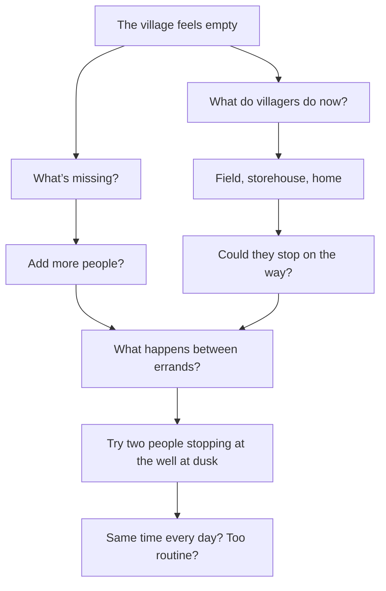
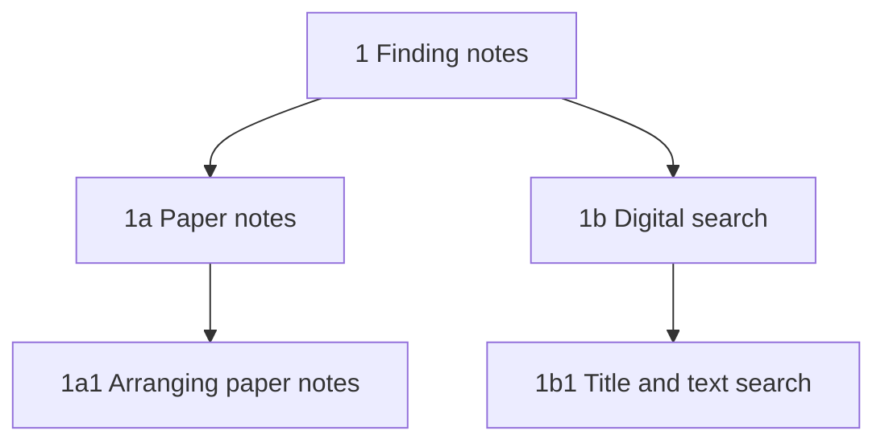
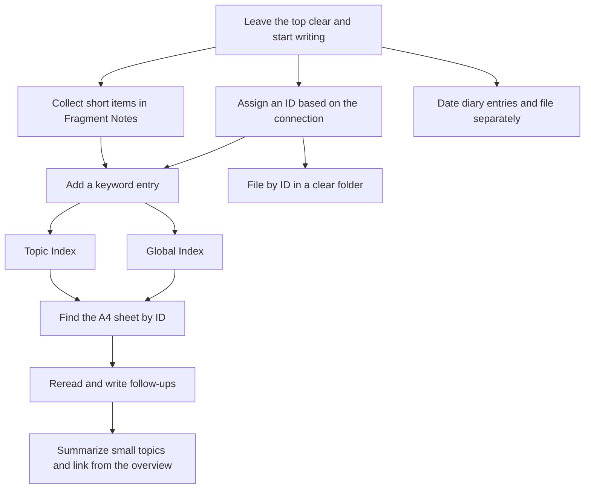

# Paper PKM, Illustrated

[Illustrated guide](https://yurii7812.github.io/homepage/en/paper-pkm/) · [日本語](https://github.com/Yurii7812/homepage/blob/main/ja/paper-pkm/guide.md)

## Part 1 · Learn by using it

### 1. Leave space at the top and start writing

Put an A4 sheet in **portrait orientation** and leave some space at the top. Start with the text. **Choose the ID for the upper left later**, once you see where this note fits among your existing notes.

| Stage | Upper left | Upper right |
| --- | --- | --- |
| Start writing | Leave clear | Leave room for the date and time |
| After choosing a position | Write the ID | For example, `2026 10 02` and `14:20` |

I use a **red ballpoint pen for IDs that refer to other notes and a blue one for everything else**. That makes IDs in indexes, citations, and continuation links easy to spot. I use **non-erasable ballpoint pens** in both colors.

Reserve the upper right for the date and time. Write the date as **`2026 10 02`**, with spaces between the year, month, and day. Write the time separately, such as `14:20`. A date stamp that prints in this order is handy. The **COLOP Mini Dater S 120** is a date stamp, and the manufacturer lists its format as day, month, year. [COLOP product specifications](https://www.colop.com/us/traditional-stamps/printer-line/mini-line-s200/mini-dater-s-120)

### 2. Keep the sheets you thought on

The figure shows **one way a sheet can look when you think on paper**. This one is about a village in a game. A sheet with loose ideas, unfinished sentences, sketches, and connecting lines can go straight into the system.

Here, I wondered whether to add more people and wrote down what the villagers were already doing. Looking at both sides gave me another idea: maybe what was missing was what happens between errands. I drew a line to connect the thoughts. Later, I gave the sheet the ID `1e` and filed it with the question still open.

As the sheets pile up, add the words you are likely to remember when looking for them. The **Global Index** searches across the collection, while a **Topic Index** gives you entries within a topic. Together they form the **Double Index**.

### 3. Assign an ID based on how the ideas relate

Place the new note under the note whose subject it **deepens or broadens**, or under a note it **relates to**.

Say you write about arranging paper notes in `1a1` and then think of digital search. Digital search broadens the original subject in `1` in a different direction, so it goes at `1b`.

### 4. Mark sources and continuations

Write `(1)` or `(2)` **at the end of a passage** you may want to cite, as in “Where you put a paper note can help you find it.  (1)”.

| Situation | Notation |
| --- | --- |
| Mark the end of a passage | `Text  (1)` |
| Cite it within the same note | `(1):Like this` |
| Refer to a passage in another note | `1a(1)` |
| Cite a whole note | `1a:` |
| Point to a continuation | `:1a1` |

To refer to that passage on the same sheet, write **`(1):Like this`**. To point to it from another note, write **`1a(1)`**. To cite the passage and add text, you could write `1a(1):Choose where to put the note.`

To cite a whole note, write **`ID:`** (for example, `1a:`). To point to the continuation, write **`:ID`** (for example, `:1a1`). Put the colon right next to the ID. Write the referenced ID in red.

### 5. Find a keyword in the Global Index

For the paper version, fold an A8 sheet in half with the **crease parallel to the long edge**. With the slip facing you in its reading orientation, punch a hole on the **left** and put it on a metal binder ring or similar fastener.

| Keyword | Sort key | ID |
| --- | --- | --- |
| PKM | pkm | `1` |
| Zettelkasten | zettelkasten | `1` |

Write one keyword per slip, with its associated IDs. The slips for “Zettelkasten” and “PKM” can both list `1`. Sort the slips by the reading of the keyword, in **Japanese kana order** or alphabetically for English keywords.

You can **keep the Global Index on a computer**, too. A table with columns for the keyword, its reading or sort key, and the IDs is easy to sort and search by keyword or ID.

### 6. Find a note within a topic

When you have several notes about PKM, take a separate portrait A4 sheet and write **`1-PKM`** at the upper left. Write keyword–ID pairs in **two columns**, one on each side. Leave out column headings and grid lines.

**1-PKM**

|  |  |  |  |
| --- | --- | --- | --- |
| Paper PKM | `1a` | Zettelkasten | `1c, 1c1` |
| Arranging notes | `1a1` | Branching notes | `1c2` |
| Pens | `1a2` | Citations | `1c3` |
| Clear folders | `1a3` | Continuations | `1c4` |
| Sticky tabs | `1a4` | Brainstorming | `1e` |
| Filing notes | `1a5` | Summary | `1g` |
| Digital PKM | `1b, 1b1` | Double Index | `1f` |
| Title search | `1b1` | Global Index | `1f1` |
| Full-text search | `1b2` | Topic Index | `1f2` |
| Sort by reading | `1b3` | Adding indexes | `1f3` |
| Search comparison | `1d` | Progress | `1h` |
| Scanning paper | `1b4` | ★KJ method | `3a1` |

For example, look up “PKM” in the Global Index and open the A4 sheet marked `1-PKM`. Find “Paper PKM `1a`” there, then read note `1a`. A brainstorming sheet is just as easy to find once you add a keyword you will remember and its ID.

### 7. Add a dot when both conditions apply

**Add a dot only when one keyword lists two or more IDs and you have made a Topic Index for that keyword.** Put the dot directly above the ID you used for the Topic Index. The rule applies to both Global Index slips and entries in a Topic Index.

| IDs for one keyword | Topic Index | Dot |
| --- | --- | --- |
| PKM `1` | `1-PKM` | None (one ID) |
| Digital PKM `1b, 1b1` | Not yet made | None |
| Digital PKM `1b, 1b1` | `1b-Digital PKM` | **Directly above `1b`** |
| Zettelkasten `1, 1c1` | `1c1-Zettelkasten` | **Directly above `1c1`** |

For example, if “Zettelkasten” lists `1, 1c1`, put the dot **directly above `1c1`** once you make `1c1-Zettelkasten`. You can still go to `1` to read the note itself.

A keyword with only one ID gets no dot, even if it has an index. A keyword with several IDs gets no dot while its index is still unmade.

### 8. Add index pages and links to related topics

When `1-PKM` fills up, write `1-PKM 2` at the upper left of the next A4 sheet and keep adding entries. The entry ID is still `1`.

Draw a **one-stroke star** at the start of an entry that points to another, related Topic Index. In `1c1-Zettelkasten`, for example, write `★PKM 1` or `★KJ method 3a1`.

You can list the same note in different indexes. If `1d` compares finding things on paper and digitally, you can list it in both `1-PKM` and `1b-Digital PKM`.

### 9. File the sheets in A4 clear folders

Put the notes and A4 Topic Index sheets into **A4 clear folders**. Start another folder when one fills up.

| Where | What to write | Purpose |
| --- | --- | --- |
| Front of the clear folder | Folder number, e.g. `1` or `2` | Put the folders back in order |
| Sticky tab near the top of a note | Note ID, e.g. `1` or `2` | Spot the note while flipping through a stack |

Use a **permanent marker to number the front of each folder `1`, `2`, and so on**. The number tells you where the folder goes in the sequence. Note IDs identify the sheets inside.

Start at the **front face of the clear folder**. Stack the notes in order from front to back, for example `1`, `1a`, `1b`, `2`, `3`. Put lower-numbered series first and keep their branches together.

For a topic with lots of notes, or a note with a numeric ID such as `1` or `2`, put a **sticky tab with the ID** near the top so you can find it while flipping through.

### 10. Keep the diary in a separate clear folder

Write the **date** at the upper left using the same format as the notes, for example `2026 10 02`. A stamp that prints in this order works here, too. Write about anything you want. A brief note about what you wrote or concluded that day can help when you look back.

| Sheet | Upper-left entry |
| --- | --- |
| First sheet for the day | `2026 10 02` |
| Second sheet for the same day | `2026 10 02 2` |

Use **one page per day** as a default, even for a short entry. If you need another sheet, put the date and page number at the upper left, as in `2026 10 02 2`. Give the diary its own A4 clear folder.

### 11. Build an overview from smaller summaries

A Topic Index can have an entry called “Summary.” In the Goals index it covers all your goals. In the Finances index it covers your financial goals. Write both summaries as ordinary notes.

| Open Topic Index | Entries in that index |
| --- | --- |
| `2-Goals` | `Finances 2a`, `Mysticism 2b`, `Summary 2d` |
| `2a-Finances` | `Summary 2a1` |
| `2a1-Summary` (Finances) | `Summary 1 2a1a`, `Summary 2 2a1b` |
| `2d-Summary` (All goals) | `Summary 1 2d1`, `Summary 2 2d2` |

Start with smaller subjects, such as financial goals, goals related to mysticism, or recent goals. In the overall summary, write a short account of what matters now in each area and link to the smaller summaries for details.

In the Finances Topic Index at `2a`, the summary has **one entry, `Summary 2a1`**. Put the versions, `Summary 1 2a1a` and `Summary 2 2a1b`, in **the Topic Index at `2a1`**. Their note titles can be `Summary-2026 10 01` and `Summary-2026 10 02`. Do the same for the overall summary. Put `Summary 2d` in the Goals index and list the versions in the Topic Index at `2d`.

Digitally, open “Finances” from the Goals Topic Index. In that note’s `BranchGroup/Group`, open “Summary.” The Summary note has its own `BranchGroup/Group`, where you find the dated summaries. On paper, follow the same route using the IDs written in the indexes.

### 12. Link subject-by-subject progress to a daily overview

A “Progress” entry tells you how far you had got by that date. For example, a philosophy progress note could say “Compared two arguments,” and a history note could say “Divided the timeline into three periods.”

| Scope | Example note |
| --- | --- |
| Overall study progress `4c1` | Daily review with links to philosophy `4a1` and history `4b1` |
| Philosophy `4a1` | Compared two arguments |
| History `4b1` | Divided the timeline into three periods |

In the overall study progress note, add a short review of the day and the IDs for the philosophy and history progress notes. As the updates accumulate, give Progress its own Topic Index so you can find the dated notes, just as with summaries.

### 13. Collect short items in Fragment Notes

Add trivia or a one-line discovery to the A4 sheet at `5`. Register it as **`Fragment Notes 5`** in the Global Index.

| Sheet | Use |
| --- | --- |
| `5` | Add short items from top to bottom |
| `5a` | Use once 5 fills up |
| `5b` | Use once 5a fills up |

When the sheet fills up, use `5a`, then `5b`. You can keep unrelated short items on one sheet. To refer to a particular entry later, add a marker such as `(1)` at that spot and refer to it as `5(1)`.

### 14. Review the whole workflow

Write, decide on an ID, add an entry to an index, and file the sheet. When you want to read it again, find it through an index or a sticky tab. As a topic grows, summarize smaller parts of it and link to those summaries wherever you need them.

## Part 2 · Quick reference

A guide to paper notes and the Double Index, based on Niklas Luhmann’s Zettelkasten.

| Item | Rule |
| --- | --- |
| Notes | Use portrait A4. Leave the top clear and write the body first. Assign the ID later and write it at the upper left. Put the date and time at the upper right. Keep sheets with unfinished thoughts, too. |
| Pens | Write referenced IDs in red and everything else in blue. Use non-erasable ballpoint pens for both. |
| Citations and continuations | Mark the end of a passage with `(1)` or `(2)`. Refer to it as `(1):Like this` on the same sheet or `1a(1)` from a different sheet. Use `ID:` for a citation and `:ID` for a continuation. |
| Global Index | Look up keywords across the collection. Sort slips by kana reading or alphabetically. A computer table can be sorted by a sort key and searched by keyword or ID. |
| Topic Index | Write “ID-Topic” at the upper left of a portrait A4 sheet. List keyword–ID pairs in two columns, omitting headings and lines. A keyword can have more than one ID. |
| Dots and stars | When a keyword lists two or more IDs and has a Topic Index, dot the ID that has the index. Put the dot directly above it. Start an entry with a hand-drawn star to point to a related Topic Index. |
| Making an index | One Topic Index per ID. Before making one, look for the subject and its other names in the Global Index. If an index already covers the same subject, add entries there. |
| Pages and filing | Label the next page of an index `1-PKM 2`, for example. Number folders on the front. File the sheets from front to back as 1, 1a, 1b, 2, 3. Use tabs at the top for numeric IDs or topics with many notes. |
| Diary | Use a separate clear folder. Put the date at the upper left, with one page per day as the default. Add a page number after the date on later pages. |
| Summaries and progress | Start with smaller topics. Write the main points in the overview and link to the subject notes. Index dated updates so you can find them again. |
| Fragment Notes | Add “Fragment Notes 5” to the Global Index. Keep adding short items to one sheet. When it fills up, continue on 5a, then 5b. |
