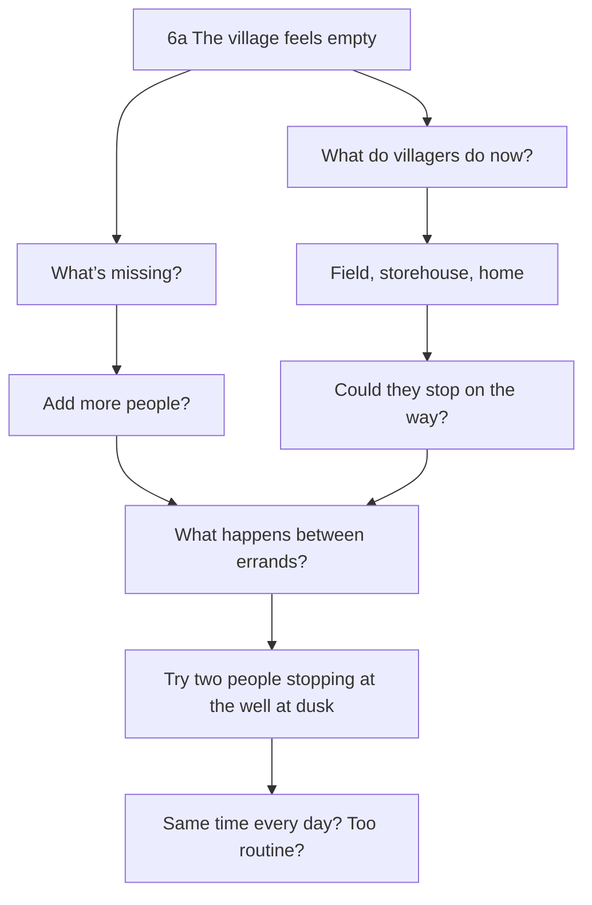
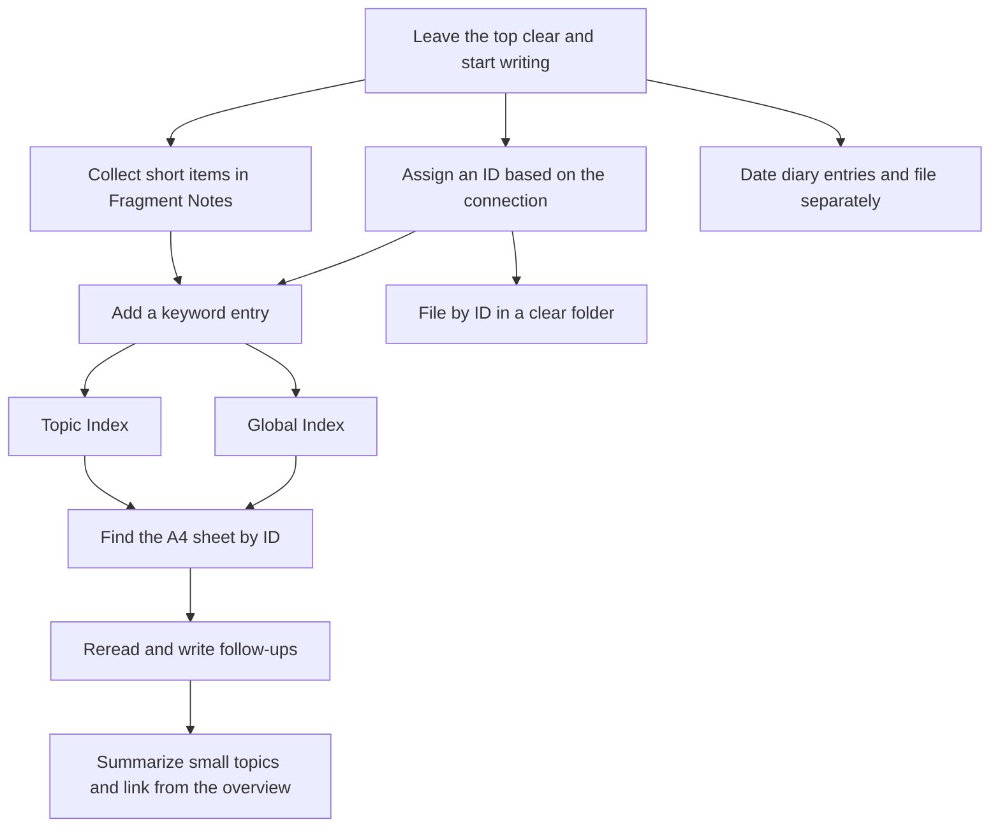

# An Illustrated Guide to Managing Knowledge on Paper

[Illustrated guide](https://yurii7812.github.io/homepage/en/paper-pkm/) · [日本語](https://github.com/Yurii7812/homepage/blob/main/ja/paper-pkm/guide.md)

The system builds on Niklas Luhmann’s Zettelkasten and uses branching **Folgezettel IDs** and links between notes. Write on A4, then assign an ID. Use the Global Index to find an entry point and the Topic Index to find notes within that subject. Together, the two indexes make up the Double Index System.

**First write notes freely. Create Topic Indexes afterward, at a useful level of specificity. Their titles indicate where an inquiry began, not categories it must remain inside.**

## Why I use the Double Index System

- **A4 is practical at university and in libraries.** I can carry A4 sheets with my usual supplies, which is easier than carrying a box of A6 cards. The larger page gives me room for long passages and diagrams.
- **I can write the way I would in an ordinary notebook.** I skip atomic notes so I can follow a train of thought across the page without stopping to put each idea on a separate sheet. I file fleeting notes, brainstorming sheets, and more developed writing the same way.
- **The context and nuance stay on the page.** Compressing a complex thought into a short, self-contained note can obscure how it connects to the surrounding ideas and why I chose particular words. Keeping the original brainstorming sheet lets me retrace how I reached a conclusion.
- **I can cite a specific passage in a longer note.** If I mark a passage with `(1)`, I can point to it from another note using `7a(1)`. The passage stays where I wrote it, with its surrounding context.
- **Notes stay easy to find as the collection grows.** The Global Index gives me an entry point for a topic across the collection. The Topic Index leads me to what I need within that topic, even as longer notes and brainstorming sheets accumulate.

## Part 1 · Learn by using it

### 1. Leave space at the top and start writing

Put an A4 sheet in **portrait orientation** and leave some space at the top. Start with the text. **Choose the ID for the upper left later**, once you see where this note fits among your existing notes.

| Stage | Upper left | Upper right |
| --- | --- | --- |
| Start writing | Leave clear | Leave room for the date |
| After choosing a position | Write the ID | Write the date, e.g. `2026 10 02` |

I use a **blue ballpoint pen for the note text and the sheet’s own ID, and a red one for references**. That makes IDs in indexes, citations, and continuation links easy to spot. When I list several IDs in an index, I write the commas between them in red, too. I also use red for the dot marking an entry to a Topic Index. I use **non-erasable ballpoint pens** in both colors.

Put the date at the upper right. When writing it by hand, use **`2026 10 02`**, with spaces between the year, month, and day. The **COLOP Mini Dater S 120 with a numeric month (CLP120B2)** stamps the date in year–month–day order. [Sample imprint from the Japanese distributor](https://item.rakuten.co.jp/thewind/513526/)

### 2. Keep the sheets you thought on

The figure shows **one way a sheet can look when you think on paper**. This one is about a village in a game. A sheet with loose ideas, unfinished sentences, sketches, and connecting lines can go straight into the system.



Here, I wondered whether to add more people and wrote down what the villagers were already doing. Looking at both sides gave me another idea: maybe what was missing was what happens between errands. I drew a line to connect the thoughts. Later, I filed this sheet as `6a` under my existing “Village design” note, `6`, with the question still open.

As the sheets pile up, add the words you are likely to remember when looking for them. The **Global Index** searches across the collection, while a **Topic Index** gives you entries within a topic. Together they form the **Double Index**.

### 3. Assign an ID based on how the ideas relate

Give a new note its own branch under an existing note when it **broadens, deepens, or relates to** what you wrote there. Similarity is enough to make a branch. If several placements make sense, choose the one that makes the connection easiest to see when you reread the notes.

Suppose I write on an A4 sheet, “The same beans taste different depending on how I brew them. The beans’ condition and the equipment may matter.” I give the sheet the ID `1`.

Later I write, “With a pour-over and a French press, the grounds spend different amounts of time in contact with the water.” I file that note at `1a` because it develops what I wrote about brewing in `1`. Then I write, “Would the taste change if I poured more water at a time in a pour-over?” That follows up on `1a`, so I file it under `1a` at `1a1`. A note on how to run the comparison while changing only the amount in each pour can go one level deeper, at `1a1a`.

Next I write about how long to steep the grounds in a French press. That develops a different part of the brewing note `1a`, so I give it `1a2`, alongside the pour-over note `1a1`. If I write, “Using the same brewing method, I found the darker roast more bitter,” I’m following up on what I wrote about the beans in `1`. That note goes at `1b`, alongside `1a`. Later, I reread what I wrote about brewing and beans and start pulling my observations together on one sheet. I file that sheet at `1c`, another branch of `1`.

Suppose I write, “With the same brewing method, the more heavily roasted hojicha tasted more bitter.” I noticed a similar connection between roasting and bitterness in my coffee note `1b`. I can give the tea note the ID `1b2` and file it under `1b` because of that similarity.

**How the Folgezettel IDs branch**

```text
1  The same beans taste different depending on how I brew them
      (The first note about coffee. This is where the example starts.)
├── 1a  The grounds spend different amounts of time in water in a pour-over and a French press
│     (Expands on how brewing affects taste, a point raised in 1.)
│   ├── 1a1  Does the amount of water in each pour change the taste?
│   │     (Explores the pour-over method mentioned in 1a in more detail.)
│   │   └── 1a1a  Compare by changing only the amount in each pour
│   │         (Sets out a way to test the question in 1a1.)
│   └── 1a2  How long to steep the grounds in a French press
│         (Explores the other brewing method mentioned in 1a.)
├── 1b  With the same brewing method, the darker roast tasted more bitter
│     (Looks more closely at the beans, another point raised in 1.)
│   ├── 1b1  Compare light and dark roasts using the same method
│   │     (Tests the difference noticed in 1b under the same brewing conditions.)
│   └── 1b2  Darker-roasted hojicha tasted more bitter
│         (The observation about tea resembles the one about coffee in 1b.)
└── 1c  Summary of what I tried with brewing and beans
      (Brings together the brewing and bean notes that grew out of 1.)
    ├── 1c1  Version 1, continued
    │     (The second sheet of the first version begun at 1c.)
    │   └── 1c1a  Supplement to 1c1
    │         (A separate sheet supplementing 1c1, filed under that note.)
    ├── 1c2  Version 1, continued
    │     (The third sheet of version 1, filed after 1c1 at the same level under 1c.)
    ├── 1c3  Last sheet of version 1
    │     (The fourth sheet of version 1, filed after 1c2 at the same level under 1c.)
    └── 1c4  First sheet of version 2
          (Version 2 starts at the next available ID under 1c.)
```

Beside each ID is an excerpt or a short description. Below it is the reason for placing the note there.

**Actual filing order (front to back)**　`1 → 1a → 1a1 → 1a1a → 1a2 → 1b → 1b1 → 1b2 → 1c → 1c1 → 1c1a → 1c2 → 1c3 → 1c4 → 2 → 3`.

[See how the A4 sheets are stacked in the folder](https://yurii7812.github.io/homepage/en/paper-pkm/#filing-stack).

#### Why branching on every continuation makes IDs grow

If every follow-up goes under the note you just wrote, the IDs keep getting longer. Even when the subject has broadened, the sequence makes each note look like a closer examination of the one immediately before it.

**What happens if every follow-up goes one level deeper**

```text
1
└── 1a
    └── 1a1
        └── 1a1a
            └── 1a1a1
                └── …
```

Each new note sits under the previous one, adding another level and making the ID longer.

To suggest what to read next, add a continuation link such as `:1b` in the note itself. You can choose the reading order separately from the branches you assign.

#### Reading notes: keep the source book as the focus

If I read Book A and make notes `1, 1a, 1b…`, those notes can stay focused on that book. When I read Book B, I start a new root, `2, 2a, 2b…`. I can compare Book A to psychology while explaining it, but if my interest becomes a sustained investigation of psychology itself, I give that inquiry a separate root and link back.

```text
1  Book A reading notes
├─ 1a  Non-self as described in Book A
├─ 1b  Comparison with psychology
└─ 1c  Provisional summary

2  Book B reading notes
├─ 2a  Non-self as described in Book B
└─ 2b  Comparison with Book A

3  Psychology as an independent subject
```

Related thoughts need not be forced into the same branch. A summary can be followed by further thought. A gap or detour is not a defect in a record of thinking.

### 4. Mark sources and continuations

Write `(1)` or `(2)` **at the end of a passage** you may want to cite. For example, the Paper PKM note `7a` could say “Where you put a paper note can help you find it.  (1)”.

| Situation | Notation |
| --- | --- |
| Mark the end of a passage | `Text  (1)` |
| Cite it within the same note | `(1):Like this` |
| Refer to a passage in another note | `7a(1)` |
| Cite a whole note | `7a:` |
| Point to a continuation | `:7a1` |

To refer to that passage on the same sheet, write **`(1):Like this`**. To point to it from another note, write **`7a(1)`**. In the Search comparison note `7d`, you could write `7a(1):Compare this with digital search.`

To cite a whole note, write **`ID:`** (for example, `7a:`). To point to the continuation, write **`:ID`** (for example, `:7a1`). Put the colon right next to the ID. Write the full citation or continuation mark in red, including parentheses, numbers, and colons. Write the note’s own ID in blue at the upper left.

[See the A4 notes written in red and blue](https://yurii7812.github.io/homepage/en/paper-pkm/#reference-ink).

### 5. Find a keyword in the Global Index

Fold an A8 sheet in half with the **crease parallel to the long edge**. With the slip facing you in its reading orientation, punch a hole on the **left** and put it on a metal binder ring or similar fastener.

| Keyword | Sort key | ID |
| --- | --- | --- |
| Coffee | coffee | `1` |
| Personal knowledge management | personal knowledge management | `7` |
| PKM | pkm | `7` |
| Village design | village design | `6` |

Write one keyword per slip, with its associated IDs. The slips for “Personal knowledge management” and “PKM” can both list `7`. Sort the slips by the reading of the keyword, in **Japanese kana order** or alphabetically for English keywords.

**A spreadsheet makes it easier to reorder the paper slips.** Enter the keywords, readings, and IDs, then sort by reading or alphabetically. Use that order to rearrange the slips on the ring.

### 6. Build Topic Indexes after writing, at a useful level of detail

A Topic Index has an **independent ID** such as `0-1`, `0-2`, or `0-3`. These are not regular Folgezettel note IDs. The regular notes `1`, `1a`, `1b`… stay where they are.

**Write first; decide how to index later.** In reading notes, personal reflections, and open-ended projects, it is usually premature to decide on “Religion,” “Psychology,” or other broad categories. Let notes accumulate and build a Topic Index only when it helps you find the actual material, at a level close to those notes.

Suppose I start at `1` by thinking about my present self and continue at `1a` (values), `1b` (relationships), `1c` (diet), and `1d` (future plans). When an overview becomes useful, I can create `0-1 — Thinking about my present self`.

| Topic Index | Name, indicating a starting point | Notes it leads to |
|---|---|---|
| `0-1` | Thoughts begun with my present self | `1, 1a, 1b, 1c, 1d` |
| `0-2` | Exploring my values | `1a, 1a1, 1a2` |

These are **possible indexes, not a template to create in advance**. I may need one, several over time, or none yet. A single note can be found through several indexes.

#### A name is the starting point, not a boundary

The words “Thinking about my present self” describe where inquiry began, not every subject it must contain. The line of thought can lead to psychology, relationships or economics. The title does not impose a classification.

I do not need to create a “Religion” index just because Buddhism is a religion. A useful index is **specific enough to be near the actual notes, without splitting them so finely that finding things gets harder**.


### 7. At most one Topic Index per starting note ID

A Topic Index `0-1` may be associated with the thinking started at regular note `1`. If the line of thought beginning at `1a` later needs an overview of its own, I can create `0-2` for `1a`.

**Each regular note ID can have zero or one associated Topic Index.** This is not a limit of one for an entire sequence. Notes `1`, `1a`, and `1a1` can each have an index when there is a practical reason. There is no need to attach multiple different indexes to the *same* starting ID merely because a subject can be classified from several angles.

| Regular note starting point | Associated index | Status |
|---|---|---|
| `1` — Thinking about my present self | `0-1` | Created after writing |
| `1a` — Exploring my values | `0-2` | Created after the branch grows |
| `1b` — Relationships | None | No index needed yet |
| `2` — Book B reading notes | None | Ordinary notes are enough |

#### Global Index and the red dot

The Global Index leads from a keyword to a regular note or Topic Index. An entry can mention both `1` (the note) and `0-1` (the index). If I mark `1` with a red dot, it means there is an associated Topic Index; I also write its independent number, `0-1`, so the destination is clear.

**The red dot does not require two or more note IDs under the keyword.** Its meaning is simply that the relevant Topic Index exists. There is no dot when no index exists.


### 8. Extend Topic Indexes and link them as needed

Write a Topic Index on a portrait A4 sheet, with its number and starting-point title in the upper left, for example `0-1 — My present self`. Inside, write keyword–note ID pairs such as `Values 1a`, `Diet 1c`, and `Summary 1f`. You can use two columns without ruled lines.

When the sheet fills, continue on `0-1 2`. The final number is the **page number**, not a new index.

`★` points to a related Topic Index, such as `★Values → 0-2`. `↑` may point to a useful broader index. Do not build a hierarchy such as Religion → Buddhism → Non-self before you need it.

| Symbol | Meaning |
|---|---|
| `↑` | Direct broader Topic Index, if useful |
| `★` | Another related Topic Index |
| `＝` | Summary, reflection, or current-state note |
| No symbol | Ordinary keyword or note reference |

Keep Topic Index sheets separate from regular Folgezettel notes and order them by `0-1`, `0-2`… rather than filing one as a second sheet of regular note `1`.


### 9. File the sheets in A4 clear folders

Put the notes and A4 Topic Index sheets into **A4 clear folders**. Start another folder when one fills up.

[See how the A4 sheets overlap in the folder](https://yurii7812.github.io/homepage/en/paper-pkm/#filing-stack).

| Where | What to write | Purpose |
| --- | --- | --- |
| Front of the clear folder | Folder number, e.g. `1` or `2` | Put the folders back in order |
| Sticky tab near the top of a note | Note ID, e.g. `1` or `2` | Spot the note while flipping through a stack |

Use a **permanent marker to number the front of each folder `1`, `2`, and so on**. The number tells you where the folder goes in the sequence. Note IDs identify the sheets inside.

Start at the **front face of the clear folder**. Stack the notes in order from front to back, for example `1`, `1a`, `1a1`, `1a1a`, `1a2`, and so on. Put lower-numbered series first and keep their branches together.

For a topic with lots of notes, or a note with a numeric ID such as `1` or `2`, put a **sticky tab with the ID** near the top so you can find it while flipping through.

Keep a Topic Index and the note with the same ID together in one clear folder. For example, put `1-Coffee` in front, with note `1` immediately behind it. You can find both even when the entry lists only one ID and has no dot.

### 10. Keep the diary in a separate clear folder

Write the **date** at the upper left using the same format as the notes, for example `2026 10 02`. A stamp that prints in this order works here, too. Write about anything you want. A brief note about what you wrote or concluded that day can help when you look back. If the details are in another note, write “See” followed by **the note ID in red**.

| Sheet | Upper-left entry |
| --- | --- |
| First sheet for the day | `2026 10 02` |
| Second sheet for the same day | `2026 10 02 2` |

> **2026 10 02**
>
> Today I wrote down how to make a Topic Index. For details, see `7f2`.
>
> I decided to collect short items in Fragment Notes. The first sheet is `5`.

Use **one page per day** as a default, even for a short entry. If you need another sheet, put the date and page number at the upper left, as in `2026 10 02 2`. Give the diary its own A4 clear folder.

### 11. A summary can be provisional

Imagine starting at `1`, writing about different concerns at `1a`–`1e`, then summarizing at `1f`. Later, at `1g`, I return to the original question or pursue another line. **The summary `1f` represents my thinking at that time.** It does not have to be rewritten to cover everything I think afterward.

```text
1    Begin thinking about my present self
1a   Values
1b   Relationships
1c   Diet
1d   The future
1e   Current concerns
1f   Summary as of November 12, 2026
1g   Revisit the original question
1h   Another thought
```

A note can be patchy, contain detours, or continue after a summary. **Those gaps are part of the thought process**, not defects. Keep dates and links so you can return to an earlier interpretation.

Later summaries may have their own regular note IDs. If finding them becomes difficult, add references to an existing Topic Index. Writing a summary does not automatically require another Topic Index.


### 12. Dated reflections are ordinary notes

I might use `1e` to start a series of periodic reflections and `1e1`, `1e2`… for particular dates. Write the date on each sheet. If a later thought deepens one particular reflection, give it a branch of that note.

| ID | Content |
|---|---|
| `1e` | Begin reflecting periodically |
| `1e1` | Reflection on November 12 |
| `1e2` | Reflection on November 20 |
| `1e2a` | Develop an idea from November 20 |

When the sequence is easy to follow, no Topic Index is necessary. If it grows unwieldy, create one associated with `1e` at that point.

These are different from the diary sheets, which use the date as the ID at the upper left and are kept in a separate folder.


### 13. Collect short items in Fragment Notes

Add trivia and one-line discoveries to a single A4 sheet. In the Global Index, write **“Fragment Notes” followed by the ID you gave the first sheet**. If the first sheet has ID `5`, write `Fragment Notes 5`.

| Sheet | Use |
| --- | --- |
| `5` | Add short items from top to bottom |
| `5a` | Use once 5 fills up |
| `5b` | Use once 5a fills up |

In this example, when the sheet fills up, use `5a`, then `5b`. You can keep unrelated short items on one sheet. To refer to a particular entry later, add a marker such as `(1)` at that spot and refer to it as `5(1)`.

### 14. Review the whole workflow

Write, decide on an ID, add an entry to an index, and file the sheet. When you want to read it again, find it through an index or a sticky tab. As a topic grows, summarize smaller parts of it and link to those summaries wherever you need them.



## Part 2 · Quick reference

The operational rules of the Double Index System.

| Item | Rule |
|---|---|
| Regular notes | Portrait A4, write first and assign Folgezettel IDs afterward. Preserve unfinished thinking. |
| Branching | Extend or deepen an existing inquiry, but do not force every related subject into the same series. |
| Reading notes | Book A: `1,1a,1b…`; Book B: `2,2a,2b…`. Give sustained tangents a separate root ID. |
| Summaries | A summary is a dated snapshot; subsequent notes can reopen the question. Gaps are permitted. |
| Topic Index IDs | Separate sequence: `0-1,0-2,0-3…`. |
| Number of indexes | Each starting note ID may have zero or one Topic Index. `1` and `1a` may each have their own. |
| When to create one | After enough notes have accumulated, at a level of detail near the content, neither overly broad nor overly narrow. |
| Topic titles | Indicate the **starting point**, not a restrictive category. |
| Global Index | Keyword slips lead to notes or indexes; sort alphabetically or by Japanese reading. |
| Dot, arrows and links | A red dot marks a note with an associated Topic Index; state `0-1` explicitly. `★` is a related index, `↑` is a useful broader one, `＝` is a summary. |
| References | Mark passages `(1)`; cite `7a(1)`; use `ID:` and `:ID` for source and continuation. |
| Paper storage | Keep regular notes in Folgezettel order, `0-1` series indexes separately, and the dated diary in a separate folder. |
| Dated progress | Use ordinary notes; create an index only when useful. |
| Fragment notes | Collect short unrelated items on one A4 sheet, continuing when full. |

## Putting the method into practice

**Write first, index later.** Open-ended thinking does not need predefined topics. Reading notes stay reasonably focused on their source book. Separate lines of thought can connect through references or a later Topic Index.

```text
Regular notes (the thinking)          Topic Indexes (made later)

1  Thinking about my present self     0-1  Started at note 1
├─ 1a  My values                 →    Values 1a
│  ├─ 1a1                        →    Life habits 1c
│  └─ 1a2                        →    Summary 1f
├─ 1b  Relationships
├─ 1c  Life habits                    0-2  Started at note 1a
├─ 1f  Provisional summary       →    Values 1a
└─ 1g  Return to the question    →    Changes in thinking 1a2
```

The IDs `0-1` and `0-2` do not belong to the Folgezettel sequence. Each starting note ID has at most one associated Topic Index, and an index can be absent altogether. The name records the point of departure, not a boundary around the content. There is no need to build a complete Religion → Buddhism → Psychology taxonomy. Choose useful index granularity after seeing the notes, and preserve detours, gaps and provisional conclusions.

[Earlier version (before November 11, 2026)](versions/2026-11-11-before-update/guide.md)
