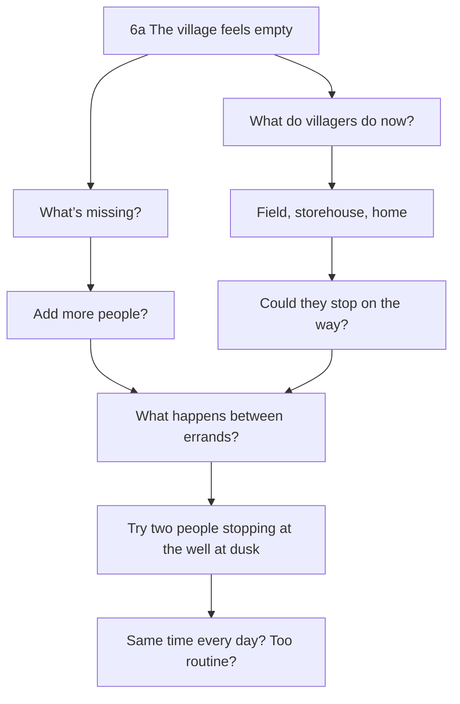
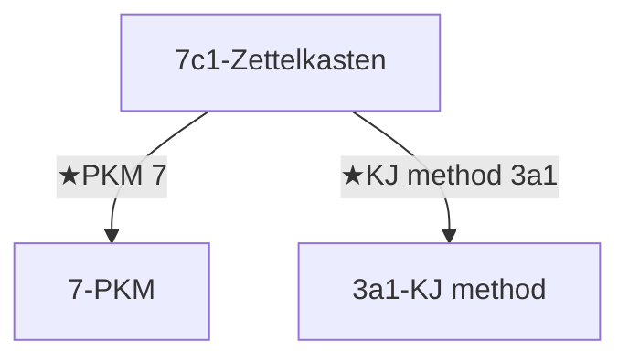
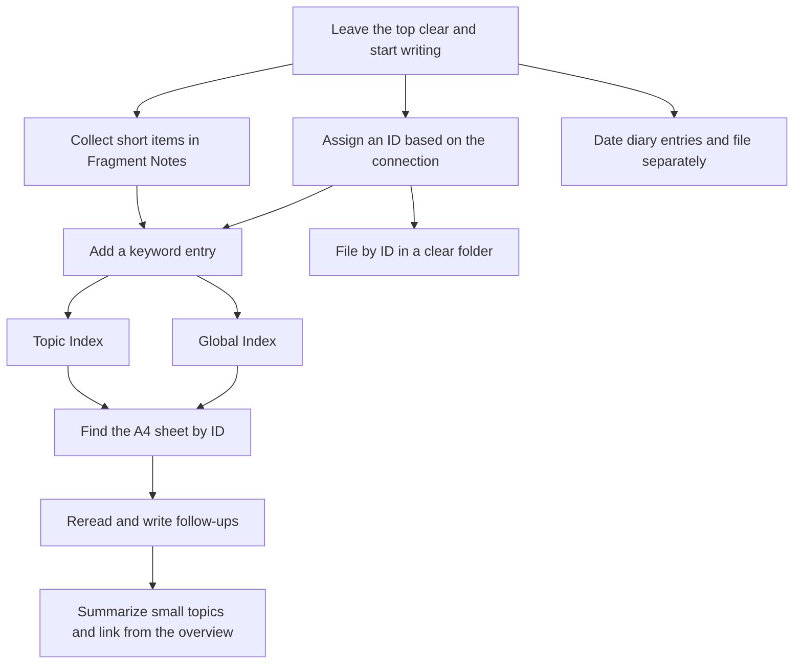

# An Illustrated Guide to Managing Knowledge on Paper

[Illustrated guide](https://yurii7812.github.io/homepage/en/paper-pkm/) · [日本語](https://github.com/Yurii7812/homepage/blob/main/ja/paper-pkm/guide.md)

The system builds on Niklas Luhmann’s Zettelkasten and uses branching **Folgezettel IDs** and links between notes. Write on A4, then assign an ID. Use the Global Index to find an entry point and the Topic Index to find notes within that subject. Together, the two indexes make up the Double Index System.

## Why I use the Double Index System

- **A4 is practical at university and in libraries.** I can carry A4 sheets with my usual supplies, which is easier than carrying a box of A6 cards. The larger page gives me room for long passages and diagrams.
- **I can write the way I would in an ordinary notebook.** I skip atomic notes so I can follow a train of thought across the page without stopping to put each idea on a separate sheet. I file fleeting notes, brainstorming sheets, and more developed writing the same way.
- **The context and nuance stay on the page.** Compressing a complex thought into a short, self-contained note can obscure how it connects to the surrounding ideas and why I chose particular words. Keeping the original brainstorming sheet lets me retrace how I reached a conclusion.
- **I can cite a specific passage in a longer note.** If I mark a passage with `(1)`, I can point to it from another note using `7a(1)`. The passage stays where I wrote it, with its surrounding context.
- **Notes stay easy to find as the collection grows.** The Global Index gives me an entry point for a topic across the collection. The Topic Index leads me to what I need within that topic, even as longer notes and brainstorming sheets accumulate.

## Part 1 · Learn by using it

### 1. Leave space at the top and start writing

Put an A4 sheet in **portrait orientation** and leave some space at the top. Start with the text. **Choose the ID for the upper left later**, once you see where this note fits among your existing notes.

| Stage | Upper left | Upper right |
| --- | --- | --- |
| Start writing | Leave clear | Leave room for the date |
| After choosing a position | Write the ID | Write the date, e.g. `2026 10 02` |

I use a **blue ballpoint pen for the note text and the sheet’s own ID, and a red one for references**. That makes IDs in indexes, citations, and continuation links easy to spot. When I list several IDs in an index, I write the commas between them in red, too. I also use red for the dot marking an entry to a Topic Index. I use **non-erasable ballpoint pens** in both colors.

Put the date at the upper right. When writing it by hand, use **`2026 10 02`**, with spaces between the year, month, and day. The **COLOP Mini Dater S 120 with a numeric month (CLP120B2)** stamps the date in year–month–day order. [Sample imprint from the Japanese distributor](https://item.rakuten.co.jp/thewind/513526/)

### 2. Keep the sheets you thought on

The figure shows **one way a sheet can look when you think on paper**. This one is about a village in a game. A sheet with loose ideas, unfinished sentences, sketches, and connecting lines can go straight into the system.



Here, I wondered whether to add more people and wrote down what the villagers were already doing. Looking at both sides gave me another idea: maybe what was missing was what happens between errands. I drew a line to connect the thoughts. Later, I filed this sheet as `6a` under my existing “Village design” note, `6`, with the question still open.

As the sheets pile up, add the words you are likely to remember when looking for them. The **Global Index** searches across the collection, while a **Topic Index** gives you entries within a topic. Together they form the **Double Index**.

### 3. Assign an ID based on how the ideas relate

Give a new note its own branch under an existing note when it **broadens, deepens, or relates to** what you wrote there. Similarity is enough to make a branch. If several placements make sense, choose the one that makes the connection easiest to see when you reread the notes.

Suppose I write on an A4 sheet, “The same beans taste different depending on how I brew them. The beans’ condition and the equipment may matter.” I give the sheet the ID `1`.

Later I write, “With a pour-over and a French press, the grounds spend different amounts of time in contact with the water.” I file that note at `1a` because it develops what I wrote about brewing in `1`. Then I write, “Would the taste change if I poured more water at a time in a pour-over?” That follows up on `1a`, so I file it under `1a` at `1a1`. A note on how to run the comparison while changing only the amount in each pour can go one level deeper, at `1a1a`.

Next I write about how long to steep the grounds in a French press. That develops a different part of the brewing note `1a`, so I give it `1a2`, alongside the pour-over note `1a1`. If I write, “Using the same brewing method, I found the darker roast more bitter,” I’m following up on what I wrote about the beans in `1`. That note goes at `1b`, alongside `1a`. Later, I reread what I wrote about brewing and beans and start pulling my observations together on one sheet. I file that sheet at `1c`, another branch of `1`.

Suppose I write, “With the same brewing method, the more heavily roasted hojicha tasted more bitter.” I noticed a similar connection between roasting and bitterness in my coffee note `1b`. I can give the tea note the ID `1b2` and file it under `1b` because of that similarity.

**How the Folgezettel IDs branch**

```text
1  The same beans taste different depending on how I brew them
      (The first note about coffee. This is where the example starts.)
├── 1a  The grounds spend different amounts of time in water in a pour-over and a French press
│     (Expands on how brewing affects taste, a point raised in 1.)
│   ├── 1a1  Does the amount of water in each pour change the taste?
│   │     (Explores the pour-over method mentioned in 1a in more detail.)
│   │   └── 1a1a  Compare by changing only the amount in each pour
│   │         (Sets out a way to test the question in 1a1.)
│   └── 1a2  How long to steep the grounds in a French press
│         (Explores the other brewing method mentioned in 1a.)
├── 1b  With the same brewing method, the darker roast tasted more bitter
│     (Looks more closely at the beans, another point raised in 1.)
│   ├── 1b1  Compare light and dark roasts using the same method
│   │     (Tests the difference noticed in 1b under the same brewing conditions.)
│   └── 1b2  Darker-roasted hojicha tasted more bitter
│         (The observation about tea resembles the one about coffee in 1b.)
└── 1c  Summary of what I tried with brewing and beans
      (Brings together the brewing and bean notes that grew out of 1.)
    ├── 1c1  Version 1, continued
    │     (The second sheet of the first version begun at 1c.)
    │   └── 1c1a  Supplement to 1c1
    │         (A separate sheet supplementing 1c1, filed under that note.)
    ├── 1c2  Version 1, continued
    │     (The third sheet of version 1, filed after 1c1 at the same level under 1c.)
    ├── 1c3  Last sheet of version 1
    │     (The fourth sheet of version 1, filed after 1c2 at the same level under 1c.)
    └── 1c4  First sheet of version 2
          (Version 2 starts at the next available ID under 1c.)
```

Beside each ID is an excerpt or a short description. Below it is the reason for placing the note there.

**Actual filing order (front to back)**　`1 → 1a → 1a1 → 1a1a → 1a2 → 1b → 1b1 → 1b2 → 1c → 1c1 → 1c1a → 1c2 → 1c3 → 1c4 → 2 → 3`.

[See how the A4 sheets are stacked in the folder](https://yurii7812.github.io/homepage/en/paper-pkm/#filing-stack).

#### Why branching on every continuation makes IDs grow

If every follow-up goes under the note you just wrote, the IDs keep getting longer. Even when the subject has broadened, the sequence makes each note look like a closer examination of the one immediately before it.

**What happens if every follow-up goes one level deeper**

```text
1
└── 1a
    └── 1a1
        └── 1a1a
            └── 1a1a1
                └── …
```

Each new note sits under the previous one, adding another level and making the ID longer.

To suggest what to read next, add a continuation link such as `:1b` in the note itself. You can choose the reading order separately from the branches you assign.

### 4. Mark sources and continuations

Write `(1)` or `(2)` **at the end of a passage** you may want to cite. For example, the Paper PKM note `7a` could say “Where you put a paper note can help you find it.  (1)”.

| Situation | Notation |
| --- | --- |
| Mark the end of a passage | `Text  (1)` |
| Cite it within the same note | `(1):Like this` |
| Refer to a passage in another note | `7a(1)` |
| Cite a whole note | `7a:` |
| Point to a continuation | `:7a1` |

To refer to that passage on the same sheet, write **`(1):Like this`**. To point to it from another note, write **`7a(1)`**. In the Search comparison note `7d`, you could write `7a(1):Compare this with digital search.`

To cite a whole note, write **`ID:`** (for example, `7a:`). To point to the continuation, write **`:ID`** (for example, `:7a1`). Put the colon right next to the ID. Write the full citation or continuation mark in red, including parentheses, numbers, and colons. Write the note’s own ID in blue at the upper left.

[See the A4 notes written in red and blue](https://yurii7812.github.io/homepage/en/paper-pkm/#reference-ink).

### 5. Find a keyword in the Global Index

Fold an A8 sheet in half with the **crease parallel to the long edge**. With the slip facing you in its reading orientation, punch a hole on the **left** and put it on a metal binder ring or similar fastener.

| Keyword | Sort key | ID |
| --- | --- | --- |
| Coffee | coffee | `1` |
| Personal knowledge management | personal knowledge management | `7` |
| PKM | pkm | `7` |
| Village design | village design | `6` |

Write one keyword per slip, with its associated IDs. The slips for “Personal knowledge management” and “PKM” can both list `7`. Sort the slips by the reading of the keyword, in **Japanese kana order** or alphabetically for English keywords.

**A spreadsheet makes it easier to reorder the paper slips.** Enter the keywords, readings, and IDs, then sort by reading or alphabetically. Use that order to rearrange the slips on the ring.

### 6. Find a note within a topic

When you have several notes about PKM, take a separate portrait A4 sheet and write **`7-PKM`** at the upper left. Write keyword–ID pairs in **two columns**, one on each side. Leave out column headings and grid lines.

**7-PKM**

|  |  |  |  |
| --- | --- | --- | --- |
| Paper PKM | `7a` | Zettelkasten | `7c, 7c1` |
| Arranging notes | `7a1` | Branching notes | `7c2` |
| Pens | `7a2` | Passage references | `7c3` |
| Clear folders | `7a3` | Continuations | `7c4` |
| Sticky tabs | `7a4` | Write reference IDs in red | `7c5` |
| Filing notes | `7a5` | Summary | `7g` |
| Digital PKM | `7b, 7b1` | Double Index | `7f` |
| Title search | `7b1` | Global Index | `7f1` |
| Full-text search | `7b2` | Topic Index | `7f2` |
| Sort by reading | `7b3` | Adding indexes | `7f3` |
| Search comparison | `7d` | Progress | `7h` |
| Scanning paper | `7b4` | ★KJ method | `3a1` |

For example, look up “PKM” in the Global Index and open the A4 sheet marked `7-PKM`. Find “Paper PKM `7a`” there, then read note `7a`. To find the village brainstorm, start from “Village design `6`” in the Global Index. Open `6-Village design` and look up “Village life `6a`”.

#### Choose where to put an entry

**When a note discusses a subject itself, give that subject an entry in the Global Index. When it discusses that subject within a particular context, list it in the Topic Index for that context.**

For example, a note about GUI principles or usability in general belongs under “GUI” in the Global Index. A note about how to design the GUI of your PKM app belongs under “GUI” in the PKM Topic Index. When a term appears in a note, consider what the note is actually discussing before choosing where to index it.

| What the note discusses | Where to index it |
|---|---|
| GUI concepts or design principles in general | “GUI” in the Global Index |
| How to design the GUI of this PKM app | “GUI” in the PKM Topic Index |
| Which color to use for references in paper PKM | `Write reference IDs in red 7c5` in `7-PKM` |
| Passage referencing as a subject in its own right | “Passage references” in the Global Index |
| Thoughts about the KJ method itself | `KJ method 3a1` in the Global Index |

If thinking about a particular app leads you to write something about GUIs in general, you can also list that note under “GUI” in the Global Index. A sheet covering several subjects can have entries appropriate to each. If there is no suitable Topic Index yet, first give the contextual subject its own Global Index entry and make a Topic Index when needed.

If you use both “Passage references” and “In-text references,” both can lead to notes about that subject itself in the Global Index. Within a Topic Index, usually choose one wording. Tidy up headings as they fall out of use.

Use note IDs in indexes. Use markers such as `(1)` when referring to a specific passage from the body of a note.

#### Use a Topic Index to reach a more specific Topic Index

As notes on Digital PKM accumulate, you can make `7b-Digital PKM` using its entry ID, `7b`. If the notes on title search grow into a subject of their own, use the same pattern to make `7b1-Title search`.

| Index you have open | Entry to look for | Topic Index you can open next |
| --- | --- | --- |
| Global Index | PKM `7` | `7-PKM` |
| `7-PKM` | Digital PKM `7b, 7b1` | `7b-Digital PKM` |
| `7b-Digital PKM` | Title search `7b1` | `7b1-Title search` |

Repeat the pattern at any depth where it helps. Each broader index gives you an entry point, and each narrower index holds the detailed entries for its subject.

### 7. Add a dot when both conditions apply

**Add a dot only when one keyword lists two or more IDs and you have made a Topic Index for that keyword.** Put a red dot directly above the ID you used for the Topic Index. The rule applies to both Global Index slips and entries in a Topic Index. **Keep the IDs already written.** The dot identifies the ID whose Topic Index gathers the notes on that subject, so you can add the index without rewriting the original list.

| IDs for one keyword | Topic Index | Dot |
| --- | --- | --- |
| PKM `7` | `7-PKM` | None (one ID) |
| Digital PKM `7b, 7b1` | Not yet made | None |
| Digital PKM `7b, 7b1` | `7b-Digital PKM` | **Directly above `7b`** |
| Zettelkasten `7c, 7c1` | Not yet made | None |
| Zettelkasten `7c, 7c1` | `7c1-Zettelkasten` | **Directly above `7c1`** |

Say the Global Index slip reads “Zettelkasten `7c, 7c1`.” Once you make `7c1-Zettelkasten`, **add one red dot directly above `7c1`**. Keep the heading and the original list, `7c, 7c1`, as written. To read the overview, go to note `7c`. To see the notes gathered under this subject, follow the dot to `7c1-Zettelkasten`.

A keyword with only one ID gets no dot, even if it has an index. A keyword with several IDs gets no dot while its index is still unmade.

#### Make a dedicated Topic Index and add to it

Two or three notes under one heading can be a good time to make a dedicated Topic Index if you want to see several aspects of the subject together. The count is a guideline. Keep using the same entry as long as it is easy to find what you need.

**Choose an entry ID that makes the subject easy to follow.** Consider a note with many connections to related notes, a note that gives an organized overview, or an early ID that is easy to reach when flipping through the folder. Each ID can have one Topic Index.

Say “Passage references” in `7-PKM` lists `7c3, 7c6, 7c8`, and `7c6` gives the overview. Make `7c6-Passage references` and put a red dot directly above `7c6` in the original entry. List all three existing notes in the dedicated index as well.

| Where | What to write |
| --- | --- |
| Original `7-PKM` | Passage references `7c3, 7c6, 7c8` (red dot directly above `7c6`) |
| Dedicated `7c6-Passage references` | First notes `7c3` |
|  | Basics of passage references `7c6` |
|  | An example from practice `7c8` |
|  | How to refer to part of a diagram `7c9` (added later) |

Add the fourth note, `7c9`, to the dedicated index first. You can already get there through `7-PKM`. If you also want to find it while working on reports, list the same `7c9` in the reports Topic Index. If a note develops thoughts about passage referencing itself, you can also list it under “Passage references” in the Global Index.

#### Keep one Topic Index for the same subject

**Give each ID one Topic Index.** Several indexes at the same ID would leave you unsure which one to open. For example, “PKM” and “Personal knowledge management” both point to `7` and lead to `7-PKM`. To index Zettelkasten as its own subject, make `7c1-Zettelkasten` at the ID for that subject, `7c1`.

**Keep one index for each subject at the same scope.** If `7c1-Zettelkasten` already exists and you make another index at `7c` with the same scope, entries can end up split between the two. It becomes harder to tell where to find the full list. Before making an index, check other names for the subject in the Global Index and look through related Topic Indexes. Add entries to the existing index if it already covers the subject, and use `★` links to reach it from related subjects.

#### Index GUI itself and GUI within PKM in their own contexts

Suppose note `8` discusses GUI design principles, note `7b5` discusses the layout of a PKM app, and note `7b6` discusses how to operate that app. These IDs are examples.

Write `GUI 8` in the Global Index and `GUI 7b5,7b6` in the PKM Topic Index, `7-PKM`. To find the app-specific notes, start at “PKM” in the Global Index and open `7-PKM`.

**Why use this approach?**

Collecting every occurrence of “GUI” in the Global Index mixes discussions about PKM, other apps, and programming. Each new context can force you to reconsider the scope of the GUI hub or gather its entries again.

Collecting notes about GUI itself under the global “GUI” entry makes its scope easier to understand. Discussions about GUI within particular contexts remain accessible through their respective topics. Adding a new context is less likely to require rebuilding the hub.

**Make a Topic Index within the shared context**

The notes in the PKM index’s “GUI” entry discuss the same app, so they are straightforward to gather. As they accumulate, make `7b5-PKM GUI` with entries such as `Layout 7b5` and `Operating steps 7b6`. Keep `GUI 7b5,7b6` in `7-PKM` and put a red dot directly above `7b5`. Add further references about that app’s GUI to the dedicated index.

As notes about GUI itself accumulate, make `8-GUI` to gather entries such as `Design principles 8` and `Thoughts on usability 8a`. Develop each index according to its own subject and context.

When an index sheet fills up, add a continuation sheet. If a hub needs to move, gather its references in the new index and leave a reference to it at the old hub. If you rewrite a Global Index slip with only the new entry ID, that row takes no dot.

### 8. Add index pages and links to related topics

When `7-PKM` fills up, write `7-PKM 2` at the upper left of the next A4 sheet and keep adding entries. The final 2 is the sheet number. The entry ID is still `7`.



Draw a **one-stroke star** at the start of an entry that points to another, related Topic Index. In `7c1-Zettelkasten`, for example, write `★PKM 7` or `★KJ method 3a1`.

You can list the same note in different indexes. If `7d` compares finding things on paper and digitally, you can list it in both `7-PKM` and `7b-Digital PKM`.

### 9. File the sheets in A4 clear folders

Put the notes and A4 Topic Index sheets into **A4 clear folders**. Start another folder when one fills up.

[See how the A4 sheets overlap in the folder](https://yurii7812.github.io/homepage/en/paper-pkm/#filing-stack).

| Where | What to write | Purpose |
| --- | --- | --- |
| Front of the clear folder | Folder number, e.g. `1` or `2` | Put the folders back in order |
| Sticky tab near the top of a note | Note ID, e.g. `1` or `2` | Spot the note while flipping through a stack |

Use a **permanent marker to number the front of each folder `1`, `2`, and so on**. The number tells you where the folder goes in the sequence. Note IDs identify the sheets inside.

Start at the **front face of the clear folder**. Stack the notes in order from front to back, for example `1`, `1a`, `1a1`, `1a1a`, `1a2`, and so on. Put lower-numbered series first and keep their branches together.

For a topic with lots of notes, or a note with a numeric ID such as `1` or `2`, put a **sticky tab with the ID** near the top so you can find it while flipping through.

Keep a Topic Index and the note with the same ID together in one clear folder. For example, put `1-Coffee` in front, with note `1` immediately behind it. You can find both even when the entry lists only one ID and has no dot.

### 10. Keep the diary in a separate clear folder

Write the **date** at the upper left using the same format as the notes, for example `2026 10 02`. A stamp that prints in this order works here, too. Write about anything you want. A brief note about what you wrote or concluded that day can help when you look back. If the details are in another note, write “See” followed by **the note ID in red**.

| Sheet | Upper-left entry |
| --- | --- |
| First sheet for the day | `2026 10 02` |
| Second sheet for the same day | `2026 10 02 2` |

> **2026 10 02**
>
> Today I wrote down how to make a Topic Index. For details, see `7f2`.
>
> I decided to collect short items in Fragment Notes. The first sheet is `5`.

Use **one page per day** as a default, even for a short entry. If you need another sheet, put the date and page number at the upper left, as in `2026 10 02 2`. Give the diary its own A4 clear folder.

### 11. Write a summary and track its versions

Suppose I reread my coffee notes and write, “In the batches I tried, changing the brewing method changed the taste even with the same beans. With the same method, the darker roast tasted more bitter to me.” I give the first sheet of the summary the ID `1c`.

If the first version takes several sheets, I use `1c`, `1c1`, `1c2`, and `1c3` in order. To point to the next sheet, I can write `:1c1`, `:1c2`, and `:1c3` in red at the ends of the respective sheets. A separate note expanding on something in `1c1` goes at `1c1a`.

If I revisit the summary after my thinking has changed, I start version 2 at the next available ID, `1c4` in this example. I make a Topic Index using the first ID, `1c-Coffee summary`, so I can find the opening sheet of either version.

**`1c-Coffee summary`**

|  |  |
|---|---|
| Summary 1 | `1c` |
| Summary 2 | `1c4` |

Each entry in this index gives the ID of the first sheet of that version. I read version 1 from `1c` through `1c3` and start version 2 at `1c4`.

#### Build an overview from smaller summaries

A Topic Index can have an entry called “Summary.” In the Goals index it covers all your goals. In the Finances index it covers your financial goals. Write both summaries as ordinary notes.

| Open Topic Index | Entries in that index |
| --- | --- |
| `2-Goals` | `Finances 2a`, `Mysticism 2b`, `Summary 2d` |
| `2a-Finances` | `Summary 2a1` |
| `2a1-Summary` (Finances) | `Summary 1 2a1`, `Summary 2 2a1b` |
| `2d-Summary` (All goals) | `Summary 1 2d`, `Summary 2 2d2` |

Start with smaller subjects, such as financial goals, goals related to mysticism, or recent goals. In the overall summary, write a short account of what matters now in each area and link to the smaller summaries for details. When you update the overview, you can reuse those summaries without copying every detail again.

In the Finances Topic Index at `2a`, the summary has **one entry, `Summary 2a1`**. Put the versions, `Summary 1 2a1` and `Summary 2 2a1b`, in **the Topic Index at `2a1`**. Their note titles can be `Summary-2026 10 01` and `Summary-2026 10 02`. Do the same for the overall summary. Put `Summary 2d` in the Goals index and list the versions in the Topic Index at `2d`.

Digitally, open “Finances” from the Goals Topic Index. In that note’s `BranchGroup/Group`, open “Summary.” The Summary note has its own `BranchGroup/Group`, where you find the dated summaries. On paper, follow the same route using the IDs written in the indexes.

### 12. Link subject-by-subject progress to a daily overview

A “Progress” entry tells you how far you had got by that date. For example, a philosophy progress note could say “Compared two arguments,” and a history note could say “Divided the timeline into three periods.”

| Scope | Example note |
| --- | --- |
| Overall study progress `4c1` | Daily review with links to philosophy `4a1` and history `4b1` |
| Philosophy `4a1` | Compared two arguments |
| History `4b1` | Divided the timeline into three periods |

In the overall study progress note, add a short review of the day and the IDs for the philosophy and history progress notes. As the updates accumulate, give Progress its own Topic Index so you can find the dated notes, just as with summaries.

When progress notes accumulate, add a “Progress” entry in each subject’s Topic Index and list dated notes in the index it leads to. Use the same pattern for overall progress. For example, `4-Study` can lead to “Philosophy `4a`,” “History `4b`,” and “Progress `4c`.” The subject indexes lead to “Progress `4a1`” and “Progress `4b1`.” The overall index, `4c-Progress`, lists the daily overview at `4c1`.

### 13. Collect short items in Fragment Notes

Add trivia and one-line discoveries to a single A4 sheet. In the Global Index, write **“Fragment Notes” followed by the ID you gave the first sheet**. If the first sheet has ID `5`, write `Fragment Notes 5`.

| Sheet | Use |
| --- | --- |
| `5` | Add short items from top to bottom |
| `5a` | Use once 5 fills up |
| `5b` | Use once 5a fills up |

In this example, when the sheet fills up, use `5a`, then `5b`. You can keep unrelated short items on one sheet. To refer to a particular entry later, add a marker such as `(1)` at that spot and refer to it as `5(1)`.

### 14. Review the whole workflow

Write, decide on an ID, add an entry to an index, and file the sheet. When you want to read it again, find it through an index or a sticky tab. As a topic grows, summarize smaller parts of it and link to those summaries wherever you need them.



## Part 2 · Quick reference

A guide to paper notes and the Double Index, based on Niklas Luhmann’s Zettelkasten.

| Item | Rule |
| --- | --- |
| Notes | Use portrait A4. Leave the top clear and write the body first. Assign the ID later and write it at the upper left. Put the date at the upper right. Keep sheets with unfinished thoughts, too. |
| Branching | Branch from a note whose subject the new note broadens, deepens, or relates to. Similarity is enough. Choose a place that makes the connection easy to find. |
| Pens | Use red for the full citation and continuation marks, including parentheses and colons, and for index commas and dots. Use blue for note text, headings, and the sheet’s own ID at the upper left. Use non-erasable ballpoint pens for both. |
| Citations and continuations | Mark the end of a passage with `(1)` or `(2)`. Refer to it as `(1):Like this` on the same sheet or `7a(1)` from a different sheet. Use `ID:` for a citation and `:ID` for a continuation. |
| Global Index | Look up keywords across the collection. Sort paper slips by kana reading or alphabetically. Use a spreadsheet to work out the order before rearranging the slips. |
| Choosing an index | Use the Global Index for a subject itself and the relevant Topic Index for that subject within a particular context. A note developing general ideas from that context can also be indexed globally. |
| Topic Index | Write “ID-Topic” at the upper left of a portrait A4 sheet. List keyword–ID pairs in two columns, omitting headings and lines. A keyword can have more than one ID. |
| Dots and stars | When a keyword lists two or more IDs and has a Topic Index, put a red dot directly above the ID for that index. Start an entry with a hand-drawn star to point to a related Topic Index. |
| Topic hubs | Gather growing references within a shared context in a dedicated Topic Index. In a multi-ID entry, dot the ID where that index was made. A single-ID entry takes no dot. |
| Making an index | One Topic Index per ID. Before making one, check the Global Index and related Topic Indexes. If an index already covers the same subject, add entries there. |
| Pages and filing | Label the next page of an index `7-PKM 2`, for example. Number folders on the front. File the sheets from front to back as 1, 1a, 1a1, 1a1a, 1a2, and so on. Use tabs at the top for numeric IDs or topics with many notes. |
| Diary | Use a separate clear folder. Put the date at the upper left, with one page per day as the default. Add a page number after the date on later pages. Write referenced note IDs in red. |
| Summaries and progress | Start with smaller topics. Write the main points in the overview and link to the subject notes. Index each summary version by its first sheet, and use dates to find progress updates. |
| Fragment Notes | In the Global Index, write “Fragment Notes” with the first sheet’s ID. Add short items to the same sheet until it fills up, then start a continuation sheet. |


## Grow topic indexes as your notes develop

A Topic Index is not a special parent hierarchy or a table of contents that must exist from the beginning. It is a regular note with its own Folgezettel ID, combining thoughts about a subject with keywords, questions and referenced note IDs. When a topic deserves its own index, create a new branch such as 1a; that note can in turn develop into 1a1, 1a2 and beyond.

- 1 — Did ancient Greek wrestlers experience erections while competing nude?
- 1a — Ancient Greece [Topic Index]
- 1a1 — Notes on Athenian democracy
- 1b — Ancient Greek wrestling [another Topic Index]

### Topic Index — 1b

- ↑ Ancient Greece — 1a
- Nudity and bodily responses — 1
- ★ Competition rules — 1b1
- ● Research summary and progress — 1b2

- **↑**: Reference to a broader concept, not necessarily a Folgezettel parent.
- **★**: Reference to another Topic Index.
- **●**: Reference to a summary, progress report or status note.
- **No mark**: Ordinary keyword or question reference.

The Global Index contains entries such as “Ancient Greece → 1a”. Note 1 stays in its original ID position; the Topic Index at 1a points back to it. Write only the directly relevant Topic Index at the top of a note. Create broader indexes later, under their own IDs, when there is something to say about those subjects. Paper and YuriiNote use separate ID namespaces but share the same ↑, ★ and ● conventions.

[Previous version (before 2026-11-11 update)](versions/2026-11-11-before-update/guide.md)
