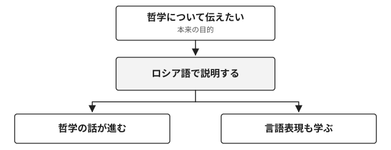
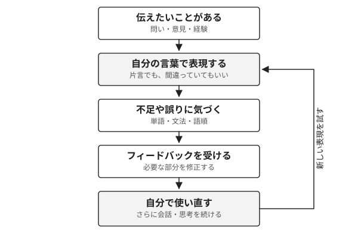
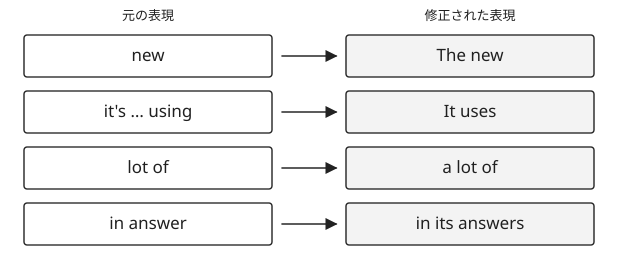
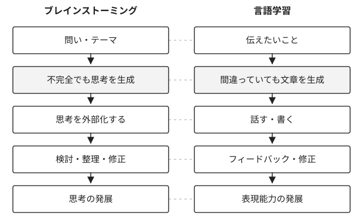

# ブレスト的な言語学習

間違ってもいいから、まず使う。

外国語で何かを伝えたいとき、文法が分からない、単語が思い出せない、間違えたくないといった理由で、話すことをためらうことがある。しかし、正しく話せるようになってから話す必要はない。

まずは自分の知っている言葉を使い、不完全でも表現してみる。それを他者やAIに修正してもらい、もう一度自分で使う。この繰り返しによって、言語を実際に使いながら学ぶことができる。

この方法を、ブレインストーミングの思想を学習に応用した**「ブレスト的な言語学習」**として考えてみたい。

## 1. 哲学について話していたら、ロシア語の練習になった

私が母親に哲学について説明していたときのことだ。日本語ではなかなか理解してもらえなかったため、ロシア語を交えて話し、やがてロシア語を中心に会話するようになった。

最初は片言だった。知っている単語を並べ、分からない言い回しは母親に尋ね、ときには日本語も使った。間違った表現を修正してもらうと、その表現を使ってもう一度説明した。そして、また次の話を続けた。

このような会話を約3時間続けたところ、ロシア語での表現がかなり上達したと感じた。ロシア語の勉強を始めたわけではない。哲学について伝えたいことがあり、そのために言語を使っていたのである。

*図 01　学習の出発点：言語学習だけを目的にしなくても、伝えたい内容を持つことが学習のきっかけになる。*

## 2. 自分で生成し、修正し、また使う

この学習方法の中心は、正解を最初から教えてもらうことではなく、まず自分で表現することにある。自分で文章を作ろうとするからこそ、何が分からないのか、どこを間違えたのかが具体的に分かる。

*図 02　言語学習の循環：修正を受け取るだけで終わらず、自分で使い直すことが重要である。*

必要な単語が分からなければ、その場で尋ねればいい。母語を交えても構わない。フィードバックは会話を完全に止めるためのものではなく、会話を続けるための材料として使う。

## 3. AIを使った実践例

例えば、英語で「新しいChatGPTはいいね。回答に視覚化をたくさん使っている」と伝えたいとする。まず、知っている英単語で自分なりに文章を作る。

**自分で作った英文**

new chatgpt sol 6.2 is nice  
it's in answer using lot of visualisation

**元の言い回しを残した修正**

**The** new ChatGPT Sol 6.2 is nice.  
It **uses a** lot of **visualisations in its answers**.

*図 03　必要な箇所だけ修正する：冠詞、動詞の形、語順などを直す。visualisation もここでは複数形にする。*

AIに流暢で高度な英文を一から作ってもらえば、完成度の高い文章を得られるかもしれない。しかし、それは今回の学習目的とは異なる。元の語彙や言い回しが残っていれば、自分がどこで間違え、どう直せばよかったのかを比較できる。

**正しい英文を得ることよりも、自分で正しい英文を生成できるようになることが目的である。**もちろん、元の表現では意味が通じない場合には、必要な言い換えも学ぶ。

## 4. ブレインストーミングとの共通点

古典的なブレインストーミングには「判断の延期」という原則がある。発想の段階でアイデアの正しさや実現可能性を厳しく判断することをいったん控え、自由に生成する。検討や評価は、その後で行う。

この原則は言語学習にも応用できる。文法が間違っているかもしれないという理由で発話を止めるのではなく、まず表現し、その後で修正する。

*図 04　ブレストと言語学習の共通構造：どちらも、正しさや完成度を生成の前提条件にしない。*

これは間違いを無条件に肯定したり、正確さを軽視したりすることではない。間違っている可能性を理由に、生成そのものを妨げないということだ。

古典的なブレインストーミングは主にアイデア生成の手法であり、この言語学習法そのものを指すわけではない。しかし、その基本思想を学習に応用した実践として「ブレスト的な言語学習」と呼ぶことはできる。

## 5. 言語習得研究とのつながり

この実践には、第二言語習得研究で論じられているいくつかの考え方と共通する部分がある。

| 理論・概念 | この学習法との関係 |
| --- | --- |
| アウトプット仮説 | 話したり書いたりすることで、知識の不足に気づき、自分の表現を試す。 |
| 気づき仮説 | 自分の表現とフィードバックされた表現の違いに注意を向ける。 |
| 相互作用仮説 | 会話の中で意味の確認や表現の調整を行う。 |
| 修正フィードバック | 訂正を受けることで誤りを認識し、表現を見直す。 |
| 手続き化 | 知識として知っている言語を、練習によって使える技能へと変えていく。 |

ただし、これらはこの方法との理論的な共通点であり、この方法全体の効果を直接証明するものではない。3時間で感じた上達についても、新しい知識の習得だけでなく、既に持っていたロシア語の知識が活性化した可能性がある。翌日以降も表現を使えるかを確認し、繰り返し実践することが大切である。

## 6. 知的探求と言語学習を一つの活動にする

哲学について考える、日記を書く、読書について話す、他者と議論する、ブレインストーミングをする。普段から行っている活動を、学びたい言語で行ってみればいい。

*図 05　知的活動と言語学習の統合：言語は学習の対象であると同時に、思考や知的探求のための道具にもなる。*

言語学習だけのために時間を設けなくても、知的活動そのものが練習の機会になる。ただし、発音、文法、語彙の体系的な学習が不要になるわけではない。必要に応じて、それらを組み合わせればよい。

## 7. 連想によって言語の知識をつなげる

単語や表現を一つずつ独立して覚えるだけでなく、一つの単語を起点として、そこから連想される単語、語源、派生語、類義語、対義語、関連する概念、例文などを自由に書き出していく。紙やキャンバス上で、関連するもの同士を線でつないでもいい。

例えば、英語の depend という単語から、dependent、independent、rely on などへ連想を広げ、自分で例文を作ってみる。

- I depend you.（自分で作った誤った例文）
  - なぜこの表現は間違っているのか？
  - I depend on you.（修正した例文）
    - I depend on my friends.
    - It depends on the weather.
  - 同じように on を使う別の表現は？
    - I rely on you.

例文が間違っていた場合には、正しい例文を書くだけで終わらせず、なぜ間違っていたのか、その箇所の言い回しや文法、同じ使い方をする別の例文についても書き出していく。間違いから生まれた疑問をさらに別の学習へとつなげる。

単語から例文へ、例文から文法へ、文法から別の表現へと、連想や疑問に従って自由に学習を展開する。

## 8. 母語の使用について

学習の際には、日本語などの自分の母語を使ってもいい。学習対象の言語だけではまだ表現できない疑問や考えについては、母語を交えることで、思考や連想を止めずに学習を続けることができる。

ただし、学習が進むにつれて、徐々に母語への依存を減らしていくことが望ましい。例えば、英単語から日本語の意味を連想するだけでなく、英単語から別の英単語を連想する。単語の意味を英語で説明したり、英語で疑問を書き出して、その疑問について英語で考えたりする。

最終的には、母語を介さず、学習対象の言語そのもので連想し、思考し、ブレストを展開できるようになることを目指す。ただし、母語を使わないことを絶対的な規則にする必要はない。必要に応じて母語も自由に活用すればいい。

## 9. 実際に始めるには

1. 自分が本当に考えたいこと、伝えたいことを選ぶ。
2. 知っている外国語で表現する。分からない部分は母語を交えてもいい。
3. 他者やAIに、元の言い回しをなるべく残して修正してもらう。
4. 修正された表現を自分で言い直す、または書き直す。
5. そのまま思考や会話を続ける。後日、同じ表現をもう一度使ってみる。

AIを使うなら、例えば次のように指示できる。

> 私は、伝えたいことを自分の知っている外国語で表現します。間違っていても、元の語彙・言い回し・ニュアンスを可能な限り維持し、必要な文法・語順・語法だけを修正してください。
>
> 意味を変えずに修正できない場合は、その理由と必要な表現を教えてください。より高度な表現に勝手に置き換えないでください。
>
> 必要に応じて修正箇所を簡潔に説明してください。会話や思考の流れをなるべく止めないようにしてください。
>
> 目的は、正しい文章を作ってもらうことではなく、自分で正しい文章を作れるようになることです。

## 10. ブレスト的実践としての学習

この考え方は言語学習だけに限らない。知識が不足していても仮説を立てる。論理が不完全でも考えを書く。完成していなくても外部化し、その結果を材料として検討・修正・発展させる。

学習とは、完成した知識を獲得してから実践することだけではない。不完全な状態で実践を始め、その実践を通じて知識や技能を獲得していくことでもある。

> **正しさや完成度を生成の前提とせず、不完全な状態でも生成し、それを検討・修正・発展させることで、思考・知識・技能を向上させていく。**

正しくなってから実践するのではなく、  
実践することによって正しくなっていく。

---

用語について：「ブレスト的な言語学習」「ブレスト的実践」は、ここでは既存の学術用語としてではなく、ブレインストーミングの原則を学習や知的活動に拡張するための概念として使用している。
