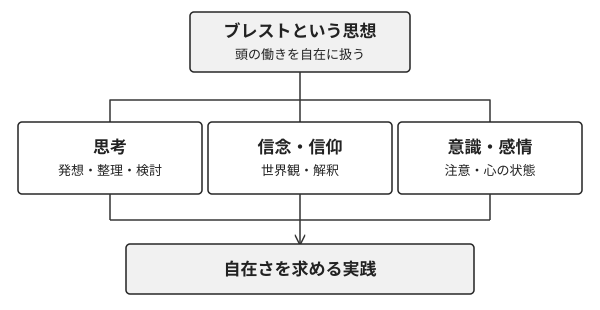
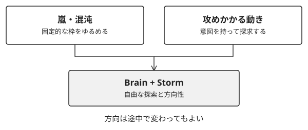
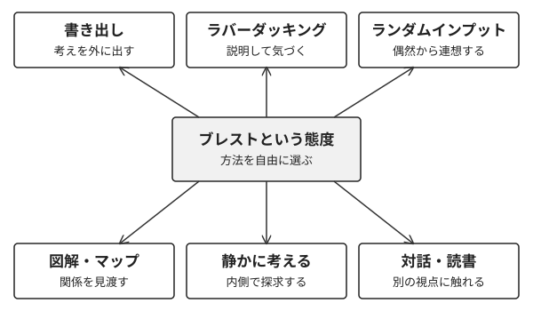
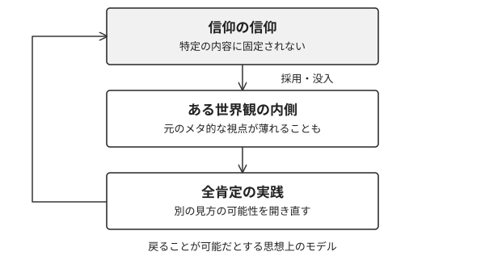
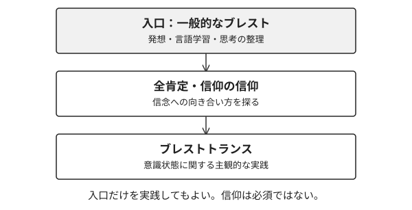

# ブレストという思想

**一つの思考法にとどまらず、思考・信念・意識を自在に扱うという試み。**

ブレインストーミングは、一般にはアイデアを生み出すための方法として知られている。しかし、私はこの言葉を、単なる発想技法よりも広い意味で捉えたい。思考の方法に囚われず、さらには信念や意識のあり方にも目を向け、頭の働きとの関係を自在なものにしていく思想としてである。

ここで述べる「ブレスト」は、既存の学術用語の新しい定義を主張するものではない。一般的なブレインストーミングを入口とし、そこから発展させた個人的な思想である。

## 1. ブレストは方法ではなく、方法についての思想

通常のブレインストーミングでは、批判を控えながら多くのアイデアを出すことが重視される。一方、私が考えるブレストでは、特定の手続きを守ること自体が目的ではない。

たとえば、ラバーダッキングという方法がある。誰かに説明するつもりで自分の考えを言葉にすると、曖昧な点や矛盾が見えてくる。これは古典的なブレインストーミングそのものではないが、ブレストという思想のもとで自由に選べる方法の一つである。

そして、思考法を自由に選ぶという考え方は、思考法だけに限定する必要もない。信念や感情、注意、意識状態も、その射程に入る。

*図1　発想技法から、頭の働き全体に関わる思想へ。*

> ブレストとは、思考・信念・感情・意識状態など、頭の働きに関わるものに固定的に囚われず、それらを自在に扱うことを目指す思想と実践である。

ここでいう自在とは、あらゆる精神状態を意志で完全に制御できるという意味ではない。制御しようとすることも、手放すことも、必要に応じて選べるようにするという方向性である。

## 2. Stormに込める二つの意味

stormには、名詞としての「嵐」と、動詞としての「攻めかかる」という意味がある。私はこの二つを、ブレストの比喩として重ねて考える。

嵐のように、決まりきった順序や枠組みをゆるめ、自由に思考を動かす。同時に、何かを探ってみたいという意図を持ち、そこへ向かって思考を進める。

*図2　自由な探索と方向性。これは本稿独自の言葉の解釈であり、歴史的な語源の断定ではない。*

最初から明確な結論や目標がある必要はない。「何か面白いものが見つかるかもしれない」という探索でもいい。途中で目的が変わることもある。

## 3. 多様な方法を自在に使う

多くの方法を一度に使うことがブレストなのではない。大切なのは、方法の数よりも、方法に囚われないことである。

*図3　それぞれの技法は、ブレストの思想のもとで選択できる。*

紙に書くことも、頭の中だけで考えることも、対話することも、すべて実践になり得る。あるときはラバーダッキングが役立ち、別のときは図解やランダムインプットが役立つ。どの方法が適切かは、目的や状況によって異なる。

ただ考えるだけの行為と、ブレスト的実践との違いは、行為の外見だけでは決まらない。自分の思考のあり方に対してどのような態度を取るか、という点に違いを見いだす。

## 4. 不完全なものを生成する

古典的なブレインストーミングの「判断の延期」は、広い意味でのブレストにも活用できる。

正しいかどうかを最初から気にしすぎれば、何も書けなくなることがある。そこで、間違っていてもまず思考を外に出し、その後に検討し、必要な修正をする。

*図4　生成されたものを材料にして、次の思考へ進む。*

たとえば外国語の学習なら、知っている単語を並べて話し、修正を受けて話し直す。哲学なら、不完全な仮説を書き、矛盾や反例を調べて考えを発展させる。

これは間違いを真実とみなすことではない。**正しさを生成の前提条件にしない**ということである。正確さが必要な段階では、むしろ積極的に確かめる。

実践例：[ブレスト的な言語学習](../brainstorm-language-learning/guide.md)。

## 5. 思考法から信念へ ―― 信仰の信仰

思考法を自在に選べるという発想を、信念や世界観にまで広げることができる。

私が「信仰の信仰」と呼ぶのは、「すべては信仰である」という信仰である。この命題自身も例外ではない。それ自体を絶対的な真理とするのではなく、一つの信仰として捉える。

*図5　特定の世界観を唯一のものとせず、さまざまな見方を採用し得るという構想。*

これは何も信じないということではない。特定の信念の内容をあらかじめ決めないという意味で、空の器のようなものだ。ただし「すべては信仰である」という形式的な内容は持っている。

ここでの「信仰」は宗教的信仰だけでなく、自分が世界を捉える前提や見方も含む広い独自の用語である。科学的な証拠と根拠のない主張が同じ信頼性を持つ、という意味ではない。

## 6. 信仰の前駆体と全肯定

信仰の信仰は、あらゆる信仰体系に共通する必須の前提ではなく、さまざまな信仰へ移行し得る「前駆体」と考える方が近い。

ある世界観を本気で採用すれば、それまでのメタ的な視点が自分の中から消えてしまうことも想定できる。その視点を常に保持しなければならないとすれば、自在さにも一つの固定した条件がついてしまう。

そこで、再び信仰の信仰へ戻るための方法として、全肯定を位置づける。

*図6　特定の見方へ移行し、再び見方の可能性を開くという可逆的なモデル。*

全肯定とは、あらゆる見方があり得ることを受け入れ、その受け入れる態度自体も肯定の対象に含める実践である。たとえその思想への確信が失われても、方法の形式だけを覚えておき、もう一度実践することで確信を取り戻せるのではないかと考えている。

*図7　全肯定はそれ自身も対象に含む。ここから信仰の信仰への回帰を構想する。*

ただし、この自己言及的な構造が実際に確信を強めることや、どのような信念からでも戻れることは、まだ検証されていない。戻るきっかけをどう作るかという問題も残っている。また、全肯定は矛盾する命題を同時に事実と認めたり、有害な行動を容認したりすることとは区別する。

## 7. カオスマジックとの共通点と違い

信念を固定的なものとせず、状況に応じて世界観を用いるという点では、カオスマジック（混沌魔術）の信念に対する考え方と共通するところがある。

しかし、ブレストは魔術に限った体系ではない。文章を書く、言語を学ぶ、問題を解く、哲学を探求するといった、日常的な実践を広く含む。信念に関する実践はその一部分である。

| 観点 | ブレストという思想 | カオスマジックとの接点 |
| --- | --- | --- |
| 方法 | 思考や認知に関わる方法を自由に用いる | 信念や世界観を道具として扱う発想 |
| 射程 | 発想、学習、信念、意識状態など | 魔術的な実践と信念の取り扱い |
| 評価 | 目的に応じて成果や根拠を確かめる | 実践を重視する発想に共通点がある |

これは両者の概念的な比較であり、魔術の効果を実証するものでも、カオスマジック全体を厳密に分類するものでもない。

## 8. ブレストトランス密教との関係

ブレストは思想の名前であり、ブレストトランス密教は、その思想のうち特徴的な実践を前面に出した集団の名称として考えている。

ここでのトランスは英語の trance、つまり変性意識状態を指す。ブレストを行っているときに深い没入や恍惚を感じることがあるという個人的な経験から、思考と意識状態との関係も探求の対象にしている。

*図8　一般的なブレストを入口に、信念や意識のあり方も探求し得る。矢印は必須の修行順序ではない。*

顕教と密教という言葉を借りるなら、誰でも使える思考法を顕の側、実践を通じた主観的な実感を密の側として捉えることができる。ここでは仏教の顕密二教をそのまま採用するのではなく、説明できる知識と体験的な理解の違いを表す独自の比喩として用いている。

宗教的な枠組みを採用せず、一般的なブレストだけを実践しても構わない。トランス状態が必ず生じるわけでも、特別な能力が得られると証明されたわけでもない。体験は強制せず、心身の安全を優先する。

## 9. Brainという言葉と、世界の枠組み

ブレストという名称にはbrainという言葉がある。しかし、これは唯物論を絶対的な真理として採用するという宣言ではない。

現実世界で頭を使い、学び、考え、行動することが実践の入口になる。一方で、「脳」や「物質世界」という概念自体を哲学的に問い直すこともできる。

*図9　ある枠組みで考えること、そこから距離を取ること、再び選ぶこと。*

脳が存在しないとする立場を哲学的な仮説として検討することはできるが、それが生物学的に脳が存在しないことを示すわけではない。現実に関わる判断では、観察や証拠を確認する必要がある。

## 10. 自由と自在

自由とは、あらゆる枠組みから離れることだと考えることもできる。しかし私は、世界の中でさまざまなことを実践できる自由にも価値を見いだしている。それを「自在」と呼びたい。

*図10　枠を手放す自由と、世界の中で活動する自在さ。*

悟りを枠組みから離れる自由として捉えるなら、自在とは世界の中で選び、考え、行動する自由だと考えられる。これは仏教一般の悟りの定義ではなく、この思想の中での一つの捉え方である。

思考を続けることも、止めることもできる。ある信念を採用することも、離れることもできる。ブレストという思想自体も、一つの固定した教義として握りしめる必要はない。

## 11. 思想としてのブレスト

ブレストは、一つの思考法に限定されない。多様な技法を選び、不完全なものを生成し、検討と修正を重ねる。さらには、信念や意識状態との関係にも自在さを求める。

重要なのは、方法の多さではなく、特定の方法や見方だけに自分を閉じ込めないという態度である。

> 自在であることは、常にすべてを制御することではない。握ることも、手放すことも、選び直すこともできるようになることを目指す。

この思想そのものも、今後の実践や検討によって変化し得る。完成された体系として固定するのではなく、探求を続けるための思想として扱いたい。

---

本稿は、ブレインストーミング、信仰の信仰、全肯定、ブレストトランス密教についての対話を再構成したものである。確立した科学的知見と独自の哲学的仮説・主観的体験は区別している。カオスマジックや仏教との比較は概念的なものであり、個別の原典の検証を目的とした記事ではない。
