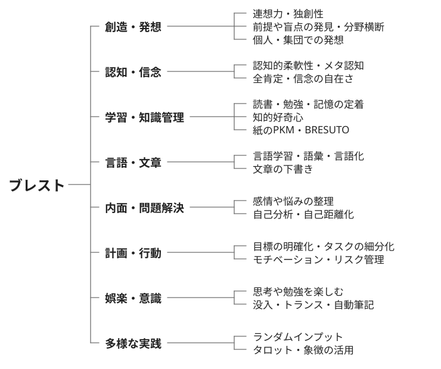
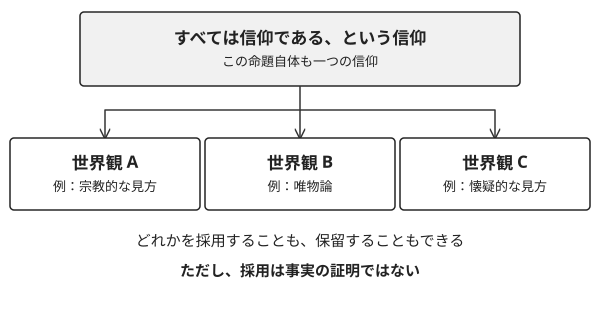
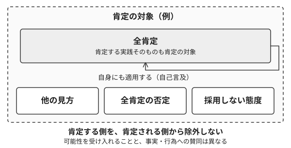
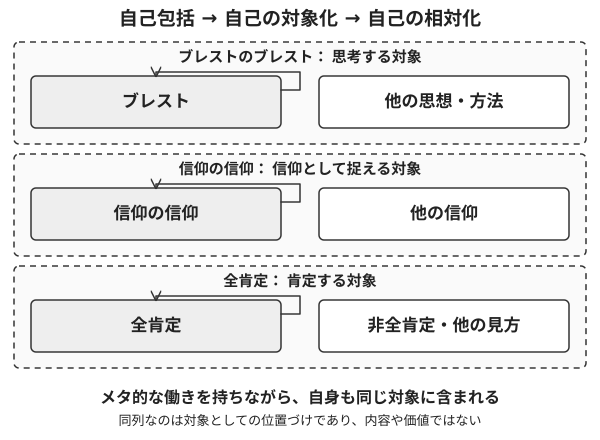
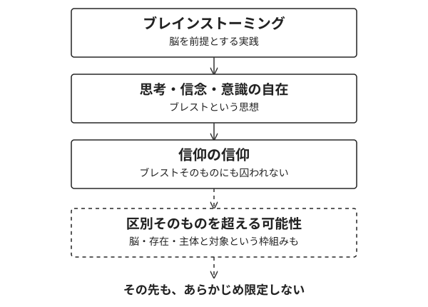
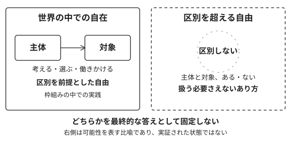

# ブレストという思想

**一つの思考法にとどまらず、思考・信念・意識を自在に扱うという試み。**

ブレインストーミングは、一般には集団でアイデアを出し合う会議の技法として知られている。しかし私は、この言葉をもっと広く捉えたい。特定の手順を守ることではなく、思考法を自由に選び使う態度そのもの。さらに、その自在さを信念や感情、意識状態にまで広げていくこと。それを私は「ブレスト」と呼ぶ。

本稿は四部からなる。第1部では、ブレインストーミングという言葉の一般的な理解から出発し、方法についての思想としてのブレストを示し、その用途と実践上の注意点を述べる。第2部では、それを信念に適用した信仰の信仰と全肯定、およびそれらに共通する構造を扱う。第3部では、カオスマジックやブレストトランス密教との関係からブレストを位置づける。第4部では、ブレストという枠組み自体を越える可能性を述べる。

なお、本稿の「ブレスト」は既存の用語の定義を改めようとするものではなく、一般的なブレインストーミングを入口として発展させた個人的な思想である。

## 1. ブレストとは何か

### 1.1 ブレインストーミングという言葉

#### 1.1.1 集団に限定されたブレスト観

日本語の辞書には、ブレインストーミングを集団的な発想法として説明するものが多い。デジタル大辞泉は「米国で開発された集団的思考の技術」[1]、精選版 日本国語大辞典は「創造的集団思考法」[2] と定義している。

一方、Merriam-Websterには次の定義もある。

> the mulling over of ideas by one or more individuals in an attempt to devise or find a solution to a problem [24]

（一人または複数の人が、問題の解決策を考案・発見するためにアイデアを考えること。）

Dictionary.comも「usually performed through group participation」[26]（通常は集団で行われる）と説明しており、集団に限定していない。

日英の辞書・事典・用語集34件 [1–34] を比較すると、次のような違いが見られる。

| 定義・説明の形式 | 日本語（15件） | 英語（19件） |
| --- | ---: | ---: |
| A：集団を前提とする | 14件（93.3%） | 10件（52.6%） |
| B：通常は集団とするが限定しない | 0件（0%） | 2件（10.5%） |
| C：個人での実践を明記 | 1件（6.7%） | 4件（21.1%） |
| D：人数を明示しない | 0件（0%） | 3件（15.8%） |

この比較では、日本語の資料の方が集団的な形式に偏っている。ただし、これは探索的な調査であり、日本社会全体の認識を示す統計ではない（調査方法は末尾を参照）。

集団で行うこと自体に問題があるわけではない。ただ、集団で行うものだけをブレインストーミングとみなす理解は、本稿のブレストにとっては狭すぎる。

#### 1.1.2 Stormの二つの意味

stormには、名詞としての「嵐」と、動詞としての「攻めかかる」という意味がある。ブレインストーミングを考案したアレックス・オズボーンは、brainstormを後者の意味で、脳を使って創造的な問題に攻めかかることとして説明した [35]。私はこれに「嵐」の意味も重ね、二つをブレストの比喩として考える。

嵐のように、決まりきった順序や枠組みをゆるめ、自由に思考を動かす。同時に、何かを探ってみたいという意図を持ち、そこへ向かって思考を進める。

*図1　自由な探索と方向性。「攻めかかる」はオズボーンの説明に基づく。「嵐」の意味を重ねるのは本稿独自の解釈である。*

最初から明確な結論や目標がある必要はない。「何か面白いものが見つかるかもしれない」という探索でもいい。途中で目的が変わることもある。

### 1.2 方法ではなく、方法についての思想

通常のブレインストーミングでは、批判を控えながら多くのアイデアを出すことが重視される。一方、私が考えるブレストでは、特定の手続きを守ること自体が目的ではない。

たとえば、ラバーダッキングという方法がある。誰かに説明するつもりで自分の考えを言葉にすると、曖昧な点や矛盾が見えてくる。ランダムインプットでは、無関係な言葉や物をきっかけに連想を広げる。Webbing（ウェビング）のように、中心の主題から関連する考えを網の目状に広げていく図解もある。さらには、考えを普通の文章として清書することも、書きながら考えが整理され、新たな気づきが生まれる実践になり得る。

これらは古典的なブレインストーミングそのものではないが、ブレストという思想のもとで自由に選べる方法である。そして、ここに挙げたものはほんの一例にすぎない。紙に書くことも、頭の中だけで考えることも、対話することも、読書することも、すべて実践になり得る。

*図2　それぞれの技法は、ブレストの思想のもとで選択できる。ここに挙げたのは一例である。*

多くの方法を一度に使うことがブレストなのではない。大切なのは、方法の数よりも、方法に囚われないことである。どの方法が適切かは、目的や状況によって異なる。

ただ考えるだけの行為と、ブレスト的実践との違いは、行為の外見だけでは決まらない。自分の思考のあり方に対してどのような態度を取るか、という点に違いを見いだす。

そして、思考法を自由に選ぶという考え方は、思考法だけに限定する必要もない。信念や感情、注意、意識状態も、その射程に入る。

*図3　発想技法から、頭の働き全体に関わる思想へ。*

> ブレストとは、思考・信念・感情・意識状態など、頭の働きに関わるものに固定的に囚われず、それらを自在に扱うことを目指す思想と実践である。

ここでいう自在とは、あらゆる精神状態を意志で完全に制御できるという意味ではない。制御しようとすることも、手放すことも、必要に応じて選べるようにするという方向性である。

### 1.3 不完全なものを生成する

古典的なブレインストーミングの「判断の延期」は、広い意味でのブレストにも活用できる。

正しいかどうかを最初から気にしすぎれば、何も書けなくなることがある。そこで、間違っていてもまず思考を外に出し、その後に検討し、必要な修正をする。

*図4　生成されたものを材料にして、次の思考へ進む一例。固定された手順ではない。*

たとえば外国語の学習なら、知っている単語を並べて話し、修正を受けて話し直す。哲学なら、不完全な仮説を書き、矛盾や反例を調べて考えを発展させる。

これは間違いを真実とみなすことではない。**正しさを生成の前提条件にしない**ということである。正確さが必要な段階では、むしろ積極的に確かめる。

実践例：[ブレスト的な言語学習](../brainstorm-language-learning/guide.md)。

### 1.4 ブレストのメリットと用途

ブレストは、アイデアを出すためだけのものではない。思考の過程そのものを実践の対象とすることで、創造、学習、知識管理、内面の整理、計画、さらには娯楽へと応用できる。これらは独立した用途というより、互いに作用し合うものである。

以下は、本稿のブレストから考えられる用途と、私自身の経験に基づく可能性である。関連する心理学・神経科学の査読論文、実験研究、レビュー、メタ分析を参照するが、個々の研究が本稿でいうブレスト全体の効果を検証したわけではない。以下では、研究で観察された結果と、本稿独自の応用・仮説を区別する。

*図4a　ブレストのメリット・用途・実践上の注意点の全体像。各枝に具体的な説明を添えた。文字と線は関連する領域を示しており、実証された因果関係や固定的な分類を意味しない。*

[図を拡大して見る（SVG）](https://yurii7812.github.io/homepage/ja/brainstorm-philosophy/figures/benefits.svg)

#### 1.4.1 連想力、創造性、認知的柔軟性

ある言葉や考えから別の言葉や考えへと連想を広げていくと、普段は結びつけないものの間に関係を見いだすことがある。異なる分野の知識を結びつけ、新しいアイデアを生み出したり、問題に対する別の解決策を考えたりすることにも役立つ。

その際、結論だけでなく、自分が無意識に置いていた前提や、見落としていた可能性が明らかになることもある。前提そのものをブレストの対象にすれば、問いの立て方から変えることができる。

このように、異なる視点や考え方へ切り替える能力は、認知的柔軟性（cognitive flexibility）と関係する。認知的柔軟性を養うための実践として、たとえば次のようなことが考えられる。

- 一つの問題に対して、異なる前提から複数の答えを考える。
- 自分の考えとは反対の立場からも考えてみる。
- ある分野の概念を、別の分野に持ち込んでみる。
- ランダムな言葉、画像、タロットカードなどを連想のきっかけにする。
- 自分が用いている思考法そのものを対象化し、別の方法へ切り替える。

Sio と Lortie-Forgues（2024）は、創造性訓練に関する169研究を統合し、平均効果を0.53標準偏差、出版バイアス補正後を0.29～0.32標準偏差と推定した。研究方法上の問題も多く、効果の大きさには慎重な解釈が必要である [36]。また、発散的思考と実行機能のレビューでは認知的柔軟性の役割が論じられているが、その独立した寄与を調べた研究は少ない [44]。認知的柔軟性を実践によって長期的に改善できるかは別の問いである。

発散的思考、連想力、認知的柔軟性、一般知能（IQ）は同じものではない。Gerwig ら（2021）の112研究を対象としたメタ分析では、発散的思考と知能に正の相関（r = 0.25）が見られた [37]。しかし相関は訓練による知能の上昇を意味しない。ブレストによってIQそのものが上昇するかどうかは、別途検証すべき仮説である。

個人で思考を広げるだけでなく、集団で互いの発想を材料にすることもできる。他者のアイデアへの接触が発想を刺激することは実験で示されている [45]。一方、発言の順番待ちなどにより、対面集団の発想数は個人で考えた結果を合算した場合より少なくなることがある [46]。個人で発想してから共有する方法も選択肢となる。ランダムインプットを用いれば、AIにアイデアの生成を委ねず、自分自身で意外な発想を生み出すこともできる。タロットカードは、占いとして用いる場合にも、象徴から連想を広げる材料として用いる場合にも、ブレストと組み合わせられる。ただし、そこから得られる着想と、未来の予測が事実として正しいかどうかは別の問題である。

ランダムインプットについては反対方向の結果もある。Malthouse ら（2022）は592人を対象とした事前登録実験で、Wikipediaのランダム記事への接触が三つの課題の成績を改善せず、むしろ低下させる場合があると報告した [47]。一方、他者の関連するアイデアによる認知的刺激には実験的な支持がある [45]。したがって、刺激のランダム性そのものが創造性を高めるとはいえない。タロットカードを利用する場合も、刺激を自分の問いと結びつける実践として捉える。

#### 1.4.2 メタ認知と信念の柔軟さ

思考を外部化すると、自分が何を考えているかだけでなく、どのように考えているかにも目を向けやすくなる。なぜある結論に至ったのか、どのような前提を採用しているのか、なぜ別の考え方を避けているのか。それらをさらに思考の対象にすることは、メタ認知的な実践になる。Lebuda と Benedek（2023）は、創造的メタ認知の理論的枠組みとして、アイデア生成だけでなく、自己の進捗やアイデアの評価、課題に応じた方略の選択・調整を位置づけている [48]。この枠組みは本稿の考え方と接点があるが、全肯定の効果を実験的に検証したものではない。

この働きは、第2部で扱う全肯定にもつながる。自分の信念や世界観を対象化し、別の見方があり得ることを認めることで、それまで固定的だった前提を相対化できるのではないかと考えている。

連想によって別の見方を発見し、メタ認知によって自分の見方を捉え、全肯定によってさらに信念の選択肢を開く。その結果として、また別の連想や考え方が可能になる。この相互作用は、ブレストにおける認知的柔軟性の一つの構想である。ただし、これらの働きが必ず生じるという因果関係を示したものではない。

#### 1.4.3 読書、勉強、知識管理

読書や勉強をしながら、理解したこと、疑問に思ったこと、自分なりの解釈、関連する知識を次々と書いていく。そうすると、与えられた情報を受け取るだけでなく、自分自身の問いから学習を進めることができる。

たとえば、一つの疑問を追って別の分野を調べ、その知識によって最初の文章を違った角度から読み直すこともできる。問いが理解を生み、その理解がまた新しい問いを生む。学習内容を自分で説明する自己説明（self-explanation）について、Bisra ら（2018）のメタ分析は学習成績への平均効果 g = 0.55 を報告している [49]。ブレストの中で自分の理解を言語化することは、この技法の応用と考えられる。

ブレストは、PKM（Personal Knowledge Management、個人知識管理）としても実践できる。紙では、私がツェッテルカステンを独自に改変したノート術を用いることで、ブレストと知識管理を一体化できる。デジタルでは、私が開発したアプリ「BRESUTO」によって、ブレストをしながら知識を蓄積し、整理し、関連づけることができる。

いずれも、ブレストによって生まれた思考を記録するだけでなく、蓄積した知識を材料としてさらにブレストするための仕組みである。思考の生成と知識管理は相互に作用し、一方がもう一方の発展につながる。

学んだ内容を資料を見ずに思い出して書くことは、検索練習（retrieval practice）にもなる。検索練習が学習の定着に役立つことは実験で報告されている [38]。また、好奇心が高い状態で学んだ情報は記憶に残りやすいという研究もある [39]。ブレストを通じて問いが生まれ、知的好奇心が増し、その好奇心がさらに学習を促すという循環が考えられる。

#### 1.4.4 言語学習、言語化、文章の作成

外国語の単語を覚えるとき、意味、語源、類義語、反対語、用例などを連想によって結びつけていくことができる。既に知っている単語を組み合わせ、まずは不完全でも文章を作り、必要に応じて修正するという使い方もできる。成人の第二言語語彙学習に関するレビューでは、間隔を空けた検索練習や、自分で意味的な関連を生成する精緻化を、語形と意味の結びつきを強める手法として取り上げている [50]。ただし、語彙の習得と会話能力全体の向上は区別する必要がある。

これは外国語に限らない。母語でも、普段使わない言葉や表現を思い出し、同じ考えを別の言い方で表現したり、曖昧な感覚を言語化したりすることは、言語の学習になり得る。言葉の間のつながりを耕すことで、会話や文章を書くときに使える表現の引き出しを増やすことを目指せる。

文章を書く際には、断片的な思考をまず外に出し、それらを並べ替えたり関係づけたりして下書きにすることができる。清書もまた、思考の整理や新たな発見を伴うブレストの一部になり得る。

#### 1.4.5 内面の整理、悩み、問題解決

悩みや感情を抱えているとき、自分が何を感じているのか、何が問題なのかさえ、はっきりしていないことがある。思いつくことを書き出し、連想やランダムインプットを用いて掘り下げることで、それまで言葉になっていなかった感情や前提に気づくことがある。

また、書き出した自分の思考を読み返すと、まるで小説の登場人物について考えているかのように、自分の問題を少し離れたところから眺められることがある。これはセルフディスタンシング（self-distancing、自己距離化）と関連する。感情や経験を文章にすることが自己距離化を促すという研究もある [40]。

自分の問題から距離を取ることで、問題の深刻さの感じ方が変わり、別の解決策が見えてくることもある。ただし、問題そのものが解消するとは限らず、書くことでかえって苦痛が強くなる場合もある。内面を分析し続けることが常に望ましいわけではない。

#### 1.4.6 計画、モチベーション、行動

目標を達成するための計画も、ブレストの対象になる。大きな目標から具体的な作業へと細分化し、それぞれについて「どうすればできるか」を考えていく。

また、行動できていないときには、なぜそれをやっていないのか、何を恐れているのか、どのような状況で先延ばししているのかを探る。自分の行動パターンが見えてくれば、それに対処する方法を考えられる。たとえば「状況Xになったら行動Yをする」と具体的に決める実行意図（implementation intentions）には、目標達成への効果を示すメタ分析がある [51]。これは単に目標について考えることより具体的な方法であり、ブレストによる計画を行動へつなげる際に活用できる。

私自身、気持ちを整理し、目標やそのために必要な行動を明確にしていく過程で、ワクワクしたり、幸福感を覚えたりすることがある。目標に向かうための作業そのものも、ブレストに取り込むことで楽しくなる場合がある。

ただし、計画を書くことと実行することは異なる。計画を考えること自体が楽しくなり、実行を先延ばしにすることもあり得る。考える必要がなくなったところで、実際に行動することも重要である。

#### 1.4.7 娯楽、没入、トランス状態、自動筆記

ブレストには、何かを達成するためではなく、書くことや考えること自体を楽しむという側面もある。何が出てくるか分からないまま連想を進め、予想していなかった理解や発想にたどり着くことが面白い。フロー研究のスコーピングレビューでは、活動への没入、努力感の少ない制御、活動そのものから得る内発的な報酬が繰り返し取り上げられている [52]。これはブレストに伴う楽しさを考える手がかりになるが、ブレストでフローやトランスが必ず生じることを示すものではない。

思考や勉強が娯楽になるということは、娯楽を別の時間に設けるだけでなく、学ぶことや目標へ向かう過程自体から楽しさを得るということである。

私自身、ブレストを続けていると深く没入したり、書いている内容が意識的に一つずつ選ばれているという感覚が薄れたりすることがある。このような体験は、自動筆記のように、浮かぶ言葉を吟味せず書き続ける実践とも結びつく。これをトランス状態の探求へ応用することも考えている（3.2参照）。ただし、没入、フロー、トランス、自動筆記は同じ現象とは限らない。自動筆記によって現れた内容も、外部から得られた知識や真理として扱う必要はない。

#### 1.4.8 ひらめきの報酬性とリスク

なぜブレストは楽しいのだろうか。私が考えている一つの仮説は、連想の先に何が現れるのか予測できないというランダム性が、ひらめきの楽しさに関わっているのではないかというものである。

ギャンブルやショート動画にも、次に何が起こるか分からないという側面がある。ブレストにも予想外の発見によって報酬を得るような仕組みがあるのかもしれない。ただし、同じ報酬の仕組みや依存性を持つと確認されたわけではない。

ひらめき（Aha! 体験）に関する研究では、強いひらめきを伴う問題解決時に、報酬処理に関わる脳領域である側坐核の活動が高まることが報告されている [41]。側坐核は、腹側被蓋野などからドーパミン性の入力を受ける領域でもある。

Becker、Yu、Cabeza（2023）は、曖昧な画像を認識した際のひらめきと、その直後の金銭的な選択を調べ、強いひらめきに伴うリスク選好の増加を報告した。fMRI実験では側坐核の活動増加も観察された [42]。言語パズルを用いた別の研究でも、ひらめきの後に一時的にリスクのある報酬を選びやすくなる結果が報告されている [53]。ただし、これは特定の実験課題で得られた結果であり、ブレスト中のドーパミン放出や、日常生活でのリスクの過小評価を直接確認したものではない。

この知見から、ひらめきの後にはリスクに対する態度が変わる可能性があると考えられる。私自身も、ひらめきによって自分に自信を持てたり、失敗への恐れや完璧主義が弱まり、それまでためらっていた行動を起こしやすくなったりした経験がある。行動を妨げていた過度な慎重さから離れられることは、ブレストの一つの力かもしれない。

しかし、自信が増すことと、判断が正しくなることは別である。ひらめきによって行動的になる一方、実際に考慮すべきリスクを軽視する可能性もある。そこで、ひらめきを得る過程と、それを実行に移す判断を分けることが考えられる。

そのリスクについてもブレストし、失敗した場合の影響、代替案、撤回の可能性を整理することができる。重要な決定については、興奮が落ち着いてから改めて確認する。ブレストによって生じた問題にも、ブレストを活用できるが、必ずしもさらに考えることだけが対策になるわけではない。

### 1.5 ブレストのしすぎと、思考から離れること

ブレストは楽しいからこそ、やりすぎてしまうことがある。連想が次々に生じ、思考が止まらなくなり、休むことが難しくなる。考え続けることで疲労し、気分や睡眠に悪影響が出る場合もある。持続的な認知課題による精神的疲労については、実験研究のシステマティックレビューがある [54]。ただし、自由なブレストに特有の危険性や、安全な実践時間が確立されているわけではない。同じ悩みを繰り返し考える反すうについても、思考の内容や状況によって建設的にも非建設的にもなり得ることが指摘されている [43]。

このようなとき、さらにブレストして思考を整理することだけが解決策ではない。**思考から身体感覚へ注意を移す**という方法がある。

たとえば、散歩や運動をする、シャワーを浴びて水の感覚に注意を向ける、足の裏が地面に触れる感覚や周囲の音を感じる。冷水シャワーを用いることも考えられるが、強い冷水刺激は必須ではなく、身体への負担を避ける。身体と周囲の感覚に注意を戻すグラウンディングは、WHOのストレス対処ガイドにも含まれる [55]。また、Bratman ら（2015）は、自然環境を90分歩いた参加者で反すうの自己報告が減少したと報告している [56]。冷水曝露については2025年の系統的レビューでも効果や研究上の限界が検討されているが [57]、過剰なブレストを止める方法としての有効性を直接示すものではない。こうした行為を新しい思考の材料にし続ける必要もない。ただ身体の感覚を感じ、思考をそれ以上進めない時間を持つ。

ブレストの途中でも、続きがあることを短く書き残して中断し、後で再開することができる。疲労、睡眠不足、思考の止めにくさがあるときは、休息を優先する。十分に休んでも眠れない状態や思考の加速が続き、生活に支障を来す場合には、医療機関に相談することも必要である。

ブレストという思想が目指しているのは、思考を際限なく発展させることだけではなく、思考との関係を自在にすることである。ブレストすることも、ブレストしないことも選べる。ブレストそのものに囚われないという点で、これは2.3.1の「ブレストのブレスト」ともつながっている。

**思考を自在に扱うことには、思考を手放すことも含まれる。**

## 2. 方法から信念へ

### 2.1 信仰の信仰

思考法を自在に選べるという発想を、信念や世界観にまで広げることができる。

私が「信仰の信仰」と呼ぶのは、「すべては信仰である」という信仰である。この命題自身も例外ではない。それ自体を絶対的な真理とするのではなく、一つの信仰として捉える。

*図5　信仰の信仰は他の信仰を捉えるメタ的な信仰でありながら、それ自身も同じ信仰の領域に含まれる。採用・保留・手放すことも可能である。*

これは何も信じないということではない。特定の信念の内容をあらかじめ決めないという意味で、空の器のようなものだ。ただし「すべては信仰である」という形式的な内容は持っている。

ここでの「信仰」は宗教的信仰だけでなく、自分が世界を捉える前提や見方も含む広い独自の用語である。科学的な証拠と根拠のない主張が同じ信頼性を持つ、という意味ではない。

信仰の信仰は、個々の信仰を対象とするだけでなく、それ自身も信仰として捉えるメタ的な信仰である（この構造は2.3で詳しく扱う）。そのため、信仰の信仰そのものも絶対化されない。信仰の信仰を採用することも、採用しないことも、再びそこに戻ることも選択肢となる。

**信仰の信仰の柔軟さは、信仰を自在に選べることだけでなく、信仰の信仰そのものにも囚われる必要がないという点にある。**

#### 2.1.1 信仰の信仰の自己完結性

信仰の信仰は、自己完結的な信仰でもある。「すべては信仰である」という信仰は、それ自身をも信仰として包括するため、自らを位置づけるために信仰の外側に別の絶対的な前提を設ける必要がない。その意味で、信仰の信仰は自身の内部で完結している。自身を信仰と捉えるために、さらに上位の信仰を次々と設ける必要もない。

この自己完結性は、その信仰の真理性が自己言及によって証明されるという意味ではなく、また、他の信仰を排除する閉じた体系であるという意味でもない。自身も一つの信仰として相対化されるからこそ、そこから他の信仰へ移行することもできる。

### 2.2 信仰の前駆体と全肯定

信仰の信仰は、あらゆる信仰体系に共通する必須の前提ではなく、さまざまな信仰へ移行し得る「前駆体」と考える方が近い。

ある世界観を本気で採用すれば、それまでのメタ的な視点が自分の中から消えてしまうことも想定できる。その視点を常に保持しなければならないとすれば、自在さにも一つの固定した条件がついてしまう。

そこで、再び信仰の信仰へ戻るための方法として、全肯定を位置づける。

*図6　信仰の信仰から特定の見方への移行と、全肯定による回帰の構想。破線は回帰の仮説を示し、必須の手順や回帰の保証を意味しない。*

全肯定とは、あらゆる見方があり得ることを受け入れ、その受け入れる態度自体も肯定の対象に含める実践である。たとえその思想への確信が失われても、方法の形式だけを覚えておき、もう一度実践することで確信を取り戻せるのではないかと考えている。

*図7　全肯定自身だけでなく、全肯定の否定や採用しない態度も肯定の対象に含まれる。ここから信仰の信仰への回帰を構想する。*

全肯定は、あらゆる信仰を同時に採用し続けることを求めるものではない。さまざまな信仰を肯定し得るからこそ、その中から特定の信仰を選び、あるいは手放すという選択的なあり方も可能になる。

全肯定によってさまざまな信仰への可能性を開き、その中から選択することができる。そして、その選択を可能にする信仰の信仰自体も、選択の対象に含まれる。信仰の信仰は、自らを手放す可能性をも内包するのである。

これは構造としての開放性であり、それを信じている人が実際に常に柔軟でいられることまで保証するものではない。

ただし、この自己言及的な構造が実際に確信を強めることや、どのような信念からでも戻れることは、まだ検証されていない。戻るきっかけをどう作るかという問題も残っている。また、全肯定は矛盾する命題を同時に事実と認めたり、有害な行動を容認したりすることとは区別する。

### 2.3 自己包括という共通構造

ブレスト、信仰の信仰、全肯定には、自身を適用対象の外側に置かないという共通の構造がある。ここではまず三者を個別に見たうえで、その共通点をまとめる。

#### 2.3.1 ブレストのブレスト

**ブレストについてもブレストする。ブレストそのものの定義にさえ囚われないことが、ブレストという思想の一部である。**

ブレストの対象を限定しないのであれば、ブレストそのものもブレストの対象に含まれる。これは自己包括による自己言及である。ブレストについてブレストすることを「ブレストのブレスト」と呼ぶなら、それは思考の方法そのものを思考の対象とするメタ的な実践である。

ブレスト自身も一つの思考の対象となることで相対化される。ブレストという思想自体を再考し、変化させ、さらには手放すこともできる。

#### 2.3.2 信仰の信仰の自己言及性

「すべては信仰である」という命題の「すべて」には、その命題自体も含まれる。したがって、「すべては信仰である」という認識もまた、一つの信仰である。信仰の信仰は、他の信仰を外側から眺めるだけの立場ではなく、自分自身をも同じ対象の中に含める自己言及的な信仰である。

この自己言及性は、「すべては信仰である」という命題を否定するものではない。むしろ、その命題自身にも同じ見方を適用することである。そのため、自分自身だけを例外として、信仰の外側にある絶対的な立場に置く必要がない。信仰についてのメタ的な信仰であると同時に、そのメタ的な立場自体も相対化されるのである。

#### 2.3.3 全肯定の自己言及性

全肯定自身も一つの肯定の対象である。自己包括によって、肯定する側にあった全肯定そのものが、肯定される側にも位置づけられる。ここに自己の対象化と、それによる自己の相対化がある。肯定するという実践そのものを肯定の対象とするという点で、全肯定はメタ的な実践でもある。

同様に、自分と他者、肯定する側と肯定される側、全肯定と非全肯定（全肯定の否定や、全肯定を採用しない態度）も、肯定の対象という点では同列になる。全肯定自身を特別扱いしないのである。これは主体と対象の区別が必ず消滅するという意味ではなく、その区別に伴う特権性を相対化するということである。

#### 2.3.4 三者に共通する構造

**自己包括 → 自己の対象化 → 自己の相対化**

*図8　三者は異なる働きを持つが、自らをその働きの対象から除外しないという構造を共有する。*

| 概念 | 自己包括・自己言及 | 自己相対化 |
| --- | --- | --- |
| ブレストのブレスト | ブレスト自身をブレストの対象とする | ブレストも他の思想や方法と同列の思考対象となる |
| 信仰の信仰 | 信仰の信仰自身も一つの信仰として包括する | 信仰の信仰も他の信仰と同列になる |
| 全肯定 | 全肯定自身を肯定の対象とする | 全肯定も非全肯定も同列の肯定対象となる |

三者はいずれも、自己包括によって自身を対象化するという点でメタ的である。ブレストのブレストはブレストそのものを思考の対象とし、信仰の信仰は信仰の信仰そのものを一つの信仰として捉え、全肯定は全肯定そのものを肯定の対象とする。対象に働きかけるだけでなく、その働きや枠組み自体をも対象とするのである。

三者は働きの内容こそ異なるが、自己包括によって自己を対象化し、相対化するという仕組みは共通している。メタ的であることと、対象として他のものと同列に位置づけられることは両立する。なお、同列になるのは対象としての位置づけであり、内容や価値まで等しくなるという意味ではない。

## 3. ブレストの位置づけ

### 3.1 カオスマジックとの共通点と違い

信念を固定的なものとせず、状況に応じて世界観を用いるという点では、カオスマジック（混沌魔術）の信念に対する考え方と共通するところがある。

しかし、ブレストは魔術に限った体系ではない。文章を書く、言語を学ぶ、問題を解く、哲学を探求するといった、日常的な実践を広く含む。信念に関する実践はその一部分である。

| 観点 | ブレストという思想 | カオスマジックとの接点 |
| --- | --- | --- |
| 方法 | 思考や認知に関わる方法を自由に用いる | 信念や世界観を道具として扱う発想 |
| 射程 | 発想、学習、信念、意識状態など | 魔術的な実践と信念の取り扱い |
| 評価 | 目的に応じて成果や根拠を確かめる | 実践を重視する発想に共通点がある |

これは両者の概念的な比較であり、魔術の効果を実証するものでも、カオスマジック全体を厳密に分類するものでもない。

### 3.2 ブレストトランス密教との関係

ブレストは思想の名前であり、ブレストトランス密教は、その思想のうち特徴的な実践を前面に出した集団の名称として考えている。禅宗が禅を修行とし、その名に掲げているように、ブレストトランス密教はブレストを修行とする。

ここでのトランスは英語の trance、つまり変性意識状態を指す。ブレストを行っているときに深い没入や恍惚を感じることがあるという個人的な経験から、思考と意識状態との関係も探求の対象にしている。

*図9　ブレストという思想と一般的な実践、ブレストトランス密教との関係。実践領域は重なり得るもので、矢印は修行の順序ではない。*

顕教と密教という言葉を借りるなら、誰でも使える思考法を顕の側、実践を通じた主観的な実感を密の側として捉えることができる。ここでは仏教の顕密二教をそのまま採用するのではなく、説明できる知識と体験的な理解の違いを表す独自の比喩として用いている。

宗教的な枠組みを採用せず、一般的なブレストだけを実践しても構わない。トランス状態が必ず生じるわけでも、特別な能力が得られると証明されたわけでもない。体験は強制せず、心身の安全を優先する。

## 4. 入口とその先

### 4.1 ブレストは実践の入口である

ブレストの入口には、脳を前提としたブレインストーミングという実践がある。頭を使って考え、言葉にし、さまざまな方法を用いながら、思考や信念、意識のあり方を自在にしていく。

しかし、脳を前提として始めるからといって、最後までその前提にとどまる必要はない。信仰の信仰においては、「脳がある」という認識も、ブレストという思想もまた、一つの信仰となり得る。

さらに、脳があるかないかという問いだけでなく、そもそも何かが「ある」「ない」と区別すること自体や、何かを扱う主体と扱われる対象という区別さえもなくなるようなあり方が考えられる。

*図10　脳を前提とする実践を入口として、複数の探求へ開かれていく構想。破線は可能性を表し、固定された到達順序を意味しない。*

**ブレストは出発点であって、到達できる範囲を定めるものではない。** ブレストから始めながら、ブレストそのものを超えていくこともできる。

ブレストという思想自体も自在に扱うことができる。ブレストを採用してもいいし、ブレストであることにこだわらなくてもいい。

そして、信仰の信仰さえも最終的な答えとして固定する必要はない。その先に、現在の自分にはまだ想像できないあり方が存在する可能性もある。

> ブレストは実践の入口である。その入口からどこまで進むことができるのかを、ブレストという名前によって制限する必要はない。

ブレストという思想は、特定の結論へ導くための閉じた体系ではない。ブレストそのものを超える可能性をも含めて、開かれた思想でありたい。

### 4.2 自在と、その先にある自由

現実世界の中で考え、選び、さまざまなことを実践できる自由を、私は「自在」と呼びたい。そこには、行為する主体や、働きかける対象、何かを選択するという区別がある。

一方、そのような区別自体がなくなるような自由も考えられる。何かを自在に扱うということよりも、そもそも何かを扱う必要がないようなあり方である。私がここで考える悟りは、そのような自由に近い。

*図11　主体が対象に働きかける自在と、その区別自体にとどまらない自由。右側は本稿独自の哲学的な可能性を図示したものである。*

しかし、どちらかを最終的な境地として決めてしまう必要もない。現実世界で実践することも、そこから離れることも、あらかじめ一つの結論に固定される必要はない。

---

本稿は、ブレインストーミング、信仰の信仰、全肯定、ブレストトランス密教についての対話を再構成したものである。確立した科学的知見と独自の哲学的仮説・主観的体験は区別している。カオスマジックや仏教との比較は概念的なものであり、個別の原典の検証を目的とした記事ではない。

## 辞書比較の調査方法

2026年11月28日、オンラインの辞書・事典・専門用語集における「ブレインストーミング」の説明を比較した。同一辞書の転載は重複集計せず、異なる辞書の見出し語は同一サイトに掲載されていても別々に数えた。無作為抽出ではなく、本文を確認できなかったWeblio等は対象外とした。複数の語義や詳細解説に個人での実践が明記される場合はCを優先した。Aは集団を中心とする説明であり、個人の実践を明示的に否定するものではない。

| 資料の種類 | 日本語（Aの割合） | 英語（Aの割合） |
| --- | ---: | ---: |
| 一般辞書・百科事典 | 6/6件（100%） | 6/10件（60%） |
| 専門辞書・用語集 | 8/9件（88.9%） | 4/9件（44.4%） |

日本語にも個人での実践を認める資料があり [15]、英語にも集団を前提とした説明がある。参考文献の番号に対応する分類は以下のとおりである。

- A：[1–14]、[16–22]、[28]、[31–32]
- B：[26–27]
- C：[15]、[24–25]、[29–30]
- D：[23]、[33–34]

専門辞書・用語集：[5]、[8–15]、[18]、[27–34]。その他は一般辞書・百科事典。

## 参考文献

以下のオンライン資料の閲覧日は、いずれも2026年11月28日。

### 日本語の資料

[1] デジタル大辞泉「[ブレーンストーミング](https://kotobank.jp/word/ぶれーんすとーみんぐ-3168207)」，コトバンク。

[2] 精選版 日本国語大辞典「[ブレーンストーミング](https://kotobank.jp/word/ぶれーんすとーみんぐ-3168207)」，コトバンク。

[3] 日本大百科全書（ニッポニカ）「[ブレーン・ストーミング](https://kotobank.jp/word/ぶれーんすとーみんぐ-3168207)」，コトバンク。

[4] ブリタニカ国際大百科事典 小項目事典「[ブレーンストーミング](https://kotobank.jp/word/ぶれーんすとーみんぐ-3168207)」，コトバンク。

[5] 流通用語辞典「[ブレーン・ストーミング](https://kotobank.jp/word/ぶれーんすとーみんぐ-3168207)」，コトバンク。

[6] 百科事典マイペディア「[ブレーンストーミング](https://kotobank.jp/word/ぶれーんすとーみんぐ-3168207)」，コトバンク。

[7] ウィクショナリー日本語版「[ブレインストーミング](https://ja.wiktionary.org/wiki/ブレインストーミング)」。

[8] IT用語辞典 e-Words「[ブレインストーミング](https://e-words.jp/w/ブレインストーミング.html)」。

[9] 三菱総合研究所 人材戦略コンパス「[ブレインストーミング](https://hr-compass.mri.co.jp/glossary/brainstorming-session/)」。

[10] セゾンパーソナルプラス 人材育成用語集「[ブレーンストーミング](https://corporate.saison-psp.co.jp/hrd/glossary/human_resources_training/gl263/)」。

[11] デジタルラーニング・コンソーシアム 用語集「[ブレーンストーミング](https://www.elc.or.jp/keyword/detail/id%3D146)」。

[12] NTT東日本 BizDrive 用語辞典「[ブレインストーミング](https://business.ntt-east.co.jp/content/bizdrive/word/brainstorming.html)」。

[13] 最新ビジネス用語辞典「[は行（ブレインストーミング）](https://www.bpb-jp.com/words/900/960/)」。

[14] サーブコープ ワークスペース用語集「[ブレスト（ブレインストーミング）](https://www.servcorp.co.jp/ja/workspace-glossary/brainstorming/)」。

[15] 日本ノハム協会 SDGs用語集「[ブレイン ストーミング](https://noharm.or.jp/news/glossary/ブレイン-ストーミング/)」。

### 英語の資料

[16] Oxford Advanced Learner’s Dictionary, “[brainstorming](https://www.oxfordlearnersdictionaries.com/us/definition/english/brainstorming)”.

[17] Cambridge Advanced Learner’s Dictionary & Thesaurus, “[brainstorming](https://dictionary.cambridge.org/us/dictionary/english/brainstorming)”.

[18] Cambridge Business English Dictionary, “[brainstorming](https://dictionary.cambridge.org/us/dictionary/english/brainstorming)”.

[19] Webster’s New World College Dictionary, “[brainstorming](https://www.collinsdictionary.com/dictionary/english/brainstorming)”.

[20] Random House（Collins掲載の米語辞典）, “[brainstorming](https://www.collinsdictionary.com/dictionary/english/brainstorming)”.

[21] Wiktionary（英語版）, “[brainstorming](https://en.wiktionary.org/wiki/brainstorming)”.

[22] Vocabulary.com Dictionary, “[brainstorming](https://www.vocabulary.com/dictionary/brainstorming)”.

[23] Collins English Dictionary, “[brainstorming](https://www.collinsdictionary.com/dictionary/english/brainstorming)”.

[24] Merriam-Webster, “[brainstorming](https://www.merriam-webster.com/dictionary/brainstorming)”.

[25] American Heritage Dictionary, “[brainstorming](https://www.ahdictionary.com/word/search.html?q=brainstorming)”.

[26] Dictionary.com（米語の定義）, “[brainstorming](https://www.dictionary.com/browse/brainstorming)”.

[27] APA Dictionary of Psychology, “[brainstorming](https://dictionary.apa.org/brainstorming)”.

[28] Monash Business School Marketing Dictionary, “[Brainstorming](https://www.monash.edu/business/marketing/marketing-dictionary/b/brainstorming)”.

[29] American Society for Quality（ASQ）Quality Glossary, “[Brainstorming（詳細解説を含む）](https://asq.org/quality-resources/brainstorming)”.

[30] Princeton University User Experience Office Glossary, “[Brainstorming](https://ux.princeton.edu/learn-ux/glossary2)”.

[31] U.S. Department of Education, LINCS Glossary, “[brainstorming](https://www.lincs.ed.gov/federal-initiatives/teal/guide/glossary)”.

[32] Kent State University, Lean Terminology, “[Brainstorming](https://www.kent.edu/lean/lean-terminology)”.

[33] University of Maryland Global Campus, Writing Center Glossary, “[brainstorming](https://www.umgc.edu/current-students/learning-resources/writing-center/online-guide-to-writing/tutorial/glossary/gloss)”.

[34] University of Kansas, Speak Out, Call In: Glossary of Terms, “[Brainstorming](https://opentext.ku.edu/speakoutcallin2/back-matter/glossary/)”.

### その他の資料

[35] Osborn, A. F. *Your Creative Power*. 1948, ch. 33. 該当箇所の引用は Buffalo State University「[Alex Osborn Archives](https://creativity.buffalostate.edu/alex-osborn-archives)」でも確認できる。

### 心理学・認知科学・神経科学の研究

以下は2026年11月28日にPubMed、出版社の論文ページ等で書誌情報と公開抄録・利用可能な本文を確認した関連文献である。網羅的なシステマティックレビューではなく、本稿の主張に関連する研究を選んだ探索的な文献調査であり、否定的な結果も含めている。

[36] Sio, U. N., & Lortie-Forgues, H. (2024). [The impact of creativity training on creative performance: A meta-analytic review and critical evaluation of 5 decades of creativity training studies](https://doi.org/10.1037/bul0000432). *Psychological Bulletin*, 150(5), 554–585.

[37] Gerwig, A., Miroshnik, K., Forthmann, B., Benedek, M., Karwowski, M., & Holling, H. (2021). [The relationship between intelligence and divergent thinking—A meta-analytic update](https://doi.org/10.3390/jintelligence9020023). *Journal of Intelligence*, 9(2), 23.

[38] Karpicke, J. D., & Blunt, J. R. (2011). [Retrieval practice produces more learning than elaborative studying with concept mapping](https://pubmed.ncbi.nlm.nih.gov/21252317/). *Science*, 331(6018), 772–775.

[39] Gruber, M. J., Gelman, B. D., & Ranganath, C. (2014). [States of curiosity modulate hippocampus-dependent learning via the dopaminergic circuit](https://pubmed.ncbi.nlm.nih.gov/25284006/). *Neuron*, 84(2), 486–496.

[40] Park, J., Ayduk, Ö., & Kross, E. (2016). [Stepping back to move forward: Expressive writing promotes self-distancing](https://pubmed.ncbi.nlm.nih.gov/26461252/). *Emotion*.

[41] Tik, M., et al. (2018). [Ultra-high-field fMRI insights on insight: Neural correlates of the Aha!-moment](https://doi.org/10.1002/hbm.24073). *Human Brain Mapping*.

[42] Becker, M., Yu, Y., & Cabeza, R. (2023). [The influence of insight on risky decision making and nucleus accumbens activation](https://doi.org/10.1038/s41598-023-44293-2). *Scientific Reports*.

[43] Watkins, E. R. (2008). [Constructive and unconstructive repetitive thought](https://doi.org/10.1037/0033-2909.134.2.163). *Psychological Bulletin*, 134(2), 163–206.

[44] [Divergent thinking and the core executive functions: A state-of-the-art review](https://doi.org/10.1007/s10339-022-01091-4). (2022). *Cognitive Processing*, 23(3), 341–366.

[45] Dugosh, K. L., Paulus, P. B., Roland, E. J., & Yang, H. C. (2000). [Cognitive stimulation in brainstorming](https://pubmed.ncbi.nlm.nih.gov/11079237/). *Journal of Personality and Social Psychology*, 79(5), 722–735.

[46] Diehl, M., & Stroebe, W. (1987). [Productivity loss in brainstorming groups: Toward the solution of a riddle](https://doi.org/10.1037/0022-3514.53.3.497). *Journal of Personality and Social Psychology*, 53(3), 497–509.

[47] Malthouse, E., Liang, Y., Russell, S., & Hills, T. (2022). [The influence of exposure to randomness on lateral thinking in divergent, convergent, and creative search](https://doi.org/10.1016/j.cognition.2021.104937). *Cognition*, 218, 104937.

[48] Lebuda, I., & Benedek, M. (2023). [A systematic framework of creative metacognition](https://doi.org/10.1016/j.plrev.2023.07.002). *Physics of Life Reviews*.

[49] Bisra, K., Liu, Q., Nesbit, J. C., Salimi, F., & Winne, P. H. (2018). [Inducing self-explanation: A meta-analysis](https://doi.org/10.1007/s10648-018-9434-x). *Educational Psychology Review*, 30, 703–725.

[50] Rice, C. A., & Tokowicz, N. (2020). [A review of laboratory studies of adult second language vocabulary training](https://eric.ed.gov/?id=EJ1251020). *Studies in Second Language Acquisition*, 42(2), 439–470.

[51] Gollwitzer, P. M., & Sheeran, P. (2006). [Implementation intentions and goal achievement: A meta-analysis of effects and processes](https://doi.org/10.1016/S0065-2601%2806%2938002-1). *Advances in Experimental Social Psychology*, 38.

[52] [Advancing our understanding of psychological flow: A scoping review of conceptualizations, measurements, and applications](https://pubmed.ncbi.nlm.nih.gov/34898235/). (2021).

[53] [Solving problems with an Aha! increases risk preference](https://doi.org/10.1080/13546783.2023.2259552). (2024). *Thinking & Reasoning*, 30(3).

[54] [Approaches to inducing mental fatigue: A systematic review and meta-analysis of (neuro)physiologic indices](https://doi.org/10.3758/s13428-025-02620-7). (2025). *Behavior Research Methods*.

[55] World Health Organization. (2020). [Doing What Matters in Times of Stress: An Illustrated Guide](https://tdr.who.int/home/our-work/global-engagement/9789240003927). （研究論文ではなく、実践ガイド。）

[56] Bratman, G. N., Hamilton, J. P., Hahn, K. S., Daily, G. C., & Gross, J. J. (2015). [Nature experience reduces rumination and subgenual prefrontal cortex activation](https://doi.org/10.1073/pnas.1510459112). *Proceedings of the National Academy of Sciences*, 112(28), 8567–8572.

[57] Cain, T., Brinsley, J., Bennett, H., Nelson, M., Maher, C., & Singh, B. (2025). [Effects of cold-water immersion on health and wellbeing: A systematic review and meta-analysis](https://doi.org/10.1371/journal.pone.0317615). *PLOS ONE*.
