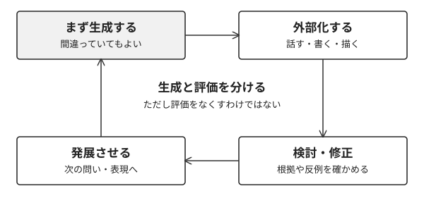

# ブレストという思想

**一つの思考法にとどまらず、思考・信念・意識を自在に扱うという試み。**

ブレインストーミングは、一般にはアイデアを生み出すための方法として知られている。しかし、私はこの言葉を、単なる発想技法よりも広い意味で捉えたい。思考の方法に囚われず、さらには信念や意識のあり方にも目を向け、頭の働きとの関係を自在なものにしていく思想としてである。

ここで述べる「ブレスト」は、既存の学術用語の新しい定義を主張するものではない。一般的なブレインストーミングを入口とし、そこから発展させた個人的な思想である。 ただし、入口となる脳や思考の枠組みが、この思想の行き先を限定するわけではない。

## 1. ブレストは方法ではなく、方法についての思想

通常のブレインストーミングでは、批判を控えながら多くのアイデアを出すことが重視される。一方、私が考えるブレストでは、特定の手続きを守ること自体が目的ではない。

たとえば、ラバーダッキングという方法がある。誰かに説明するつもりで自分の考えを言葉にすると、曖昧な点や矛盾が見えてくる。これは古典的なブレインストーミングそのものではないが、ブレストという思想のもとで自由に選べる方法の一つである。

そして、思考法を自由に選ぶという考え方は、思考法だけに限定する必要もない。信念や感情、注意、意識状態も、その射程に入る。

*図1　発想技法から、頭の働き全体に関わる思想へ。*

> ブレストとは、思考・信念・感情・意識状態など、頭の働きに関わるものに固定的に囚われず、それらを自在に扱うことを目指す思想と実践である。

ここでいう自在とは、あらゆる精神状態を意志で完全に制御できるという意味ではない。制御しようとすることも、手放すことも、必要に応じて選べるようにするという方向性である。

### 集団に限定されたブレスト観

日本語の辞書には、ブレインストーミングを集団的な発想法として説明するものが多い。デジタル大辞泉は「米国で開発された集団的思考の技術」[1]、精選版 日本国語大辞典は「創造的集団思考法」[2] と定義している。

一方、Merriam-Websterには次の定義もある。

> the mulling over of ideas by one or more individuals in an attempt to devise or find a solution to a problem [24]

（一人または複数の人が、問題の解決策を考案・発見するためにアイデアを考えること。）

Dictionary.comも「usually performed through group participation」[26]（通常は集団で行われる）と説明しており、集団に限定していない。

日英の辞書・事典・用語集34件 [1–34] を比較すると、次のような違いが見られる。

| 定義・説明の形式 | 日本語（15件） | 英語（19件） |
| --- | ---: | ---: |
| A：集団を前提とする | 14件（93.3%） | 10件（52.6%） |
| B：通常は集団とするが限定しない | 0件（0%） | 2件（10.5%） |
| C：個人での実践を明記 | 1件（6.7%） | 4件（21.1%） |
| D：人数を明示しない | 0件（0%） | 3件（15.8%） |

この比較では、日本語の資料の方が集団的な形式に偏っている。ただし、これは探索的な調査であり、日本社会全体の認識を示す統計ではない（調査方法は末尾を参照）。

集団で行うことがブレスト的ではないのではない。集団で行うことだけがブレストであると考え、それ以外の可能性を排除する姿勢こそがブレスト的ではない。

**ブレストについてもブレストする。ブレストそのものの定義にさえ囚われないことが、ブレストという思想の一部である。**

### ブレストの自己包括による自己言及性

ブレストの対象を限定しないのであれば、ブレストそのものもブレストの対象に含まれる。これは自己包括による自己言及である。「ブレストについてもブレストする」というのは、この構造を実践として表したものである。

この構造は、後述する信仰の信仰や全肯定にも共通している。

| 概念 | 自己包括の構造 |
| --- | --- |
| ブレスト | ブレスト自身もブレストの対象に含まれる。 |
| 信仰の信仰 | 信仰の信仰自身も信仰に含まれる。 |
| 全肯定 | 全肯定自身も肯定の対象に含まれる。 |

いずれも自身を適用対象の外側に置かないという点で、自己包括による自己言及性を持つ。ブレストという思想も例外ではなく、それ自体を再考し、変化させ、さらには手放すこともできる。

## 2. Stormに込める二つの意味

stormには、名詞としての「嵐」と、動詞としての「攻めかかる」という意味がある。私はこの二つを、ブレストの比喩として重ねて考える。

嵐のように、決まりきった順序や枠組みをゆるめ、自由に思考を動かす。同時に、何かを探ってみたいという意図を持ち、そこへ向かって思考を進める。

*図2　自由な探索と方向性。これは本稿独自の言葉の解釈であり、歴史的な語源の断定ではない。*

最初から明確な結論や目標がある必要はない。「何か面白いものが見つかるかもしれない」という探索でもいい。途中で目的が変わることもある。

## 3. 多様な方法を自在に使う

多くの方法を一度に使うことがブレストなのではない。大切なのは、方法の数よりも、方法に囚われないことである。

*図3　それぞれの技法は、ブレストの思想のもとで選択できる。*

紙に書くことも、頭の中だけで考えることも、対話することも、すべて実践になり得る。あるときはラバーダッキングが役立ち、別のときは図解やランダムインプットが役立つ。どの方法が適切かは、目的や状況によって異なる。

ただ考えるだけの行為と、ブレスト的実践との違いは、行為の外見だけでは決まらない。自分の思考のあり方に対してどのような態度を取るか、という点に違いを見いだす。

## 4. 不完全なものを生成する

古典的なブレインストーミングの「判断の延期」は、広い意味でのブレストにも活用できる。

正しいかどうかを最初から気にしすぎれば、何も書けなくなることがある。そこで、間違っていてもまず思考を外に出し、その後に検討し、必要な修正をする。

*図4　生成されたものを材料にして、次の思考へ進む。*

たとえば外国語の学習なら、知っている単語を並べて話し、修正を受けて話し直す。哲学なら、不完全な仮説を書き、矛盾や反例を調べて考えを発展させる。

これは間違いを真実とみなすことではない。**正しさを生成の前提条件にしない**ということである。正確さが必要な段階では、むしろ積極的に確かめる。

実践例：[ブレスト的な言語学習](../brainstorm-language-learning/guide.md)。

## 5. 思考法から信念へ ―― 信仰の信仰

思考法を自在に選べるという発想を、信念や世界観にまで広げることができる。

私が「信仰の信仰」と呼ぶのは、「すべては信仰である」という信仰である。この命題自身も例外ではない。それ自体を絶対的な真理とするのではなく、一つの信仰として捉える。

*図5　特定の世界観を唯一のものとせず、さまざまな見方を採用し得るという構想。*

これは何も信じないということではない。特定の信念の内容をあらかじめ決めないという意味で、空の器のようなものだ。ただし「すべては信仰である」という形式的な内容は持っている。

ここでの「信仰」は宗教的信仰だけでなく、自分が世界を捉える前提や見方も含む広い独自の用語である。科学的な証拠と根拠のない主張が同じ信頼性を持つ、という意味ではない。

## 6. 信仰の前駆体と全肯定

信仰の信仰は、あらゆる信仰体系に共通する必須の前提ではなく、さまざまな信仰へ移行し得る「前駆体」と考える方が近い。

ある世界観を本気で採用すれば、それまでのメタ的な視点が自分の中から消えてしまうことも想定できる。その視点を常に保持しなければならないとすれば、自在さにも一つの固定した条件がついてしまう。

そこで、再び信仰の信仰へ戻るための方法として、全肯定を位置づける。

*図6　特定の見方へ移行し、再び見方の可能性を開くという可逆的なモデル。*

全肯定とは、あらゆる見方があり得ることを受け入れ、その受け入れる態度自体も肯定の対象に含める実践である。たとえその思想への確信が失われても、方法の形式だけを覚えておき、もう一度実践することで確信を取り戻せるのではないかと考えている。

*図7　全肯定はそれ自身も対象に含む。ここから信仰の信仰への回帰を構想する。*

全肯定は、あらゆる信仰を同時に採用し続けることを求めるものではない。さまざまな信仰を肯定し得るからこそ、その中から特定の信仰を選び、あるいは手放すという選択的なあり方も可能になる。

信仰の信仰は、その構造上、必然的にメタ的な信仰である。「すべては信仰である」という信仰は、個々の信仰を対象とするだけでなく、それ自身も信仰として捉える。この自己言及的な構造によって、信仰の信仰そのものも絶対化されない。信仰の信仰を採用することも、採用しないことも、再びそこに戻ることも選択肢となる。

**信仰の信仰の柔軟さは、信仰を自在に選べることだけでなく、信仰の信仰そのものにも囚われる必要がないという点にある。**

### 信仰の信仰の自己言及性

「すべては信仰である」という命題の「すべて」には、その命題自体も含まれる。したがって、「すべては信仰である」という認識もまた、一つの信仰である。信仰の信仰は、他の信仰を外側から眺めるだけの立場ではなく、自分自身をも同じ対象の中に含める自己言及的な信仰である。

ここでの自己言及性は、信仰の信仰が自らの対象にも含まれるという自己包括によるものである。この構造は、ブレストや全肯定にも共通している。

この自己言及性は、「すべては信仰である」という命題を否定するものではない。むしろ、その命題自身にも同じ見方を適用することである。そのため、自分自身だけを例外として、信仰の外側にある絶対的な立場に置く必要がない。

全肯定によってさまざまな信仰への可能性を開き、その中から選択することができる。そして、その選択を可能にする信仰の信仰自体も、選択の対象に含まれる。信仰の信仰は、自らを手放す可能性をも内包するのである。

これは構造としての開放性であり、それを信じている人が実際に常に柔軟でいられることまで保証するものではない。

ただし、この自己言及的な構造が実際に確信を強めることや、どのような信念からでも戻れることは、まだ検証されていない。戻るきっかけをどう作るかという問題も残っている。また、全肯定は矛盾する命題を同時に事実と認めたり、有害な行動を容認したりすることとは区別する。

## 7. カオスマジックとの共通点と違い

信念を固定的なものとせず、状況に応じて世界観を用いるという点では、カオスマジック（混沌魔術）の信念に対する考え方と共通するところがある。

しかし、ブレストは魔術に限った体系ではない。文章を書く、言語を学ぶ、問題を解く、哲学を探求するといった、日常的な実践を広く含む。信念に関する実践はその一部分である。

| 観点 | ブレストという思想 | カオスマジックとの接点 |
| --- | --- | --- |
| 方法 | 思考や認知に関わる方法を自由に用いる | 信念や世界観を道具として扱う発想 |
| 射程 | 発想、学習、信念、意識状態など | 魔術的な実践と信念の取り扱い |
| 評価 | 目的に応じて成果や根拠を確かめる | 実践を重視する発想に共通点がある |

これは両者の概念的な比較であり、魔術の効果を実証するものでも、カオスマジック全体を厳密に分類するものでもない。

## 8. ブレストトランス密教との関係

ブレストは思想の名前であり、ブレストトランス密教は、その思想のうち特徴的な実践を前面に出した集団の名称として考えている。

ここでのトランスは英語の trance、つまり変性意識状態を指す。ブレストを行っているときに深い没入や恍惚を感じることがあるという個人的な経験から、思考と意識状態との関係も探求の対象にしている。

*図8　一般的なブレストを入口に、信念や意識のあり方も探求し得る。矢印は必須の修行順序ではない。*

顕教と密教という言葉を借りるなら、誰でも使える思考法を顕の側、実践を通じた主観的な実感を密の側として捉えることができる。ここでは仏教の顕密二教をそのまま採用するのではなく、説明できる知識と体験的な理解の違いを表す独自の比喩として用いている。

宗教的な枠組みを採用せず、一般的なブレストだけを実践しても構わない。トランス状態が必ず生じるわけでも、特別な能力が得られると証明されたわけでもない。体験は強制せず、心身の安全を優先する。

## 9. ブレストは実践の入口である

ブレストの入口には、脳を前提としたブレインストーミングという実践がある。頭を使って考え、言葉にし、さまざまな方法を用いながら、思考や信念、意識のあり方を自在にしていく。

しかし、脳を前提として始めるからといって、最後までその前提にとどまる必要はない。信仰の信仰においては、「脳がある」という認識も、ブレストという思想もまた、一つの信仰となり得る。

さらに、脳があるかないかという問いだけでなく、そもそも何かが「ある」「ない」と区別すること自体や、何かを扱う主体と扱われる対象という区別さえもなくなるようなあり方が考えられる。

*図9　脳を前提とする実践から、ブレストという枠組み自体にも囚われないあり方へ。これは固定された到達順序ではない。*

**ブレストは出発点であって、到達できる範囲を定めるものではない。** ブレストから始めながら、ブレストそのものを超えていくこともできる。

## 10. 自在と、その先にある自由

現実世界の中で考え、選び、さまざまなことを実践できる自由を、私は「自在」と呼びたい。そこには、行為する主体や、働きかける対象、何かを選択するという区別がある。

一方、そのような区別自体がなくなるような自由も考えられる。何かを自在に扱うということよりも、そもそも何かを扱う必要がないようなあり方である。私がここで考える悟りは、そのような自由に近い。

*図10　世界の中での自在と、自在という区別にもとどまらない自由。これは本稿独自の捉え方である。*

しかし、どちらかを最終的な境地として決めてしまう必要もない。現実世界で実践することも、そこから離れることも、あらかじめ一つの結論に固定される必要はない。

## 11. ブレストそのものにも囚われない

ブレストという思想は、さまざまな思考法を自在に活用するところから出発し、信念や意識状態にもその自在さを広げていく。

信仰の信仰においては、ブレストという思想自体も自在に扱うことができる。ブレストを採用してもいいし、ブレストであることにこだわらなくてもいい。

そして、信仰の信仰さえも最終的な答えとして固定する必要はない。その先に、現在の自分にはまだ想像できないあり方が存在する可能性もある。

> ブレストは実践の入口である。その入口からどこまで進むことができるのかを、ブレストという名前によって制限する必要はない。

ブレストという思想は、特定の結論へ導くための閉じた体系ではない。ブレストそのものを超える可能性をも含めて、開かれた思想でありたい。

---

本稿は、ブレインストーミング、信仰の信仰、全肯定、ブレストトランス密教についての対話を再構成したものである。確立した科学的知見と独自の哲学的仮説・主観的体験は区別している。カオスマジックや仏教との比較は概念的なものであり、個別の原典の検証を目的とした記事ではない。

## 辞書比較の調査方法

2026年11月28日、オンラインの辞書・事典・専門用語集における「ブレインストーミング」の説明を比較した。同一辞書の転載は重複集計せず、異なる辞書の見出し語は同一サイトに掲載されていても別々に数えた。無作為抽出ではなく、本文を確認できなかったWeblio等は対象外とした。複数の語義や詳細解説に個人での実践が明記される場合はCを優先した。Aは集団を中心とする説明であり、個人の実践を明示的に否定するものではない。

| 資料の種類 | 日本語（Aの割合） | 英語（Aの割合） |
| --- | ---: | ---: |
| 一般辞書・百科事典 | 6/6件（100%） | 6/10件（60%） |
| 専門辞書・用語集 | 8/9件（88.9%） | 4/9件（44.4%） |

日本語にも個人での実践を認める資料があり [15]、英語にも集団を前提とした説明がある。参考文献の番号に対応する分類は以下のとおりである。

- A：[1–14]、[16–22]、[28]、[31–32]
- B：[26–27]
- C：[15]、[24–25]、[29–30]
- D：[23]、[33–34]

専門辞書・用語集：[5]、[8–15]、[18]、[27–34]。その他は一般辞書・百科事典。

## 参考文献

以下のオンライン資料の閲覧日は、いずれも2026年11月28日。

### 日本語の資料

[1] デジタル大辞泉「[ブレーンストーミング](https://kotobank.jp/word/ぶれーんすとーみんぐ-3168207)」，コトバンク。

[2] 精選版 日本国語大辞典「[ブレーンストーミング](https://kotobank.jp/word/ぶれーんすとーみんぐ-3168207)」，コトバンク。

[3] 日本大百科全書（ニッポニカ）「[ブレーン・ストーミング](https://kotobank.jp/word/ぶれーんすとーみんぐ-3168207)」，コトバンク。

[4] ブリタニカ国際大百科事典 小項目事典「[ブレーンストーミング](https://kotobank.jp/word/ぶれーんすとーみんぐ-3168207)」，コトバンク。

[5] 流通用語辞典「[ブレーン・ストーミング](https://kotobank.jp/word/ぶれーんすとーみんぐ-3168207)」，コトバンク。

[6] 百科事典マイペディア「[ブレーンストーミング](https://kotobank.jp/word/ぶれーんすとーみんぐ-3168207)」，コトバンク。

[7] ウィクショナリー日本語版「[ブレインストーミング](https://ja.wiktionary.org/wiki/ブレインストーミング)」。

[8] IT用語辞典 e-Words「[ブレインストーミング](https://e-words.jp/w/ブレインストーミング.html)」。

[9] 三菱総合研究所 人材戦略コンパス「[ブレインストーミング](https://hr-compass.mri.co.jp/glossary/brainstorming-session/)」。

[10] セゾンパーソナルプラス 人材育成用語集「[ブレーンストーミング](https://corporate.saison-psp.co.jp/hrd/glossary/human_resources_training/gl263/)」。

[11] デジタルラーニング・コンソーシアム 用語集「[ブレーンストーミング](https://www.elc.or.jp/keyword/detail/id%3D146)」。

[12] NTT東日本 BizDrive 用語辞典「[ブレインストーミング](https://business.ntt-east.co.jp/content/bizdrive/word/brainstorming.html)」。

[13] 最新ビジネス用語辞典「[は行（ブレインストーミング）](https://www.bpb-jp.com/words/900/960/)」。

[14] サーブコープ ワークスペース用語集「[ブレスト（ブレインストーミング）](https://www.servcorp.co.jp/ja/workspace-glossary/brainstorming/)」。

[15] 日本ノハム協会 SDGs用語集「[ブレイン ストーミング](https://noharm.or.jp/news/glossary/ブレイン-ストーミング/)」。

### 英語の資料

[16] Oxford Advanced Learner’s Dictionary, “[brainstorming](https://www.oxfordlearnersdictionaries.com/us/definition/english/brainstorming)”.

[17] Cambridge Advanced Learner’s Dictionary & Thesaurus, “[brainstorming](https://dictionary.cambridge.org/us/dictionary/english/brainstorming)”.

[18] Cambridge Business English Dictionary, “[brainstorming](https://dictionary.cambridge.org/us/dictionary/english/brainstorming)”.

[19] Webster’s New World College Dictionary, “[brainstorming](https://www.collinsdictionary.com/dictionary/english/brainstorming)”.

[20] Random House（Collins掲載の米語辞典）, “[brainstorming](https://www.collinsdictionary.com/dictionary/english/brainstorming)”.

[21] Wiktionary（英語版）, “[brainstorming](https://en.wiktionary.org/wiki/brainstorming)”.

[22] Vocabulary.com Dictionary, “[brainstorming](https://www.vocabulary.com/dictionary/brainstorming)”.

[23] Collins English Dictionary, “[brainstorming](https://www.collinsdictionary.com/dictionary/english/brainstorming)”.

[24] Merriam-Webster, “[brainstorming](https://www.merriam-webster.com/dictionary/brainstorming)”.

[25] American Heritage Dictionary, “[brainstorming](https://www.ahdictionary.com/word/search.html?q=brainstorming)”.

[26] Dictionary.com（米語の定義）, “[brainstorming](https://www.dictionary.com/browse/brainstorming)”.

[27] APA Dictionary of Psychology, “[brainstorming](https://dictionary.apa.org/brainstorming)”.

[28] Monash Business School Marketing Dictionary, “[Brainstorming](https://www.monash.edu/business/marketing/marketing-dictionary/b/brainstorming)”.

[29] American Society for Quality（ASQ）Quality Glossary, “[Brainstorming（詳細解説を含む）](https://asq.org/quality-resources/brainstorming)”.

[30] Princeton University User Experience Office Glossary, “[Brainstorming](https://ux.princeton.edu/learn-ux/glossary2)”.

[31] U.S. Department of Education, LINCS Glossary, “[brainstorming](https://www.lincs.ed.gov/federal-initiatives/teal/guide/glossary)”.

[32] Kent State University, Lean Terminology, “[Brainstorming](https://www.kent.edu/lean/lean-terminology)”.

[33] University of Maryland Global Campus, Writing Center Glossary, “[brainstorming](https://www.umgc.edu/current-students/learning-resources/writing-center/online-guide-to-writing/tutorial/glossary/gloss)”.

[34] University of Kansas, Speak Out, Call In: Glossary of Terms, “[Brainstorming](https://opentext.ku.edu/speakoutcallin2/back-matter/glossary/)”.
