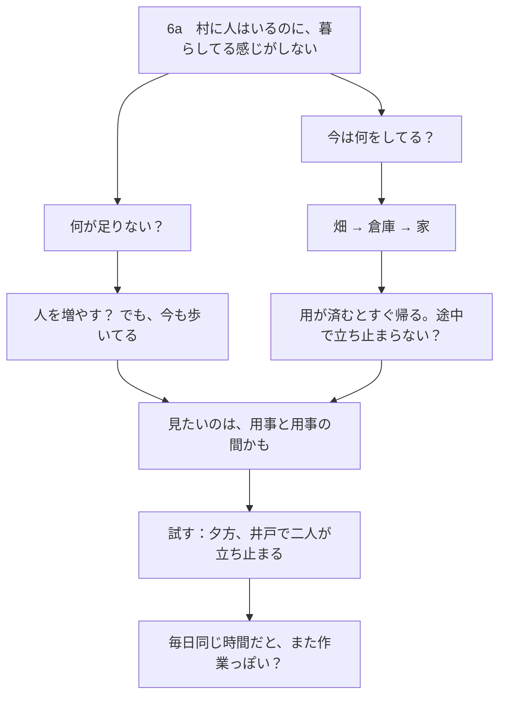
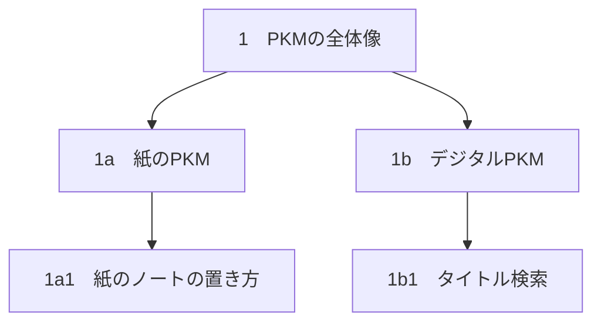
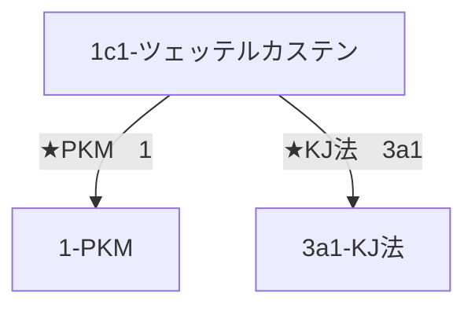
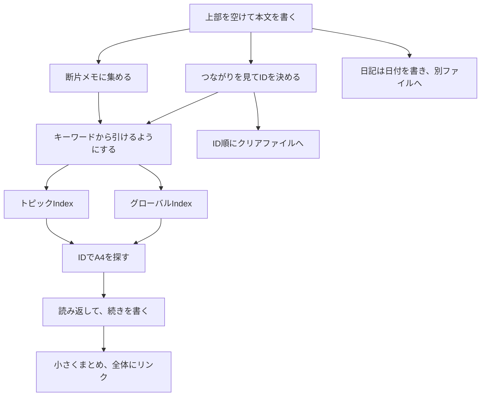

# 図でわかる 紙のPKM

[図解ガイド](https://yurii7812.github.io/homepage/ja/paper-pkm/) · [English](https://github.com/Yurii7812/homepage/blob/main/en/paper-pkm/guide.md)

ルーマンのツェッテルカステンを土台に、枝分かれする**フォルゲゼッテル（Folgezettel）ID**とノート同士のリンクを使う。A4に書いてからIDを付け、グローバルIndexで話題の入口を、トピックIndexでその話題の中身を探す。この二つの索引を組み合わせるのがダブルインデックス方式。

## この方式のメリット

- **A4は大学や図書館でも使いやすい。** 普段の筆記用具と一緒に持ち運べるので、A6カードの束を箱で持ち歩くより扱いやすい。広い紙面に、長い文章も図も書き込める。
- **普通のノートのように書ける。** 私は、一つの考えを一枚に収めるアトミックノートを使わない。考えが続くところまで書けるので、ブレインストーミングの途中で紙を分ける必要がない。走り書きも、考え途中の紙も、まとまった文章も、同じように保管する。
- **文脈と言葉のニュアンスが残る。** 考えを短い独立したノートに圧縮すると、前後のつながりや、言葉を選んだ理由まで抜け落ちることがある。ブレインストーミングの紙をそのまま残せば、あとから結論に至った流れを読み返せる。
- **長いノートの一部分だけを引用できる。** 気になる箇所に `(1)` と付けておけば、別のノートから `1a(1)` のように、その箇所を指せる。引用のために元の文章から切り出す手間が省ける。
- **ノートが増えても探しやすい。** グローバルIndexで全体から話題の入口を見つけ、トピックIndexでその話題の中をたどる。長いノートやブレインストーミングの紙が増えても、読み返したい内容に戻りやすい。

## 第1部　実際に使いながら覚える

### 1. A4の上を空けて、まず書く

A4を**縦向き**に置き、上に余白を残して本文から書き始める。**左上のIDはあとで決める。** 書いた内容と既存のノートのつながりが見えてから、位置を決めてIDを書く。

| 書く順番 | 左上 | 右上 |
|---|---|---|
| 書き始め | 空けておく | 日付のスペースを残す |
| 位置を決めたあと | IDを書く | 日付を書く。例 `2026 10 02` |

私は、**参照先のIDは赤、本文は青**のボールペンを使う。索引の参照先や、本文中の引用・続きのIDが見つけやすくなる。索引で複数のIDを並べるときは、間のカンマも赤で書く。トピックIndexへの入口を示す点も赤。赤も青も、**消えないボールペン**を使う。

右上に日付を書く。手書きなら **`2026 10 02`** のように、年・月・日を空白で区切る。日付印なら、**COLOP Mini Dater S 120の数字月タイプ（CLP120B2）**で年・月・日の順に押せる。 [輸入代理店の印字例](https://item.rakuten.co.jp/thewind/513526/)

### 2. 考えながら書いた紙も、そのまま入れる

下の図は、ゲームの村について**実際に考えながら書くと、こうなることもある**という一例。思いつきの箇条書き、書きかけの文章、図や線が混じった紙も、そのままノートにできる。

このときは「人を増やす？」と考えたあと、村人が普段何をしているかを横に書いた。それを見て「用事と用事の間かも」と思いつき、線でつないだ。書いたあと、既存の「村づくり」のノート `6` の枝としてこの紙に `6a` とIDを付け、疑問が残った状態のままPKMに入れた。

紙が増えたら、あとで思い出しそうな言葉から探せるようにする。全体から探す**グローバルIndex**と、話題の中で探す**トピックIndex**。この二つを使う方法を**ダブルインデックス**と呼ぶ。

### 3. 考えのつながりに合わせてIDを付ける

新しいノートが、**どのノートの話を深める・広げるか、もしくはどのノートに関連するか**で、置く場所を決める。

#### 続きのたびに枝を深くするとどうなるか（無限ID問題）

直前に書いたノートの続きというだけで毎回その下に置くと、`1 → 1a → 1a1 → 1a1a → 1a1a1 → …` とIDが際限なく長くなりやすい。話題が広がっていても、並びだけを見ると、すべてが直前のノートの細部を掘り下げたように見える。

**新しいノートがどの話を深めるか、広げるか、どの話と関連するか**を見て、枝を付ける。たとえば、`1a`「紙のPKM」の続きが紙の置き方を掘り下げるなら `1a1`。デジタルPKMの話なら `1`「PKMの全体像」を別方向に広げるので、`1a` と同じ段の `1b` に置く。紙の置き方 `1a1` をさらに具体化するなら、その下に `1a1a` を付けてよい。

読んでほしい順番があるなら、本文に `:1b` のように続きのリンクを書く。続きのリンクと、IDが表す枝分かれはそれぞれ決められる。

### 4. 引用元と続きの行き先を書く

あとから参照したい文章の**末尾**に `(1)` や `(2)` を書く。たとえば紙のPKMのノート `1a` に「紙は置き場所が手がかりになる。  (1)」。

| 場面 | 書き方 |
|---|---|
| 引用したい箇所の末尾 | `文章  (1)` |
| 同じノートで引用する | `(1):こういう感じ` |
| 別のノートの箇所を指す | `1a(1)` |
| 引用元を示す | `1a:` |
| 続きの行き先を示す | `:1a1` |

同じノート内でそこを受けて書くなら **`(1):こういう感じ`**。別のノートからその箇所を指すなら **`1a(1)`**。検索の比較ノート `1d` に書き足すなら `1a(1):デジタルの検索方法と比べてみる。` と書ける。

ノートを引用するときは **`ID:`**（例 `1a:`）。「続きはここ」と案内するときは **`:ID`**（例 `:1a1`）。コロンとIDは詰めて書く。参照先のIDは赤。

### 5. グローバルIndexで、全体から探す

A8の紙を**折り目が長辺と平行になる向き**に半分に折る。読む向きで**左側**に穴を開け、金属製の綴じリングなどに通す。

| キーワード | 読み | ID |
|---|---|---|
| 個人の知識管理 | こじんのちしきかんり | `1` |
| PKM | ぴーけーえむ | `1` |
| 村づくり | むらづくり | `6` |

小紙片一枚に一つのキーワードと、対応するIDを書く。「個人の知識管理」の紙片と「PKM」の紙片の両方に `1` を書いてもよい。紙片はキーワードの**読みのあいうえお順**に綴じる。

**パソコンで紙片の並び順を確認できる。** 表にキーワード・読み・IDを入力し、読みでソートする。表示された順に紙片をリングに通し直せば、あいうえお順に揃えやすい。

### 6. トピックIndexで、一つの話題の中から探す

PKMのノートが増えたら、別の縦向きA4の左上に **`1-PKM`** と書く。左右それぞれに、キーワードとIDだけを**横2列**で書き足す。列の見出しや区切り線は書かない。

**1-PKM**

|  |  |  |  |
|---|---|---|---|
| 紙のPKM | `1a` | ツェッテルカステン | `1c, 1c1` |
| 紙のノートの置き方 | `1a1` | ノートの枝分かれ | `1c2` |
| 筆記具 | `1a2` | 部分引用 | `1c3` |
| クリアファイル | `1a3` | 続きの案内 | `1c4` |
| 付箋 | `1a4` | 赤ペンで参照先を書く | `1c5` |
| ノートの保管 | `1a5` | まとめ | `1g` |
| デジタルPKM | `1b, 1b1` | ダブルインデックス | `1f` |
| タイトル検索 | `1b1` | グローバルIndex | `1f1` |
| 本文検索 | `1b2` | トピックIndex | `1f2` |
| 読みで並べる | `1b3` | 索引を増やす | `1f3` |
| 検索の比較 | `1d` | 進捗 | `1h` |
| 紙の取り込み | `1b4` | ★KJ法 | `3a1` |

たとえばグローバルIndexで「PKM」を探し、A4の `1-PKM` を開く。そこで「紙のPKM `1a`」を見つけたら、`1a` の本文を読む。村のブレインストーミングを探すなら、グローバルIndexの「村づくり `6`」から `6-村づくり` を開き、「村の暮らし `6a`」を引く。

#### どちらの索引に書くか

**上位の話題を思い出して探しそうなら、そのトピックIndexに書く。その言葉から直接探し始めそうなら、グローバルIndexにも入口を作る。**

一般件名は、「KJ法」のように、特定のトピックを開く前から探せる話題名。ローカルな見出しは、「赤ペンで参照先を書く」のように、いま開いているトピックの中で役に立つ。一般件名として通じる言葉でも、上位の話題から自然にたどれるなら、トピックIndexだけで足りる。

| あとで何を思い出すか | どこに何を書くか |
| --- | --- |
| 紙PKMで参照先は何色だったか | `1-PKM` に `赤ペンで参照先を書く 1c5` |
| 紙PKMで文章の一部をどう参照するか | `1-PKM` に `部分引用 1c3` |
| KJ法について以前に何を書いたか | グローバルIndexに `KJ法 3a1`。関係するトピックIndexからもたどれるようにする。 |

迷ったら、まず自然にたどれそうなトピックIndexに書く。後日、報告書を書きながら「部分引用」で探したくなったら、その時点でグローバルIndexにも足す。まだたどれるトピックIndexがなければ、あとで思い出せそうな言葉をグローバルIndexに一つ書いておく。

自分の中で「部分引用」と「文中の引用」の両方を使い、どちらからも直接探しそうなら、グローバルIndexには両方を載せてよい。トピックIndexでは基本的に一つの呼び方で書く。見出しが変わったら、古い言葉でも探しそうなら残し、使わなくなったら消してよい。

一枚に複数の話題があれば、関連するトピックIndexに同じノートIDを書ける。索引にはノートIDを書く。`(1)` などの部分指定は、本文から特定の箇所を参照するときに使う。

#### トピックIndexの中から、さらに小さなトピックへ

デジタルPKMのノートが増えたら、入口に選んだ `1b` と同じIDで `1b-デジタルPKM` を作れる。その中でタイトル検索がさらに広がったら、同じ手順で `1b1-タイトル検索` を作れる。

| 開いている索引 | 見る項目 | 次に開けるトピックIndex |
| --- | --- | --- |
| グローバルIndex | PKM `1` | `1-PKM` |
| `1-PKM` | デジタルPKM `1b, 1b1` | `1b-デジタルPKM` |
| `1b-デジタルPKM` | タイトル検索 `1b1` | `1b1-タイトル検索` |

この入れ子は、必要なところだけ何段でも作れる。上の索引からは話題の入口が見え、細かい項目はそれぞれの索引で探せる。

### 7. 点を打つのは、二つの条件がそろったとき

**一つのキーワードにIDが2つ以上あり、かつ、そのキーワードのトピックIndexを作ったときだけ**、索引を作ったIDの真上に赤い点を打つ。グローバルIndexの紙片でも、トピックIndexの一行でも同じ。**元のIDは消さず、そのまま残せる。** 点を一つ足せば、どのIDから話題全体を見渡せるトピックIndexへ進めるか分かる。

| 一つのキーワードに並ぶID | 作ったトピックIndex | 点 |
|---|---|---|
| PKM　`1` | `1-PKM` | なし（IDは一つ） |
| デジタルPKM　`1b, 1b1` | まだない | なし |
| デジタルPKM　`1b, 1b1` | `1b-デジタルPKM` | **`1b` の真上** |
| ツェッテルカステン　`1c, 1c1` | まだない | なし |
| ツェッテルカステン　`1c, 1c1` | `1c1-ツェッテルカステン` | **`1c1` の真上** |

グローバルIndexの紙片に「ツェッテルカステン `1c, 1c1`」と書いてあるとする。`1c1-ツェッテルカステン` を作ったら、**`1c1` の真上に赤い点を一つ足す。** 紙片の見出しも、元のIDの並び `1c, 1c1` もそのまま使える。概要を読みたければ `1c` の本文へ、この話題のノートをまとめて探したければ点の付いた `1c1` を手がかりに `1c1-ツェッテルカステン` へ進む。

キーワードにIDが一つなら、索引があっても点は付けない。IDが複数あっても、まだ索引を作っていなければ点は付けない。

#### 専用のトピックIndexを作って、続きを書く

同じ見出しのノートが2、3枚になり、いくつかの論点を一か所で見渡したくなったら、専用のトピックIndexを作る目安になる。枚数は目安なので、同じ行から探しやすいうちはそのままでよい。

**入口IDは、その話題をたどりやすいノートから選ぶ。** 関連するノートが多くつながっている、全体を体系的に説明している、並びの早い位置にあって手に取りやすい、といった点が目安。一つのIDに作るトピックIndexは一つ。

たとえば `1-PKM` の「部分引用」に `1c3, 1c6, 1c8` が並び、`1c6` が全体を整理したノートだとする。`1c6-部分引用` を作って、元の行の `1c6` の真上に赤い点を打つ。新しい索引にも、それまでの3枚すべてを載せる。

| 書く場所 | 実際に書く行 |
| --- | --- |
| 元の `1-PKM` | 部分引用　`1c3, 1c6, 1c8`（`1c6` の真上に赤い点） |
| 専用の `1c6-部分引用` | 最初のメモ　`1c3` |
|  | 部分引用の基本　`1c6` |
|  | 使ってみた例　`1c8` |
|  | 図の一部分を引用する方法　`1c9`（あとから追加） |

4枚目の `1c9` は、まず専用の索引に足せば、上位の `1-PKM` からもたどれる。報告書の話からも見つけたいなら、報告書のトピックIndexにも同じ `1c9` を書く。グローバルIndexへの追記も、その言葉から直接探すのに役立つときに行う。

#### 同じ話題の索引が散らばるのを防ぐ

**一つのIDに置くトピックIndexは一つ。** 同じIDに複数作ると、そのIDを見ても開く索引が決まらない。たとえば「PKM」と「個人の知識管理」は両方とも `1` を指し、同じ `1-PKM` を開く。ツェッテルカステンを独立した話題としてまとめるなら、その話題の入口 `1c1` に `1c1-ツェッテルカステン` を作る。

**同じ範囲の話題を扱う索引も一つにまとめる。** たとえば `1c1-ツェッテルカステン` があるのに、同じ範囲の索引を `1c` にも作ると、項目が二か所に分かれ、どちらを見れば全部そろうのか分かりにくくなる。新しく作る前に、グローバルIndexで別名を引き、関連するトピックIndexも確認する。同じ範囲の索引があればそこに追記し、別の話題からは `★` でその索引へ案内する。

### 8. 索引に用紙や関連トピックを足す

`1-PKM` が埋まったら、次のA4の左上に `1-PKM 2` と書いて追記する。末尾の2は用紙番号。入口のIDは引き続き `1`。

関連する別のトピックIndexへの案内は、行頭に**一筆書きの星印**を付ける。たとえば `1c1-ツェッテルカステン` に `★PKM 1` や `★KJ法 3a1` と書く。

同じノートを別々の索引に載せてもよい。「紙とデジタルの検索の比較」を `1d` に書いたら、`1-PKM` と `1b-デジタルPKM` の両方から引ける。

### 9. A4のクリアファイルにしまう

ノートとA4のトピックIndexは、**A4のクリアファイル**に入れる。いっぱいになったら別のクリアファイルを使う。

| 何に書くか | 書く番号 | 何のためか |
|---|---|---|
| クリアファイルの表 | ファイル番号 `1`、`2` | ファイルを順番に戻す |
| ノート上部の付箋 | そのノートのID `1`、`2` など | ノートの束からトピックの入口を見つける |

クリアファイルの表に、**マジックペンで `1`、`2`、…** と順番を書く。並べ直すためのファイル番号で、ノートのIDとは別。

クリアファイルの**表側が手前**。そこから `1`、`1a`、`1b`、`2`、`3` の順に重ねる。小さい数字の系列を手前に置き、その系列の枝を続けて入れる。

ノートが多いトピックの入口や、`1`、`2` のように数字だけのノートは、上のほうに**IDを書いた付箋**を貼ると探しやすい。

トピックIndexと同じIDの本文は、同じクリアファイルに続けて入れる。たとえば、手前に `1-PKM`、そのすぐ奥に本文の `1` を置く。索引に入口IDが一つだけで点がなくても、この並びで両方を見つけられる。

### 10. 日記は別のクリアファイルに入れる

日記は左上に**日付**を書く。本文ノートと同じ書式で、たとえば `2026 10 02`。この順で押せる日付スタンプも使える。何を書いてもよく、その日に書いたノートや、考えた結論を短く振り返っておくとあとで読み返しやすい。詳しい内容が本文ノートにあるときは、「詳しくは」に続けて**参照先のIDを赤で**書く。

| 用紙 | 左上の記入例 |
|---|---|
| その日の一枚目 | `2026 10 02` |
| 書き足した二枚目 | `2026 10 02 2` |

> **2026 10 02**
>
> 今日はトピックIndexの書き方をまとめた。詳しくは `1f2`。
>
> 短い話は断片メモに集めることにした。最初の一枚は `5`。

短い日でも、基本は**一日一ページ**。一枚に収まらない日は、次のページの左上に `2026 10 02 2` のように日付と続きの番号を書く。日記用のA4クリアファイルを、PKMのノートとは別に用意する。

### 11. 小さなまとめを、全体のまとめで使う

トピックIndexには「まとめ」という項目も置ける。たとえば「目標」の索引の「まとめ」は目標全体、「経済」の索引の「まとめ」は経済の目標を扱う。どちらも普通のノートとして書く。

| 開いているトピックIndex | その索引に書く項目 |
|---|---|
| `2-目標` | `経済 2a`、`神秘主義 2b`、`まとめ 2d` |
| `2a-経済` | `まとめ 2a1` |
| `2a1-まとめ`（経済） | `まとめ1 2a1a`、`まとめ2 2a1b` |
| `2d-まとめ`（目標全体） | `まとめ1 2d1`、`まとめ2 2d2` |

まず経済、神秘主義、最近の目標など、小さな範囲でそれぞれまとめる。全体のまとめには、各分野からいま押さえておきたいことを短く書き、詳しい内容は分野別まとめへのリンクでつなぐ。全体のまとめを更新するときも、各分野の詳しい内容を毎回書き写さずに済む。

「経済」のトピックIndex `2a` に書くまとめの入口は、**`まとめ 2a1` の一行**。版ごとの `まとめ1 2a1a` と `まとめ2 2a1b` は、一つ先の **`2a1` のトピックIndex** に並べる。リンク先の本文は、たとえば `まとめ-2026 10 01` と `まとめ-2026 10 02`。全体のまとめも同じで、「目標」の索引に `まとめ 2d`、`2d` のトピックIndexに各版を書く。

デジタルでは、「目標」のトピックIndexで「経済」を開き、そのノートの `BranchGroup/Group` から「まとめ」を開く。「まとめ」のノートにも `BranchGroup/Group` があり、そこに日付付きのまとめが並ぶ。紙では同じ道順を、索引に書いたIDでたどる。

### 12. 進捗も、分野別から一日の全体へ

「進捗」には、その日までにどこまで進んだかを書く。たとえば哲学の進捗ノートに「論証を二つ比較した」と書き、歴史の進捗には「年表を三つの時期に分けた」と書く。

| 範囲 | ノートの例 |
|---|---|
| 勉強全体 `4c1` | 今日の振り返りと、哲学 `4a1`・歴史 `4b1` へのリンク |
| 哲学 `4a1` | 論証を二つ比較した |
| 歴史 `4b1` | 年表を三つの時期に分けた |

勉強全体の進捗では、その日の短い振り返りを書き、哲学や歴史の進捗ノートのIDを添える。更新が増えたら、まとめと同じように「進捗」のトピックIndexで日付ごとのノートをたどれる。

進捗がたまったら、分野ごとのトピックIndexにも「進捗」の入口を作り、その先の索引に日付ごとのノートを足す。全体の進捗も同じ形で整理する。たとえば `4-勉強` から「哲学 `4a`」「歴史 `4b`」「進捗 `4c`」へ進める。哲学のトピックIndexでは「進捗 `4a1`」、歴史では「進捗 `4b1`」を引き、全体の `4c-進捗` にはその日の見渡し用のノート `4c1` を載せる。

### 13. 断片メモを一枚に集める

豆知識や、一言で収まる発見は、一枚のA4に上から書き足す。グローバルIndexには **「断片メモ」と最初の用紙に付けたID** を登録する。たとえば、最初の用紙のIDが `5` なら `断片メモ 5` と書く。

| 紙 | 使い方 |
|---|---|
| `5` | 短い話を上から追記する |
| `5a` | 5が埋まったら使う |
| `5b` | 5aが埋まったら使う |

この例では、一枚が埋まったら `5a`、その次は `5b`。一つの話にA4を一枚ずつ使わず、別々の短い話を続けて書ける。あとで一項目だけ引きたいときは、その箇所に `(1)` などを付けて `5(1)` と参照できる。

### 14. 全体の流れをおさらいする

普段は、書く、IDを決める、索引に入口を作る、しまう。読み返すときは索引や付箋から探す。考えが増えたときは、同じトピックのノートを小さくまとめ、必要なところからリンクする。

## 第2部　ルール早見表

ルーマンのツェッテルカステンを土台にした、紙のノートとダブルインデックスの使い方。

| 項目 | ルール |
|---|---|
| 本文ノート | 縦向きのA4。上部を空けて本文から書き、あとで左上にID。右上に日付。考えの途中の紙も入れる。 |
| ペン | 参照先のID、IDを区切るカンマ、索引を示す点は赤。本文や見出しは青。どちらも消えないボールペン。 |
| 引用と続き | 文章の末尾に `(1)` や `(2)`。同じノートなら `(1):こういう感じ`、別のノートなら `1a(1)`。引用は `ID:`、続きは `:ID`。 |
| グローバルIndex | キーワードで全体を引く。紙片は読みのあいうえお順。パソコンで順番を出しておくと、紙片を並べ替えやすい。 |
| 索引の使い分け | 上位の話題から探すならトピックIndex。その言葉で直接探し始めそうなら、グローバルIndexにも入口を作る。 |
| トピックIndex | 縦向きA4の左上に「ID-主題」。左右の2列にキーワードとIDを記入。見出しや線は省く。一つのキーワードに複数のIDを書ける。 |
| 点と★ | 赤い点は、同じキーワードにIDが2つ以上あり、そのキーワードのトピックIndexを作ったときだけ、そのIDの真上。★は関連する別のトピックIndexを指す行の先頭。 |
| 索引の作成 | 一つのIDにつき一つのトピックIndex。作る前にグローバルIndexと関係するトピックIndexを確認する。同じ範囲の索引があればそこに追記する。 |
| 用紙と保管 | 索引の続きは「1-PKM 2」など。クリアファイルの表に順番を記し、表側から 1、1a、1b、2、3。上部の付箋は数字だけのIDやノートが多いトピックの目印。 |
| 日記 | 別のクリアファイルに入れる。左上に日付、基本は一日一ページ。続きは日付の後ろに 2 など。参照先のノートIDは赤。 |
| まとめと進捗 | 小さなトピックで作り、全体には要点と分野別ノートへのリンクを書く。更新は日付付きノートとして索引からたどる。 |
| 断片メモ | グローバルIndexに「断片メモ」と最初の用紙のIDを登録する。短い話を一枚に追記し、埋まったら続きの用紙に書く。 |
