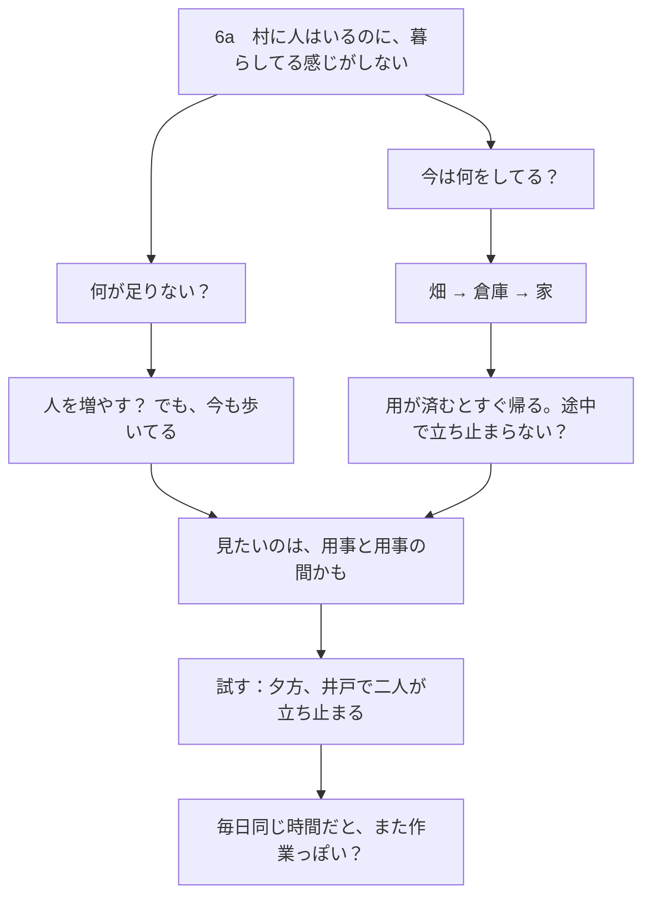
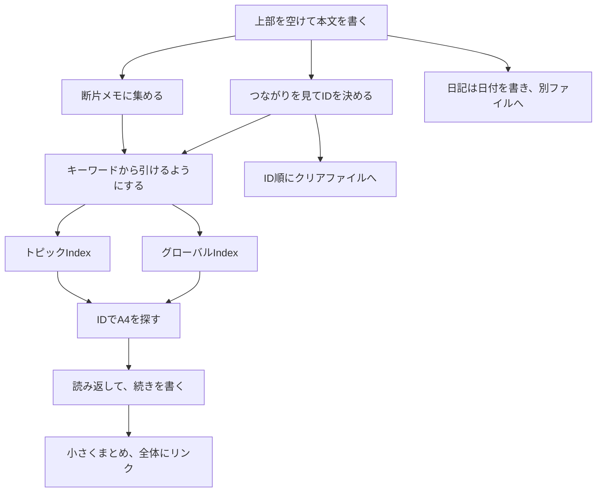

# 図でわかる 紙の知識管理術

[図解ガイド](https://yurii7812.github.io/homepage/ja/paper-pkm/) · [English](https://github.com/Yurii7812/homepage/blob/main/en/paper-pkm/guide.md)

ルーマンのツェッテルカステンを土台に、枝分かれする**フォルゲゼッテル（Folgezettel）ID**とノート同士のリンクを使う。A4に書いてからIDを付け、グローバルIndexで話題の入口を、トピックIndexでその話題の中身を探す。この二つの索引を組み合わせるのがダブルインデックス方式。

この方法では、先に分類を設計しない。ノートを自由に書いてから、必要になったところだけ適切な粒度のTopic Indexを作る。Topic Indexの名前は思考の出発点を示すもので、その後の展開を制限する分類名ではない。

## この方式のメリット

- **A4は大学や図書館でも使いやすい。** 普段の筆記用具と一緒に持ち運べるので、A6カードの束を箱で持ち歩くより扱いやすい。広い紙面に、長い文章も図も書き込める。
- **普通のノートのように書ける。** 私は、一つの考えを一枚に収めるアトミックノートを使わない。考えが続くところまで書けるので、ブレインストーミングの途中で紙を分ける必要がない。走り書きも、考え途中の紙も、まとまった文章も、同じように保管する。
- **文脈と言葉のニュアンスが残る。** 考えを短い独立したノートに圧縮すると、前後のつながりや、言葉を選んだ理由まで抜け落ちることがある。ブレインストーミングの紙をそのまま残せば、あとから結論に至った流れを読み返せる。
- **長いノートの一部分だけを引用できる。** 気になる箇所に `(1)` と付けておけば、別のノートから `7a(1)` のように、その箇所を指せる。引用のために元の文章から切り出す手間が省ける。
- **ノートが増えても探しやすい。** グローバルIndexで全体から話題の入口を見つけ、トピックIndexでその話題の中をたどる。長いノートやブレインストーミングの紙が増えても、読み返したい内容に戻りやすい。

## 第1部　実際に使いながら覚える

### 1. A4の上を空けて、まず書く

A4を**縦向き**に置き、上に余白を残して本文から書き始める。**左上のIDはあとで決める。** 書いた内容と既存のノートのつながりが見えてから、位置を決めてIDを書く。

| 書く順番 | 左上 | 右上 |
|---|---|---|
| 書き始め | 空けておく | 日付のスペースを残す |
| 位置を決めたあと | IDを書く | 日付を書く。例 `2026 10 02` |

私は、**本文と用紙自身のIDは青、参照の記号とIDは赤**のボールペンを使う。索引の参照先や、本文中の引用・続きのIDが見つけやすくなる。索引で複数のIDを並べるときは、間のカンマも赤で書く。トピックIndexへの入口を示す点も赤。赤も青も、**消えないボールペン**を使う。

右上に日付を書く。手書きなら **`2026 10 02`** のように、年・月・日を空白で区切る。日付印なら、**COLOP Mini Dater S 120の数字月タイプ（CLP120B2）**で年・月・日の順に押せる。 [輸入代理店の印字例](https://item.rakuten.co.jp/thewind/513526/)

### 2. 考えながら書いた紙も、そのまま入れる

下の図は、ゲームの村について**実際に考えながら書くと、こうなることもある**という一例。思いつきの箇条書き、書きかけの文章、図や線が混じった紙も、そのままノートにできる。



このときは「人を増やす？」と考えたあと、村人が普段何をしているかを横に書いた。それを見て「用事と用事の間かも」と思いつき、線でつないだ。書いたあと、既存の「村づくり」のノート `6` の枝としてこの紙に `6a` とIDを付け、疑問が残った状態のままPKMに入れた。

紙が増えたら、あとで思い出しそうな言葉から探せるようにする。全体から探す**グローバルIndex**と、話題の中で探す**トピックIndex**。この二つを使う方法を**ダブルインデックス**と呼ぶ。

### 3. 考えのつながりに合わせてIDを付ける

新しいノートが、既存のノートの話を**広げている、深めている、またはその話に関連している**ときは、そのノートから分岐させる。内容が似ているという理由でも枝を付けてよい。置き場所の候補がいくつかあるなら、一緒に読み返したときに関係が分かりやすい場所を選ぶ。

たとえば、A4に「同じ豆でも、淹れ方で味が変わる。豆の状態や道具も関係しそうだ」と書き、その紙に `1` を付けたとする。

そのあと「ハンドドリップとフレンチプレスでは、粉がお湯に触れる時間が違う」と書いた。`1` に書いた淹れ方の話を広げているので、このノートは `1a` に置く。さらに「ハンドドリップで一度に注ぐお湯の量を変えたら、味も変わるだろうか」と書いたら、`1a` の話を掘り下げているので、その下に `1a1` を置く。注ぐ量だけを変えて比べる手順まで書いたら、そのノートは `1a1` の下の `1a1a` に置ける。

今度はフレンチプレスで粉をお湯に浸す時間について書いた。これは `1a` の淹れ方の話を別の方法から広げているので、ハンドドリップの `1a1` と同じ段に `1a2` を置く。「同じ淹れ方でも、深煎りの豆は苦く感じた」と書いたノートは、`1` に書いた豆の話を掘り下げているので、`1a` と同じ段の `1b` に置く。あとで淹れ方や豆について書いたことを読み返し、気づいたことを一枚にまとめ始めたら、同じ `1` からつながる `1c` に置く。

「同じ淹れ方でも、焙煎の強いほうじ茶は苦く感じた」と書いたとする。焙煎の違いと苦味に気づいた点が、コーヒーについて書いた `1b` と似ている。そこで、関連するノートとして `1b` から枝を付け、`1b2` に置ける。

**フォルゲゼッテルの枝分かれ**

```text
1  同じ豆でも、淹れ方で味が変わる
      （コーヒーについて最初に書いたノート。この例の起点。）
├── 1a  ハンドドリップとフレンチプレスでは、粉がお湯に触れる時間が違う
│     （1で触れた、淹れ方による味の違いを広げる。）
│   ├── 1a1  一度に注ぐお湯の量で味が変わるか
│   │     （1aに出てくるハンドドリップを掘り下げる。）
│   │   └── 1a1a  一度に注ぐ量だけを変えて比べる
│   │         （1a1の疑問をどう確かめるかを書く。）
│   └── 1a2  フレンチプレスで粉をお湯に浸す時間
│         （1aに出てくるもう一つの淹れ方を掘り下げる。）
├── 1b  同じ淹れ方でも、深煎りの豆は苦く感じた
│     （1で触れた豆の話を掘り下げる。）
│   ├── 1b1  浅煎りと深煎りを同じ淹れ方で比べる
│   │     （1bで気づいた焙煎による違いを、条件をそろえて比べる。）
│   └── 1b2  焙煎の強いほうじ茶は苦く感じた
│         （ほうじ茶での観察が1bのコーヒーでの観察と似ている。）
└── 1c  淹れ方と豆について試したことのまとめ
      （1から書き広げた淹れ方と豆のノートをまとめる。）
    ├── 1c1  第1版の続き
    │     （1cで始めた第1版の2枚目。）
    │   └── 1c1a  1c1に書いたことの補足
    │         （1c1の内容を補う別紙なので、1c1の下に置く。）
    ├── 1c2  第1版の続き
    │     （第1版の3枚目。1c1の次に読む紙で、1cの下の同じ段に置く。）
    ├── 1c3  第1版の最後
    │     （第1版の4枚目。1c2に続けて、1cの下の同じ段に置く。）
    └── 1c4  第2版の最初
          （第2版は、1cの下で次に空いているIDから始める。）
```

各IDの右に本文の一部や要点を、その下にその位置を選んだ理由を示した。

**実際にしまう順番（手前 → 奥）**　`1 → 1a → 1a1 → 1a1a → 1a2 → 1b → 1b1 → 1b2 → 1c → 1c1 → 1c1a → 1c2 → 1c3 → 1c4 → 2 → 3`。

[A4の紙を重ねた保管順の図を見る](https://yurii7812.github.io/homepage/ja/paper-pkm/#filing-stack)。

#### 続きのたびに枝を深くするとどうなるか（無限ID問題）

直前に書いたノートの続きというだけで毎回その下に置くと、IDが際限なく長くなりやすい。話題が広がっていても、並びだけを見ると、すべてが直前のノートの細部を掘り下げたように見える。

**続きのたびに一段深くした場合**

```text
1
└── 1a
    └── 1a1
        └── 1a1a
            └── 1a1a1
                └── …
```

一つ前のノートの下に置き続けると、枝が横に並ばず、IDが一段ずつ長くなる。

読んでほしい順番があるなら、本文に `:1b` のように続きのリンクを書く。続きのリンクと、IDが表す枝分かれはそれぞれ決められる。

#### 読書ノートと自由な考察は、同じように広げなくてもよい

本Aを読みながら書いた `1, 1a, 1b, 1c…` は、基本的に本Aについての読書ノートとして続ける。本Bを読み始めたら、`2, 2a, 2b…` という新しい系列にする。本Aの内容を理解するために心理学と比較することはできるが、心理学自体の研究が中心になれば、別の独立IDで始め、元のノートから参照する。

```text
1  本A（仏教）の読書ノート
├─ 1a  本Aの無我の説明
├─ 1b  心理学との比較（本Aを理解するため）
└─ 1c  本Aについての暫定的なまとめ

2  本B（別の仏教書）の読書ノート
├─ 2a  本Bの無我の説明
└─ 2b  本Aと本Bの比較

3  心理学自体についての独立した考察
```

**関連しているからといって、必ず同じ系列に入れる必要はない。** 一方、考えが飛んだり、途中のまとめの後に新しい議論が始まったりしても、それは欠陥ではない。思考の枝や「穴ぼこ」はそのまま残してよい。まとめは書いた時点のまとめであり、最終結論ではない。後で探せるように、必要な参照だけ付ける。

### 4. 引用元と続きの行き先を書く

あとから参照したい文章の**末尾**に `(1)` や `(2)` を書く。たとえば紙のPKMのノート `7a` に「紙は置き場所が手がかりになる。  (1)」。

| 場面 | 書き方 |
|---|---|
| 引用したい箇所の末尾 | `文章  (1)` |
| 同じノートで引用する | `(1):こういう感じ` |
| 別のノートの箇所を指す | `7a(1)` |
| 引用元を示す | `7a:` |
| 続きの行き先を示す | `:7a1` |

同じノート内でそこを受けて書くなら **`(1):こういう感じ`**。別のノートからその箇所を指すなら **`7a(1)`**。検索の比較ノート `7d` に書き足すなら `7a(1):デジタルの検索方法と比べてみる。` と書ける。

ノートを引用するときは **`ID:`**（例 `7a:`）。「続きはここ」と案内するときは **`:ID`**（例 `:7a1`）。コロンとIDは詰めて書く。引用・続きの記号は、括弧・番号・コロンを含めて赤。ノート自身のIDは用紙の左上に青で書く。

[赤と青で書いたA4ノートの見本を見る](https://yurii7812.github.io/homepage/ja/paper-pkm/#reference-ink)。

### 5. グローバルIndexで、全体から探す

A8の紙を**折り目が長辺と平行になる向き**に半分に折る。読む向きで**左側**に穴を開け、金属製の綴じリングなどに通す。

| キーワード | 読み | ID |
|---|---|---|
| コーヒー | こーひー | `1` |
| 個人の知識管理 | こじんのちしきかんり | `7` |
| PKM | ぴーけーえむ | `7` |
| 村づくり | むらづくり | `6` |

小紙片一枚に一つのキーワードと、対応するIDを書く。「個人の知識管理」の紙片と「PKM」の紙片の両方に `7` を書いてもよい。紙片はキーワードの**読みのあいうえお順**に綴じる。

**パソコンで紙片の並び順を確認できる。** 表にキーワード・読み・IDを入力し、読みでソートする。表示された順に紙片をリングに通し直せば、あいうえお順に揃えやすい。

### 6. Topic Indexは、書いてから必要な粒度で作る

Topic Indexは、本文ノートとは**独立した番号**を使う。例えば `0-1`、`0-2`、`0-3`。通常ノートの `1` や `1a` と、Topic Indexの番号を混同しない。

**最初からトピック名や分類階層を決めない。** 読書、プロジェクト、自由な思考などをまず書き進め、ノートがある程度蓄積してから、実際に使いやすい粒度でTopic Indexを作る。話が大きく広がっても、最初に書いたノートの内容を無理に移し替える必要はない。

例えば `1` から「今の自分について」という考察を始め、`1a` に価値観、`1b` に人間関係、`1c` に食生活、`1d` に将来について書いたとする。全体をたどる入口が必要になった時点で、`0-1 — 今の自分について考え始めた記録` を作れる。

| Topic Index | 名前（出発点） | 主な参照先 |
|---|---|---|
| `0-1` | 今の自分について考え始めた記録 | `1, 1a, 1b, 1c, 1d` |
| `0-2` | 価値観についての考察 | `1a, 1a1, 1a2` |
| `0-3` | 無我についての読書・比較 | `1a, 2a, 2b` |

これは最初から3枚用意するという意味ではない。**最初は1枚でも0枚でもよい。** 後から必要になったときだけ追加する。あるノートが複数の索引から参照されてもかまわない。

#### 名前は分類の境界ではなく出発点

`0-1` の「今の自分」は、その中に書かれたすべての話題を定義する分類名ではない。途中で心理学や経済の話へ広がってもよい。索引は思考がどこから始まったかを示し、実際の項目で必要なノートに案内する。

「宗教」の下に必ず「仏教」を作る、という階層は不要。仏教についてのノートがあっても、`宗教` という上位Topic Indexが必要になるとは限らない。索引の粒度は、**実際にたどりたいノートに近く、広すぎず細かすぎない範囲**にする。


### 7. 一つのノートIDから作るTopic Indexは最大一つ

`1` から始まる考察に対応するTopic Indexが必要なら、例えば `0-1` を作る。`1a` の考察が独自に広がって見渡しにくくなったら、`1a` に対応する別のTopic Index `0-2` を作ってよい。

**一つのノートIDにつきTopic Indexは0個または1個。** ただし、これは`1` の系列全体に1枚しか作れないという意味ではない。`1a` や `1a1` にも、必要ならそれぞれ1枚作れる。異なる観点で索引を作るためだけに、同じノートIDへ複数のTopic Indexを割り当てない。

| ノートの出発点 | 対応するTopic Index | 状態 |
|---|---|---|
| `1` 今の自分について | `0-1` | 必要になったので作成 |
| `1a` 自分の価値観 | `0-2` | 考察が増えたので作成 |
| `1b` 人間関係 | なし | まだ必要ない |
| `2` 本Bの読書ノート | なし | ノートの流れだけで十分 |

#### Global Indexと赤い点

Global Indexはキーワードから本文ノートやTopic Indexへアクセスするための索引。例えば「今の自分 → `1`、関連Topic Index → `0-1`」と書ける。`1` に対応するTopic Indexがあることを示したければ、`1` の真上に赤い点を打ち、行内に対応先の `0-1` を明記する。

**点の有無を「キーワードにIDが二つ以上あるか」で決めない。** 点は対応するTopic Indexが存在することの目印であり、Topic IndexのIDそのものは `0-1` のように明記する。索引が存在しないときは点を付けない。


### 8. Topic Indexを増やし、関連する索引へつなぐ

Topic Indexは縦向きのA4用紙。左上に独立番号と出発点を記し、本文にはキーワードと参照先のノートIDを並べる。例えば `0-1 — 今の自分` の中に、`価値観 1a`、`生活習慣 1c`、`現時点のまとめ 1e` と記入する。二列に分けるのは自由で、項目を増やすために用紙を継ぎ足してもよい。

`0-1` が埋まったら、次の用紙は `0-1 2` とする。末尾の `2` はページ番号で、新しいTopic Indexではない。

別のTopic Indexへの参照には `★` を使う。例えば `★価値観 → 0-2` と書けばよい。上位概念を参照したいときは `↑` を使えるが、**「宗教→仏教→無我」という分類階層を先に作る必要はない**。上位のTopic Indexは、実際に使うようになってから作る。

| 記号 | 意味 |
|---|---|
| `↑` | 必要になった上位のTopic Indexへの参照 |
| `★` | 関連する別のTopic Indexへの参照 |
| `＝` | まとめ・現状整理のノートへの参照 |
| 記号なし | 通常ノートの参照 |

Topic Indexの置き場所は、通常ノートのFolgezettel系列とは分けて管理する。紙のクリアファイルでは `0-1`、`0-2`…をまとめておくと見つけやすい。


### 9. A4のクリアファイルにしまう

ノートとA4のトピックIndexは、**A4のクリアファイル**に入れる。いっぱいになったら別のクリアファイルを使う。

[A4の紙を重ねた図を見る](https://yurii7812.github.io/homepage/ja/paper-pkm/#filing-stack).

| 何に書くか | 書く番号 | 何のためか |
|---|---|---|
| クリアファイルの表 | ファイル番号 `1`、`2` | ファイルを順番に戻す |
| ノート上部の付箋 | そのノートのID `1`、`2` など | ノートの束からトピックの入口を見つける |

クリアファイルの表に、**マジックペンで `1`、`2`、…** と順番を書く。並べ直すためのファイル番号で、ノートのIDとは別。

クリアファイルの**表側が手前**。そこから `1`、`1a`、`1a1`、`1a1a`、`1a2`、…の順に重ねる。小さい数字の系列を手前に置き、その系列の枝を続けて入れる。

ノートが多いトピックの入口や、`1`、`2` のように数字だけのノートは、上のほうに**IDを書いた付箋**を貼ると探しやすい。

Topic IndexのIDは本文ノートと独立しているため、`0-1`、`0-2`…の索引用紙は別のまとまりで保管する。本文ノート`1`とTopic Index`0-1`を、同じIDの紙として重ねる必要はない。

### 10. 日記は別のクリアファイルに入れる

日記は左上に**日付**を書く。本文ノートと同じ書式で、たとえば `2026 10 02`。この順で押せる日付スタンプも使える。何を書いてもよく、その日に書いたノートや、考えた結論を短く振り返っておくとあとで読み返しやすい。詳しい内容が本文ノートにあるときは、「詳しくは」に続けて**参照先のIDを赤で**書く。

| 用紙 | 左上の記入例 |
|---|---|
| その日の一枚目 | `2026 10 02` |
| 書き足した二枚目 | `2026 10 02 2` |

> **2026 10 02**
>
> 今日はトピックIndexの書き方をまとめた。詳しくは `7f2`。
>
> 短い話は断片メモに集めることにした。最初の一枚は `5`。

短い日でも、基本は**一日一ページ**。一枚に収まらない日は、次のページの左上に `2026 10 02 2` のように日付と続きの番号を書く。日記用のA4クリアファイルを、PKMのノートとは別に用意する。

### 11. まとめは途中の記録でよい

`1` から自由な考察を始めて、`1a`〜`1e` と広がったあと、`1f` に一度まとめを書く。その後 `1g` で最初の問いについて考え直しても問題ない。**`1f` はその時点のまとめ**であり、以後のノートをすべて取り込む最終版ではない。

```text
1    今の自分について考え始める
1a   価値観
1b   人間関係
1c   食生活
1d   将来
1e   今の問題
1f   2026-11-12時点のまとめ
1g   後日、最初の問いを考え直す
1h   新しい気づき
```

途中の話題が飛んでも、まとめの後に考察が続いても、**ノートを穴ぼこのない完成品に整える必要はない**。日付や参照先を残すことで、いつ何を考えたかを振り返れる。

後から新しいまとめを書きたければ、次に適切な空きIDへ書く。版ごとに見つける必要ができたら、その時点で既存のTopic Indexに「まとめ 1f」「次のまとめ …」を加える。まとめのためだけにTopic Indexを新設する義務はない。


### 12. 日付別の振り返りも普通のノートとして書く

例えば `1e` を「自分の状態を定期的に振り返る」という考察の出発点にして、`1e1`、`1e2`…へ日付ごとの振り返りをつないでもよい。日付は各用紙の右上に記録する。別の日の考察が前の振り返りを直接深めるなら、そのIDからさらに分岐させてもよい。

| ID | 記録 |
|---|---|
| `1e` | 自分の状態を振り返り始める |
| `1e1` | 11月12日時点の考察 |
| `1e2` | 11月20日時点の考察 |
| `1e2a` | 11月20日の気づきを掘り下げる |

`1e` の系列をそのままたどれるならTopic Indexは不要。振り返りが増えて一覧しにくくなってから、`1e` に対応するTopic Indexを1枚作ればよい。

この日付付きの振り返りは、日記とは別。日記は日付そのものを用紙の左上に書き、専用のクリアファイルに保管する。


### 13. 断片メモを一枚に集める

豆知識や、一言で収まる発見は、一枚のA4に上から書き足す。グローバルIndexには **「断片メモ」と最初の用紙に付けたID** を登録する。たとえば、最初の用紙のIDが `5` なら `断片メモ 5` と書く。

| 紙 | 使い方 |
|---|---|
| `5` | 短い話を上から追記する |
| `5a` | 5が埋まったら使う |
| `5b` | 5aが埋まったら使う |

この例では、一枚が埋まったら `5a`、その次は `5b`。一つの話にA4を一枚ずつ使わず、別々の短い話を続けて書ける。あとで一項目だけ引きたいときは、その箇所に `(1)` などを付けて `5(1)` と参照できる。

### 14. 全体の流れをおさらいする

普段は、書く、IDを決める、索引に入口を作る、しまう。読み返すときは索引や付箋から探す。考えが増えたときは、同じトピックのノートを小さくまとめ、必要なところからリンクする。



## 第2部　ルール早見表

紙のノートとダブルインデックスの運用ルール。

| 項目 | ルール |
|---|---|
| 本文ノート | A4縦。まず自由に書き、書いた後でIDを付ける。右上に日付。思考の途中の紙も残す。 |
| Folgezettel | 考察を深めたり広げたりするときに分岐する。関連するだけで全てを同じ系列に押し込まない。続きの順番は参照で示せる。 |
| 読書ノート | 本Aは1、1a、1b…、本Bは2、2a、2b…など別の系列にする。比較は自由だが、別主題の継続的な研究は独立IDへ。 |
| 思考とまとめ | 穴ぼこや寄り道を認める。途中のまとめはその時点の記録。後から別の考察を続けてよい。 |
| Topic Indexの番号 | 本文ノートと独立した0-1、0-2、0-3…を使う。 |
| Topic Indexの数 | 一つの本文ノートIDに対し0個または1個。1にも1aにも、それぞれ必要に応じて作れる。 |
| 作成時期と粒度 | 事前設計せず、ノートが蓄積してから、探したい内容に近く、広すぎない適切な粒度で作る。 |
| 名前の役割 | 分類境界ではなく思考の出発点。名前が後の内容を制限しない。 |
| グローバルIndex | 小紙片のキーワードからノートやTopic Indexへ。見出しはあいうえお順。 |
| 赤い点と参照 | 赤い点はそのノートIDに対応するTopic Indexの存在を示す。独立番号0-1等も併記する。★は関連索引、↑は必要になった上位索引、＝はまとめ。 |
| 引用と続き | (1)、7a(1)、ID:、:IDで参照。参照先や記号は赤、用紙自身のIDと本文は青。 |
| 保管と日記 | 通常ノートはFolgezettel順、Topic Indexは0-1から独立管理。日記は日付を左上に書いて別ファイル。 |
| 振り返り | 日付付きのまとめや進捗も通常ノートで書く。必要になってからTopic Indexを設ける。 |
| 断片メモ | 短い話を一枚にまとめて書き、埋まったら続きの紙へ。 |

## 実際に運用するときの考え方

**ノートを書いてから索引を作る。** これがこの方式の基本。自由な思考は最初から整理しない。読書ノートなら本Aは `1,1a,1b…`、本Bは `2,2a,2b…` と別々に展開し、どちらからも「無我」などのTopic Indexを後から作れる。

```text
本文ノート（思考の記録）          Topic Index（あとから作る入口）

1  今の自分について              0-1  今の自分から始めた考察
├─ 1a  価値観                →   価値観 1a
│  ├─ 1a1                    →   生活習慣 1c
│  └─ 1a2                    →   現在のまとめ 1f
├─ 1b  人間関係
├─ 1c  生活習慣                 0-2  価値観について
├─ 1f  一度まとめる         →   価値観 1a
└─ 1g  また考え始める       →   考えの変化 1a2
```

`0-1` や `0-2` は本文ノートのIDではない。**各出発点のIDに対応するTopic Indexは最大1枚でよく、作らないままでもよい。** 名称はその時点の出発点を示すだけで、内容の境界を決めるものではない。複数の観点から同じノートを探したいときは、索引内の項目や相互参照を使う。

最初から「宗教」「仏教」「心理学」といった体系を完成させる必要はない。ノートが蓄積してから、実際の内容に近い適切な粒度で必要な索引だけ作る。思考の飛躍、穴ぼこ、暫定的なまとめは消さず、後からたどれるようにする。
