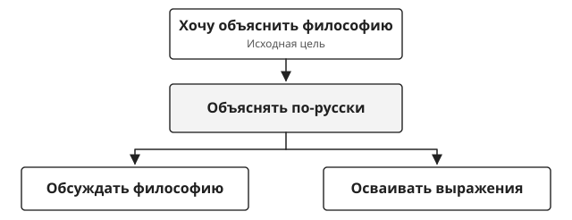
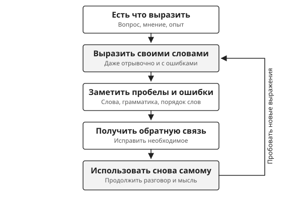
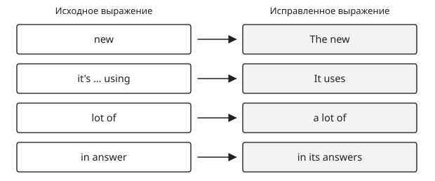
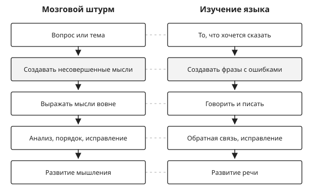
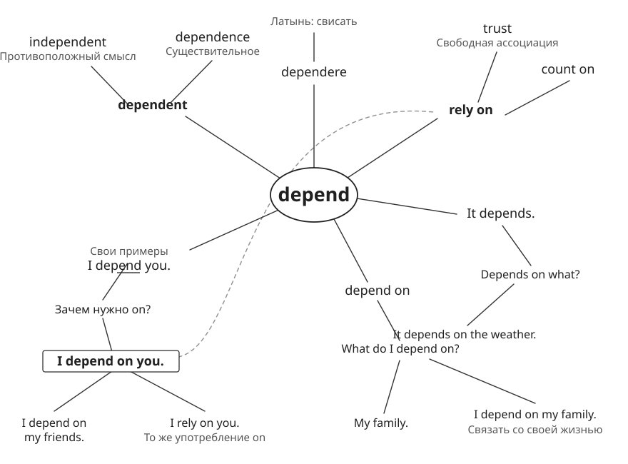

# Изучение языков методом брейнсторма

Сначала пользуйся языком, даже если ошибаешься.

Когда мы хотим что-то сказать на иностранном языке, мы иногда колеблемся: не знаем грамматику, не можем вспомнить слово или боимся ошибиться. Однако необязательно ждать, пока научишься говорить правильно, чтобы начать говорить.

Сначала попробуй выразить мысль с помощью знакомых слов, пусть даже несовершенно. Попроси другого человека или ИИ исправить выражение, а затем используй его самостоятельно ещё раз. Повторяя этот процесс, можно изучать язык непосредственно в ходе его использования.

Я хочу рассмотреть этот метод как **«изучение языков методом брейнсторма»** — применение философии мозгового штурма к обучению.

## 1. Разговор о философии превратился в практику русского языка

Однажды я объяснял маме философию. Ей было трудно понять объяснение на японском, поэтому я начал вставлять русские слова, а затем постепенно перешёл преимущественно на русский язык.

Сначала я говорил отрывочными фразами. Составлял их из знакомых слов, спрашивал маму о незнакомых выражениях, иногда пользовался японским. Получив исправление, я снова объяснял мысль с помощью исправленного выражения, а потом продолжал разговор.

После примерно трёх часов такого общения мне показалось, что способность выражать мысли по-русски значительно улучшилась. Я не ставил перед собой цель изучать русский. Мне хотелось рассказать о философии, и для этого я пользовался языком.

*Рис. 01. Желание что-то выразить может стать стимулом к обучению, даже если изучение языка не является основной целью.*

## 2. Самостоятельно создавать, исправлять и снова использовать

Главное в этом методе — не сразу получить правильный ответ, а сначала самостоятельно выразить мысль. Именно попытка составить предложение позволяет конкретно понять, чего не знаешь и где ошибся.

*Рис. 02. Важно не ограничиваться получением исправления, а самостоятельно использовать исправленное выражение.*

Если необходимое слово неизвестно, можно спросить его прямо в разговоре. Допустимо пользоваться родным языком. Обратная связь — материал для продолжения разговора, а не повод полностью его останавливать.

## 3. Пример практики с ИИ

Предположим, хочется сказать по-английски: «Новый ChatGPT хорош. В его ответах много визуализаций». Сначала составим предложение самостоятельно из знакомых английских слов.

**Самостоятельно составленный английский текст**

new chatgpt sol 6.2 is nice  
it's in answer using lot of visualisation

**Исправление с сохранением исходных выражений**

**The** new ChatGPT Sol 6.2 is nice.  
It **uses a** lot of **visualisations in its answers**.

*Рис. 03. Исправляются артикль, форма глагола, порядок слов и т. д. Слово visualisation здесь также ставится во множественное число.*

Если поручить ИИ с нуля написать беглый и сложный английский текст, можно получить качественный результат. Но это отличается от нашей учебной цели. Сохранение исходной лексики и выражений позволяет сравнить варианты и понять, где была допущена ошибка и как её нужно исправить.

**Цель — не получить правильный английский текст, а научиться самостоятельно создавать правильный английский текст.** Конечно, если исходное выражение не передаёт смысла, следует освоить необходимый другой способ его выражения.

## 4. Общее с мозговым штурмом

В классическом мозговом штурме существует принцип отсрочки оценки. На этапе выдвижения идей мы временно воздерживаемся от строгой оценки их правильности и осуществимости, свободно создавая их. Анализ и оценка следуют позже.

Этот принцип применим и к изучению языков. Вместо того чтобы прекращать говорить из-за возможной грамматической ошибки, сначала выражаем мысль, а затем исправляем её.

*Рис. 04. Ни в том, ни в другом случае правильность и завершённость не являются предварительными условиями создания.*

Это не означает безусловного одобрения ошибок или пренебрежения точностью. Смысл в том, чтобы не препятствовать самому созданию высказывания из-за возможной ошибки.

Классический мозговой штурм — прежде всего метод генерации идей, а не название данного метода изучения языков. Однако как применение его основной философии к обучению эту практику можно назвать изучением языков методом брейнсторма.

## 5. Связь с исследованиями усвоения языка

У этой практики есть общие черты с несколькими концепциями исследований усвоения второго языка.

| Теория или концепция | Связь с методом |
| --- | --- |
| Гипотеза языкового выхода (output hypothesis) | Речь и письмо позволяют замечать пробелы в знаниях и проверять собственные выражения. |
| Гипотеза замечания (noticing hypothesis) | Внимание направляется на различия между собственным выражением и полученным исправлением. |
| Гипотеза взаимодействия | В разговоре уточняется смысл и корректируются выражения. |
| Корректирующая обратная связь | Исправления помогают осознать ошибки и пересмотреть выражения. |
| Процедурализация | Через практику знания о языке превращаются в навыки его использования. |

Однако речь идёт о теоретическом сходстве, а не о прямом доказательстве эффективности всего метода. Ощущение прогресса за три часа могло быть связано не только с приобретением новых знаний, но и с активизацией уже имеющихся знаний русского языка. Важно проверять, удаётся ли использовать выражения в последующие дни, и регулярно повторять практику.

## 6. Объединить интеллектуальный поиск и изучение языка

Размышлять о философии, вести дневник, обсуждать прочитанное, дискутировать или заниматься мозговым штурмом. Попробуй делать то, чем обычно занимаешься, на языке, который хочешь изучать.

*Рис. 05. Язык одновременно является предметом изучения и инструментом мышления и интеллектуального поиска.*

Даже не выделяя отдельного времени исключительно на изучение языка, можно превращать саму интеллектуальную деятельность в возможность для практики. Однако это не делает систематическое изучение произношения, грамматики и лексики ненужным. При необходимости сочетай разные подходы.

## 7. Связывать языковые знания посредством ассоциаций

Не только запоминай слова и выражения по отдельности, но и бери одно слово за отправную точку, свободно записывая связанные с ним слова, этимологию, производные слова, синонимы, антонимы, близкие понятия и примеры предложений. На бумаге или холсте можно соединять связанные элементы линиями.

Например, от английского слова depend перейдём по ассоциации к dependent, independent и rely on и составим собственные предложения.

- I depend you. (Самостоятельно составленный ошибочный пример)
  - Почему это выражение неверно?
  - I depend on you. (Исправленный пример)
    - I depend on my friends.
    - It depends on the weather.
  - Какие другие выражения используют on таким же образом?
    - I rely on you.

Если пример оказался ошибочным, не ограничивайся записью правильного предложения. Запиши, почему возникла ошибка, какие выражения и грамматика здесь используются, и другие примеры того же употребления. Пусть вопросы, возникшие из ошибок, ведут к дальнейшему обучению.

*Рис. 06. Запиши слово в центре и соедини линиями ассоциации, этимологию, связанные слова, примеры и причины ошибок. Вопросы можно писать по-японски, а по мере освоения языка формулировать вопросы и развивать ассоциации по-английски.*

Свободно развивай обучение по возникающим ассоциациям и вопросам: от слова к примеру, от примера к грамматике, от грамматики к другим выражениям.

## 8. Об использовании родного языка

При обучении можно пользоваться своим родным языком, например японским. Если на изучаемом языке пока не получается выразить вопрос или мысль, родной язык помогает продолжать обучение, не прерывая размышления и ассоциации.

Однако по мере продвижения желательно постепенно уменьшать зависимость от родного языка. Например, ассоциировать английское слово не только с его японским значением, но и с другими английскими словами. Объяснять значение слов по-английски, записывать вопросы и размышлять над ними по-английски.

Конечная цель — научиться ассоциировать, мыслить и развивать брейнсторм непосредственно на изучаемом языке, без посредничества родного. Но превращать отказ от родного языка в абсолютное правило необязательно. При необходимости можно свободно использовать и его.

## 9. Как начать практиковаться

1. Выбери то, о чём действительно хочется подумать или рассказать.
2. Вырази это на известном тебе иностранном языке. Где необходимо, можно пользоваться родным.
3. Попроси другого человека или ИИ исправить высказывание, максимально сохранив исходную формулировку.
4. Самостоятельно произнеси или запиши исправленное выражение.
5. Продолжай размышление или разговор. В другой день попробуй снова употребить то же выражение.

При использовании ИИ можно дать ему такие инструкции:

> Я буду выражать то, что хочу сказать, на иностранном языке, которым владею. Даже если я ошибаюсь, максимально сохраняй исходную лексику, формулировки и оттенки смысла, исправляя только необходимые ошибки в грамматике, порядке слов и словоупотреблении.
>
> Если невозможно исправить высказывание без изменения смысла, объясни причину и предложи необходимое выражение. Не заменяй мои формулировки более сложными без необходимости.
>
> При необходимости кратко объясняй исправления. Старайся не прерывать течение разговора или мысли.
>
> Моя цель — не получить готовое правильное предложение, а научиться самостоятельно составлять правильные предложения.

## 10. Обучение как практика брейнсторма

Эта идея не ограничивается изучением языков. Выдвигай гипотезы, даже если знаний недостаточно. Записывай мысли, даже если логика несовершенна. Выражай вовне незавершённое и используй результат как материал для анализа, исправления и развития.

Обучение — это не только практика после приобретения завершённого знания. Это также начало практики в несовершенном состоянии и приобретение знаний и навыков в процессе самой практики.

> **Не делая правильность и завершённость предварительными условиями создания, создавай даже несовершенное, анализируй, исправляй и развивай его, совершенствуя мышление, знания и навыки.**

Не нужно ждать, пока всё станет правильно, чтобы начать практику.  
Правильность приходит в процессе практики.

---

О терминах: «изучение языков методом брейнсторма» и «практика брейнсторма» используются здесь не как установленные научные термины, а как понятия для распространения принципов мозгового штурма на обучение и интеллектуальную деятельность.
