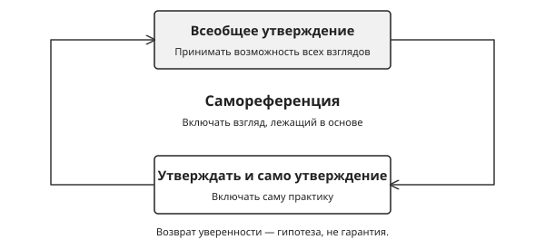
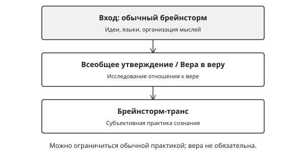

# Философия под названием «Брейнсторм»

**Попытка выйти за пределы отдельного метода мышления и свободно обращаться с мыслями, убеждениями и сознанием.**

Мозговой штурм обычно известен как техника, при которой группа людей собирается, чтобы генерировать идеи. Однако я хочу понимать это слово шире. Не как следование определённой процедуре, а как саму установку свободно выбирать и использовать способы мышления — и, далее, как распространение этой свободы на убеждения, чувства и состояния сознания. Именно это я называю «брейнстормом».

Далее рассматриваются брейнсторм как философия методов (§1–4), его применение к убеждениям — Вера в веру и Всеобщее утверждение (§5–6), связанные практики и сообщество (§7–8), а также возможность выйти за рамки самого брейнсторма (§9–11).

«Брейнсторм» в этой статье не претендует на пересмотр определения существующего термина. Это личная философия, развившаяся из обычного мозгового штурма как отправной точки.

## 1. Брейнсторм — не метод, а философия методов

В обычном мозговом штурме важно выдвигать много идей, откладывая критику. Однако в моём понимании брейнсторма соблюдение какой-либо конкретной процедуры не является самоцелью.

Например, существует метод резиновой уточки. Когда формулируешь свои мысли так, будто объясняешь их кому-то, становятся заметны неясности и противоречия. Это не классический мозговой штурм, но один из методов, которые можно свободно выбирать в рамках философии брейнсторма.

Идею свободного выбора методов необязательно ограничивать способами мышления. В её сферу также входят убеждения, эмоции, внимание и состояния сознания.

*Рис. 1. От техники создания идей к философии, охватывающей работу ума в целом.*

> Брейнсторм — философия и практика, направленные на свободное обращение с мыслями, убеждениями, эмоциями, состояниями сознания и другими аспектами работы ума без жёсткой привязанности к ним.

Под свободой здесь не подразумевается полный волевой контроль над всеми психическими состояниями. Речь идёт о возможности выбирать в зависимости от обстоятельств: стремиться к контролю или отказаться от него.

## 2. Два значения слова Storm

Английское слово storm как существительное означает «буря», а как глагол — «бросаться в атаку», «штурмовать». Алекс Осборн, создатель мозгового штурма, объяснял это слово во втором значении: использовать мозг, чтобы штурмовать творческую задачу [1]. Я добавляю к этому значение «бури» и объединяю оба как метафоры брейнсторма.

Подобно буре, мышление свободно движется, ослабляя привычные последовательности и рамки. Одновременно можно иметь намерение исследовать что-либо и направлять мысли в эту сторону.

*Рис. 2. Свободное исследование и направленность. Значение «штурмовать» следует объяснению Осборна; наложение значения «бури» — авторская интерпретация.*

Необязательно с самого начала иметь чёткий вывод или цель. Можно исследовать что-либо в надежде найти нечто интересное. Цель также может меняться в процессе.

## 3. Свободное использование разнообразных методов

Брейнсторм не означает одновременного применения множества методов. Важно не их количество, а отсутствие привязанности к ним.

*Рис. 3. В рамках философии брейнсторма можно выбирать различные техники.*

Практикой могут стать записи на бумаге, размышление про себя и диалог. В одном случае полезен метод резиновой уточки, в другом — схемы или случайный стимул. Выбор метода зависит от цели и обстоятельств.

Различие между простым размышлением и практикой брейнсторма определяется не только внешней формой деятельности. Оно заключается в отношении человека к собственному способу мышления.

## 4. Создавать несовершенное

Принцип классического мозгового штурма — отсрочку оценки — можно применять и к брейнсторму в широком смысле.

Если с самого начала слишком беспокоиться о правильности, иногда не удаётся написать ничего. Поэтому сначала можно выразить мысли вовне, даже если они ошибочны, а затем рассмотреть их и внести необходимые исправления.

*Рис. 4. Созданное становится материалом для дальнейшего мышления.*

Например, при изучении иностранного языка можно составить фразу из известных слов, получить исправление и повторить её. В философии — записать несовершенную гипотезу и развивать её, исследуя противоречия и контрпримеры.

Это не означает признания ошибок истиной. Речь о том, чтобы **не делать правильность предварительным условием создания**. Когда требуется точность, её, напротив, следует активно проверять.

Пример практики: [Изучение языков методом брейнсторма](../brainstorm-language-learning/guide.md).

## 5. От методов мышления к убеждениям — Вера в веру

Идею свободного выбора способов мышления можно распространить на убеждения и мировоззрения.

То, что я называю «Верой в веру», — это вера в то, что «всё есть вера». Само это утверждение не является исключением. Оно рассматривается не как абсолютная истина, а как одна из форм веры.

*Рис. 5. Возможность принимать разные точки зрения, не считая одно мировоззрение единственно возможным.*

Это не значит ни во что не верить. Такое отношение подобно пустому сосуду в том смысле, что оно заранее не определяет содержание конкретных убеждений. При этом оно обладает формальным содержанием: «всё есть вера».

«Вера» здесь — особый авторский термин, охватывающий не только религиозную веру, но и предпосылки и взгляды, через которые мы воспринимаем мир. Это не означает, что научные доказательства и необоснованные утверждения одинаково надёжны.

## 6. Предшественник веры и Всеобщее утверждение

Веру в веру правильнее понимать как «предшественник», из которого можно переходить к различным формам веры, а не как обязательную предпосылку всех систем убеждений.

При искреннем принятии какого-либо мировоззрения прежняя метапозиция может исчезнуть из сознания. Если требовать сохранять её постоянно, сама свобода окажется связанной фиксированным условием.

Поэтому я рассматриваю Всеобщее утверждение как способ возвращения к Вере в веру.

*Рис. 6. Обратимая модель перехода к определённой точке зрения и повторного открытия возможности других взглядов.*

Всеобщее утверждение — практика принятия возможности любых точек зрения, при которой само принимающее отношение также включается в число утверждаемых объектов. Я предполагаю, что даже если уверенность в этой философии утрачена, можно помнить форму метода и, повторив практику, возможно, восстановить эту уверенность.

*Рис. 7. Всеобщее утверждение включает в число своих объектов и себя. Отсюда возникает идея возвращения к Вере в веру.*

Всеобщее утверждение не требует непрерывно придерживаться всех убеждений одновременно. Именно возможность утверждать различные формы веры позволяет избирательно принять определённую веру или отказаться от неё.

В силу своей структуры Вера в веру неизбежно является метаверой. Вера в то, что всё есть вера, рассматривает в качестве своего объекта не только отдельные убеждения, но и саму себя. Благодаря этой самореферентной структуре сама Вера в веру не абсолютизируется. Принять её, не принимать её или вернуться к ней вновь — всё это возможные варианты.

**Гибкость Веры в веру заключается не только в свободном выборе убеждений, но и в отсутствии необходимости быть связанным самой Верой в веру.**

### Самореферентность Веры в веру

Слово «всё» в утверждении «всё есть вера» включает и само это утверждение. Следовательно, представление о том, что всё есть вера, также является верой. Вера в веру — не просто позиция внешнего наблюдения за другими убеждениями, а самореферентная вера, включающая саму себя в ту же область.

Эта самореферентность не отрицает утверждение «всё есть вера». Напротив, она применяет к самому утверждению тот же взгляд. Поэтому нет необходимости делать для себя исключение и занимать абсолютную позицию вне веры.

Всеобщее утверждение открывает возможность различных убеждений, из которых можно выбирать. Сама Вера в веру, делающая этот выбор возможным, также становится объектом выбора. Вера в веру содержит возможность отказа от самой себя.

Это структурная открытость, а не гарантия того, что верящий в неё человек действительно всегда будет оставаться гибким.

Однако пока не проверено, укрепляет ли эта самореферентная структура уверенность на практике и возможно ли вернуться из любого убеждения. Остаётся и вопрос о том, как создать повод для возвращения. Кроме того, Всеобщее утверждение следует отличать от одновременного признания противоречащих друг другу утверждений фактами или оправдания вредных действий.

## 7. Сходства и различия с магией хаоса

Идея не воспринимать убеждения как нечто неизменное и пользоваться мировоззрениями в зависимости от обстоятельств имеет общие черты с отношением к убеждениям в магии хаоса.

Однако брейнсторм не ограничен магической системой. Он охватывает повседневные практики: письмо, изучение языков, решение задач, философское исследование. Работа с убеждениями — лишь одна из его частей.

| Аспект | Философия под названием «Брейнсторм» | Общие черты с магией хаоса |
| --- | --- | --- |
| Методы | Свободное использование методов мышления и познания | Отношение к убеждениям и мировоззрениям как к инструментам |
| Сфера | Генерация идей, обучение, убеждения, состояния сознания и т. д. | Магическая практика и обращение с верой |
| Оценка | Проверка результатов и оснований в зависимости от цели | Общий акцент на практике |

Это концептуальное сопоставление, а не доказательство действенности магии и не строгая классификация магии хаоса в целом.

## 8. Связь с эзотерикой брейнсторм-транса

Брейнсторм — название философии, а эзотерика брейнсторм-транса задумана как название группы, выдвигающей на первый план характерные для этой философии практики. Подобно тому как школа дзэн избирает своей практикой дзэн (медитацию) и носит его в своём названии, эзотерика брейнсторм-транса избирает своей практикой брейнсторм.

Транс здесь означает изменённое состояние сознания. Основываясь на личном опыте глубокого погружения или экстаза во время брейнсторма, я также исследую связь мышления и состояний сознания.

*Рис. 8. Начав с обычного брейнсторма, можно исследовать также веру и сознание. Стрелки не обозначают обязательной последовательности практик.*

Если заимствовать термины «экзотерическое» и «эзотерическое», общедоступные методы мышления можно отнести к экзотерической стороне, а субъективное понимание, возникающее через опыт практики, — к эзотерической. Здесь не воспроизводится в точности буддийское разделение учений: это авторская метафора различия между объяснимым знанием и пониманием через опыт.

Можно заниматься только обычным брейнстормом, не принимая религиозной системы. Возникновение транса не гарантировано, получение особых способностей не доказано. Не следует принуждать себя к переживаниям; физическая и психическая безопасность важнее.

## 9. Брейнсторм — вход в практику

Входом в брейнсторм служит мозговой штурм — практика, исходящая из предположения о наличии мозга. Мы размышляем, выражаем мысли словами, применяем разные методы и развиваем свободу обращения с мышлением, верой и сознанием.

Но если мы начинаем с предположения о мозге, необязательно оставаться в рамках этой предпосылки до конца. В Вере в веру представление о существовании мозга и сама философия брейнсторма также могут рассматриваться как формы веры.

Более того, можно представить состояние, в котором исчезают не только вопрос о наличии или отсутствии мозга, но и само различие между существованием и несуществованием, между действующим субъектом и объектом его действия.

*Рис. 9. От практики, предполагающей наличие мозга, к состоянию, не ограниченному даже рамками самого брейнсторма. Это не фиксированная последовательность достижения.*

**Брейнсторм — отправная точка, а не граница достижимого.** Начав с брейнсторма, можно выйти за его пределы.

## 10. Свобода действий и свобода за её пределами

Свободу мыслить, выбирать и осуществлять разные практики в мире я хочу назвать «свободой обращения» (дзидзай). Она предполагает различия между действующим субъектом, объектом действия и тем, что выбирается.

Можно также представить свободу, при которой исчезают сами эти различия. Это не столько свободное обращение с чем-либо, сколько состояние, в котором вообще нет необходимости чем-либо управлять. Моё понимание просветления здесь близко к такой свободе.

*Рис. 10. Свобода действий в мире и свобода, не ограниченная даже различием, подразумеваемым свободой обращения. Это авторское понимание.*

Однако нет необходимости заранее определять какое-либо из этих состояний как окончательное. Практика в мире и выход за её пределы не должны быть предопределены одним выводом.

## 11. Не быть связанным даже самим брейнстормом

Философия брейнсторма начинается со свободного использования различных методов мышления и распространяет эту свободу на убеждения и состояния сознания.

В Вере в веру с самой философией брейнсторма также можно обращаться свободно. Можно принять брейнсторм, а можно не настаивать на том, чтобы всё называлось брейнстормом.

Даже Веру в веру необязательно считать окончательным ответом. За её пределами могут существовать способы бытия, которые я пока не способен представить.

> Брейнсторм — вход в практику. Нет необходимости ограничивать названием «брейнсторм» то, насколько далеко можно пройти от этого входа.

Философия брейнсторма — не замкнутая система, призванная привести к определённому выводу. Я хочу, чтобы она оставалась открытой философией, включающей и возможность выхода за пределы самого брейнсторма.

---

Статья представляет собой переработку диалогов о мозговом штурме, Вере в веру, Всеобщем утверждении и эзотерике брейнсторм-транса. Установленные научные знания отделяются от авторских философских гипотез и субъективного опыта. Сопоставления с магией хаоса и буддизмом носят концептуальный характер и не ставят целью исследование отдельных первоисточников.

## Литература

[1] Osborn, A. F. *Your Creative Power*. 1948, ch. 33. Соответствующий фрагмент также цитируется в: Buffalo State University, «[Alex Osborn Archives](https://creativity.buffalostate.edu/alex-osborn-archives)» (дата обращения: 28 ноября 2026 г.).
